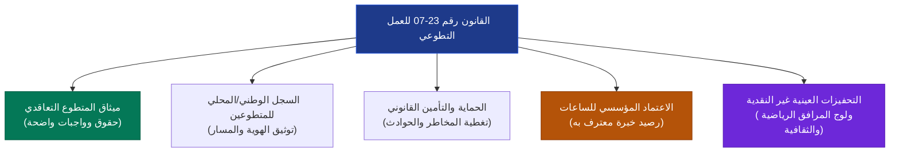
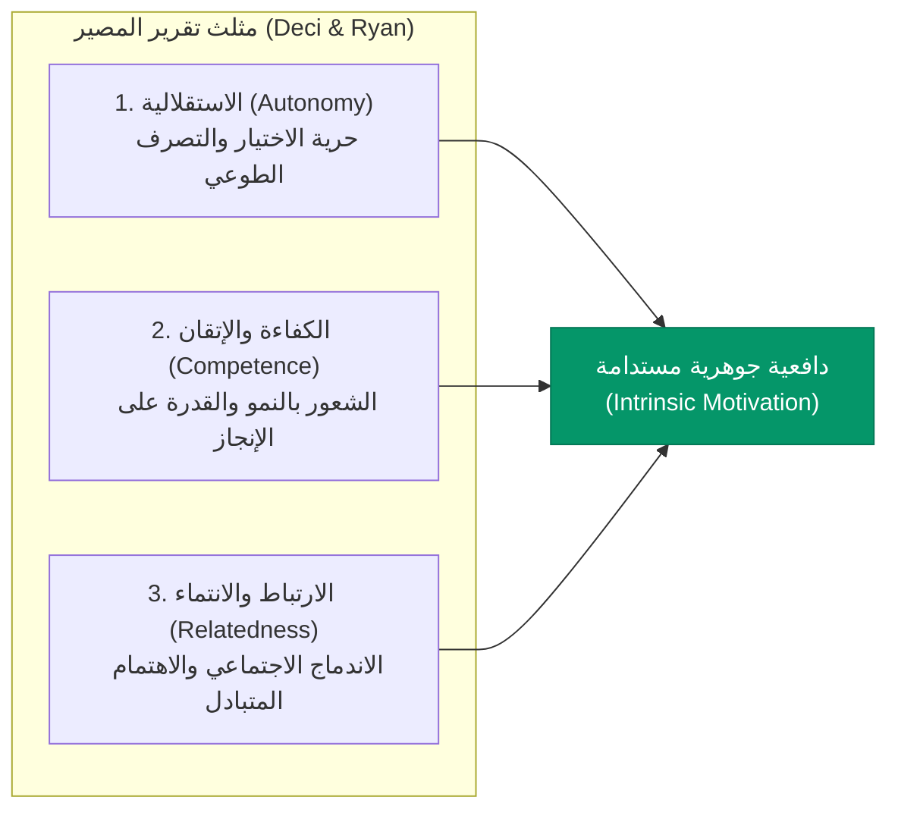
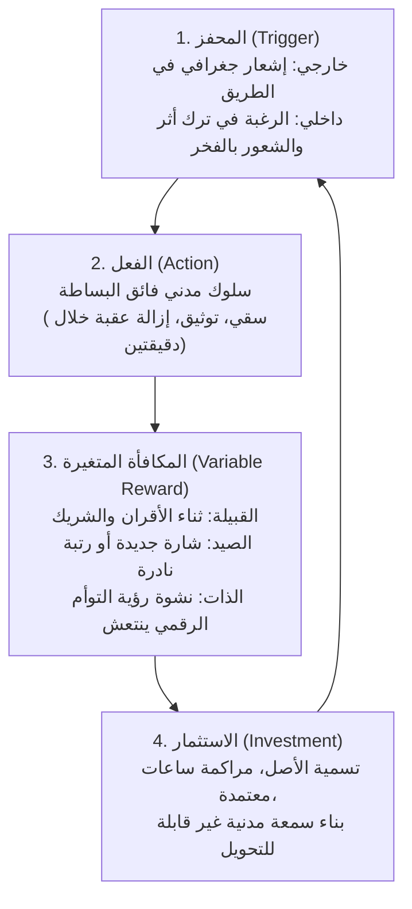
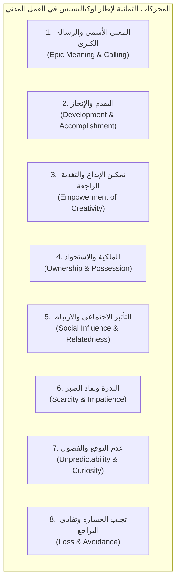
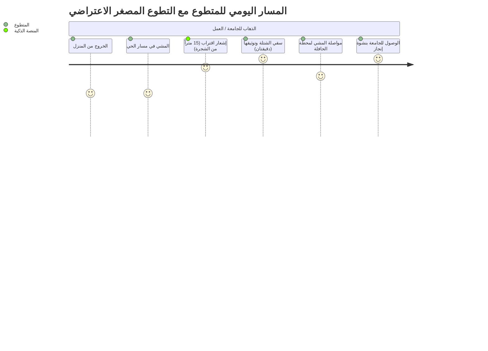
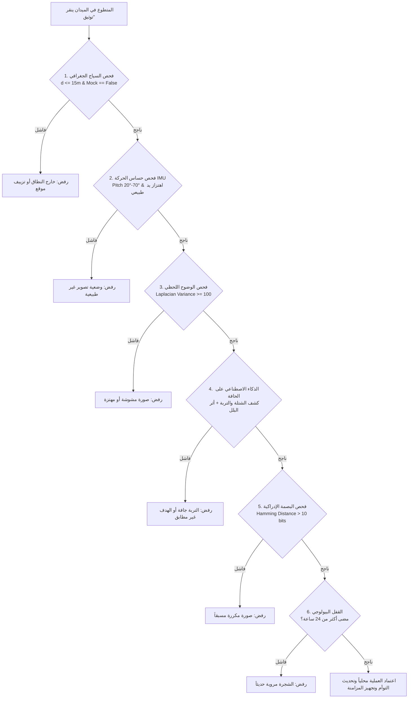

# الموسوعة الشاملة في هندسة السلوك، التلعيب، وتطوير العمل التطوعي
## دراسة سوسيولوجية ونفسية ومعمارية لتعظيم الأثر المجتمعي وبناء الثقة الرقمية في المنصات المدنية
### مرجع بحثي وعملياتي متكامل لتصميم وإدارة المبادرات التطوعية في الجزائر والعالم

---

> **بيان المرجعية والهدف العلمي:**  
> يمثل هذا المستند مرجعاً أكاديمياً وهندسياً شاملاً ومستقلاً، يستعرض كافة النظريات السلوكية، الدراسات الميدانية السوسيولوجية (المحلية الجزائرية والعالمية)، وأطر التلعيب (Gamification) المتقدمة، وآليات التحقق والتوثيق الخوارزمي في العمل التطوعي والمدني.  
> صُمم هذا الدليل ليكون وثيقة استراتيجية مجردة وقابلة للتطبيق المباشر في أي مشروع مجتمعي، بيئي، أو مدني يستهدف استقطاب المتطوعين، معالجة معضلة التسرب، ومأسسة الأثر المستدام، وفق المعايير العلمية والتشريعية المعاصرة.

---

## فهرس المحتويات التنفيذي

1. **المقدمة المنهجية: معضلة العمل التطوعي المعاصر بين الاندفاع العاطفي والاستدامة**
2. **الباب الأول: سوسيولوجيا العمل التطوعي في الجزائر (التشخيص الميداني والأطر القانونية)**
   - 1.1. السوسيومترية وديناميكية الجماعات التطوعية (دراسة مجادبة وآخرون 2024)
   - 1.2. متلازمة "غرس اليوم الأول" (Day-One Euphoria) وفخ التراجع الميداني
   - 1.3. الحشد الرقمي مقابل الالتزام الميداني المستمر (دراسة بن جاودو 2022 وغواوي ورميطة 2025)
   - 1.4. المعوقات الهيكلية والإدارية في أطروحات الميدان الجزائرية (أطروحة خليل ودبلة 2016)
   - 1.5. الإطار القانوني والتشريعي: القانون رقم 23-07 المنظم للتطوع في الجزائر
   - 1.6. الأبعاد الثقافية والدينية: الصدقة الجارية والتضامن المدني ومكافحة التبرير الزائد (Overjustification)
3. **الباب الثاني: الأسس النفسية والسلوكية العالمية للتحفيز وصناعة العادات**
   - 2.1. نظرية تقرير المصير (Self-Determination Theory - SDT)
   - 2.2. نموذج فوغ السلوكي (Fogg Behavior Model: B = MAP) وتقليص الاحتكاك
   - 2.3. نموذج الصنارة (The Hook Model) وبناء الدورات السلوكية الراسخة
   - 2.4. مبادئ الاقتصاد السلوكي (Kahneman, Tversky & Thaler)
   - 2.5. أنماط المتطوعين وفق تصنيف بارتل المعدل للمنصات المدنية (Civic Bartle Taxonomy)
4. **الباب الثالث: التأصيل الشامل لإطار عمل أوكتاليسيس (Octalysis) في المبادرات المدنية**
   - 3.1. المحرك 1: المعنى الأسمى والرسالة الكبرى (Epic Meaning & Calling)
   - 3.2. المحرك 2: التقدم والإنجاز (Development & Accomplishment)
   - 3.3. المحرك 3: تمكين الإبداع والتغذية الراجعة الفورية (Empowerment of Creativity & Feedback)
   - 3.4. المحرك 4: الملكية والاستحواذ (Ownership & Possession)
   - 3.5. المحرك 5: التأثير الاجتماعي والارتباط (Social Influence & Relatedness)
   - 3.6. المحرك 6: الندرة ونفاد الصبر (Scarcity & Impatience)
   - 3.7. المحرك 7: عدم التوقع والفضول (Unpredictability & Curiosity)
   - 3.8. المحرك 8: تجنب الخسارة وتفادي التراجع (Loss & Avoidance)
   - 3.9. هندسة التوازن المزدوج: القبعة البيضاء مقابل السوداء، والتحفيز الداخلي مقابل الخارجي
5. **الباب الرابع: الآليات التشغيلية والهندسة السلوكية لتعظيم استدامة التطوع**
   - 4.1. هندسة التطوع المصغر (Micro-Volunteering & Atomic Civic Actions)
   - 4.2. نظام الثنائيات التبادلية ونموذج الرفيق (Dyadic Peer Stewardship / The Buddy System)
   - 4.3. التوأم الرقمي الحي والتجسيد الافتراضي (Digital Twin / Avatar Feedback Loop)
   - 4.4. ديناميكية السلاسل وحمايتها من الانهيار (Streaks & Streak Freeze Mechanics)
   - 4.5. التنافس الجغرافي الإيجابي ودوري الأحياء والبلديات (Inter-Commune Civic Derbies)
   - 4.6. مصفوفة التحفيز المزدوج: التوفيق بين الأجر المعنوي والمكافآت العينية غير النقدية
6. **الباب الخامس: التحقق الخوارزمي، الأمان، وبناء الثقة الرقمية (Algorithmic Trust & Anti-Cheat)**
   - 5.1. معضلة الاحتيال في التلعيب المدني وحتمية إثبات العمل الفيزيائي (Proof of Physical Work)
   - 5.2. التحقق متعدد الحساسات وتطويق التموضع الجغرافي (Sensor Fusion & GNSS Geofencing)
   - 5.3. فلترة الحركة والزوايا الحركية (Kalman Filter & IMU Pitch Gating)
   - 5.4. معالجة الصور على الحافة والبصمة الإدراكية (Edge Computer Vision & pHash Deduplication)
   - 5.5. القفل البيولوجي والفيزيائي ومعدلات التبريد الإلزامية (Cooldowns & Diurnal Caps)
   - 5.6. معمارية عدم الاتصال والمزامنة المرنة (Offline-First Architecture & Durable Outbox)
7. **الباب السادس: دراسات الحالة العالمية والمقارنات القياسية (International Benchmarks)**
   - 7.1. منصة Duolingo: هندسة السلاسل والدوريات ومكافحة الانقطاع
   - 7.2. تطبيق Forest: ربط الإنجاز الافتراضي بالأثر الواقعي الملموس
   - 7.3. منصة Strava: القطاعات الجغرافية والتنافس المجتمعي الإيجابي
   - 7.4. منصات Zooniverse و Wikipedia: تقسيم المهام الكبرى وسلالم الجدارة
   - 7.5. تطبيق Be My Eyes: التطوع فوري الاستجابة وصفرية العوائق الإدارية
8. **الباب السابع: دليل التصميم المعماري للمشاريع المستقبلية (Master Operational Blueprint)**
   - 8.1. خارطة الطريق المرحلية للبناء والإطلاق (5-Phase Implementation Framework)
   - 8.2. مصفوفة مؤشرات الأداء السلوكية والميدانية (Civic KPIs & Cohesion Metrics)
   - 8.3. القائمة المرجعية للامتثال القانوني وحماية البيانات والنزاهة المؤسساتية
9. **المراجع الأكاديمية والتشريعية**

---

# المقدمة المنهجية: معضلة العمل التطوعي المعاصر بين الاندفاع العاطفي والاستدامة

يعاني العمل التطوعي والمدني عبر العالم — وفي العالم العربي والجزائر على وجه الخصوص — من فجوة هيكلية عميقة بين مرحلتين متباينتين تماماً:
1. **مرحلة التعبئة الأولية (Initial Mobilization):** وتتسم بحماس جارف، تدفق عاطفي عالٍ، وتغطية إعلامية ورقمية واسعة، تدفع مئات الشباب إلى النزول للميدان في أيام محددة (حملات تشجير، تنظيف شواطئ، إغاثة عاجلة، أو تنظيم فعاليات).
2. **مرحلة الاستدامة والصيانة (Sustained Stewardship):** وهي مرحلة الرعاية الصامتة، الروتينية، واليومية غير المرئية التي تلي الحملة. وفي هذه المرحلة تحديداً، تُسجل الإحصائيات الميدانية **انهياراً دراماتيكياً في نسبة المشاركة يتجاوز 80% إلى 85% خلال الأسابيع الأولى**.

إن مقاربة العمل التطوعي عبر الخطابات الوعظية التقليدية أو التعبئة المناسباتية أثبتت عجزها العلمي والميداني. لم يعد السؤال المعاصر هو: *«كيف نقنع الناس بالتطوع؟»*، بل أصبح:
> **«كيف نبني منظومة متكاملة من هندسة السلوك (Behavioral Engineering)، والتصميم التحفيزي (Gamification)، والتنظيم السوسيومتري الميداني، والتحقق الخوارزمي الصارم، لتحويل الاندفاع العاطفي العابر إلى التزام مدني مستدام، ومؤسس، ومنعدم الاحتكاك؟»**

يهدف هذا المرجع إلى تقديم الإجابة العلمية والهندسية المتكاملة عن هذا السؤال، انطلاقاً من التشخيص السوسيولوجي الميداني للواقع الجزائري، مروراً بأحدث نظريات علم النفس المعرفي والاقتصاد السلوكي، وصولاً إلى التصميم المعماري للأنظمة والبرمجيات المدنية.

---

# الباب الأول: سوسيولوجيا العمل التطوعي في الجزائر (التشخيص الميداني والأطر القانونية)

## 1.1. السوسيومترية وديناميكية الجماعات التطوعية (دراسة مجادبة وآخرون 2024)

تُعد دراسة **د. عبد المالك مجادبة، توريا عريبي، وفاطمة معيني (2024)** المنشورة في المجلة الباكستانية للعلوم الحياتية والاجتماعية (*PJLSS*) بعنوان:  
*(Structure and Dynamic Interaction within the Volunteer Work Group: A Sociometric Study of the Abwab Al-Khair Association in Bechar, Algeria)*  
واحدة من أدق الدراسات السوسيولوجية الميدانية المعاصرة التي شرّحت النسيج الداخلي لفرق العمل التطوعي في الجزائر باستخدام المنهج السوسيومتري (Sociometric Approach) المستند إلى أطر **جاكوب مورينو (Jacob L. Moreno)**.

```mermaid
graph TD
    subgraph "الهيكل السوسيومتري لفرق التطوع (مجادبة 2024)"
    A(("النجم المركزي (Star)<br>العضو 1 (16 اختياراً)")) -->|تأثير مركزي| B(("العضو 17"))
    A -->|تأثير مركزي| C(("العضو 21"))
    A -->|تأثير مركزي| D(("العضو 23"))
    
    B <--->|علاقة تبادلية قوية (Dyad)| A
    C <--->|علاقة تبادلية قوية (Dyad)| A
    D <--->|علاقة تبادلية قوية (Dyad)| A
    
    E(("أعضاء السلاسل (Chains)")) --> B
    
    F(("العضو الهامشي (Marginal)")) -.->|اختيار أحادي غير متبادل| A
    G(("العضو المنعزل (Isolated)<br>0 اختيارات"))
    
    style A fill:#059669,stroke:#047857,color:#fff
    style G fill:#dc2626,stroke:#b91c1c,color:#fff
    style F fill:#d97706,stroke:#b45309,color:#fff
    end
```

### النتائج الإحصائية والسوسيومترية المحورية:
1. **معامل التماسك الاجتماعي العام (Group Cohesion Index):**
   وفق معادلة مورينو لقياس التماسك بناءً على الاختيارات الثنائية المتبادلة ($d$) مقارنة بالحد الأقصى النظري للاختيارات المتبادلة الممكنة:
   $$C = \frac{d}{d_{\max}} = \frac{2d}{N(N-1)}$$
   أظهرت الدراسة أن مؤشر التماسك المحقق داخل الفريق لم يتجاوز **0.33** (حيث بلغ عدد الاختيارات التبادلية المحققة نسبة محدودة من إجمالي العلاقات الممكنة). وهذا المؤشر المنخفض يكشف علمياً أن فرق العمل التطوعي في الجزائر — رغم مظهرها الخارجي الموحد — تعاني من **هشاشة بنيوية داخلية تجعلها سريعة التصدع والانقسام بمجرد مواجهة ضغوط ميدانية أو تراجع الحماس الأولي**.

2. **ظاهرة التمركز حول "النجم" (The Star Centrality Vulnerability):**
   * كشفت المصفوفة السوسيومترية أن العضو رقم (1) حاز بمفرده على **16 اختياراً من أصل 24 عضواً** (بنسبة 23.18% من إجمالي اختيارات الجماعة ومجموع نقاط سوسيومترية بلغ 39 نقطة)، مشكلاً النواة المركزية (Social Atom) للجمعية كقائد رسمي وغير رسمي في آن واحد.
   * *الأثر السلوكي السلبي:* هذا التمركز الشديد يُنشئ ما يُعرف في علم الاجتماع التنظيمي بـ **"نقطة الفشل الفردية" (Single Point of Failure)**؛ فإذا أصيب القائد المركزي بالإرهاق (Burnout)، أو انشغل، أو تعرض للإحباط، فإن المنظومة التطوعية بأكملها تصاب بالشلل والتفكك.

3. **أنماط العلاقات الخمسة داخل الفريق التطوعي:**
   * **أ. العلاقات المركزية (Stars):** أعضاء يحظون بأعلى نسب الجذب وتعتمد عليهم الجماعة عاطفياً وتنظيمياً.
   * **ب. العلاقات التبادلية الثنائية (Reciprocal Dyads):** اختيار متبادل بين متطوعين اثنين (Mutual Selection). أثبتت الدراسة أن هذه الثنائيات هي **الوحدات الأكثر استقراراً وصموداً داخل الجماعة**.
   * **ج. العلاقات المتسلسلة (Chains):** انتقال التأثير من عضو إلى آخر بشكل خطي؛ تتسم بالبطء وقابلية الانقطاع إذا تعطلت إحدى الحلقات.
   * **د. العلاقات الهامشية (Marginals):** أعضاء يختارون الآخرين لكنهم نادراً ما يتم اختيارهم (يحصلون على اختيار واحد فقط).
   * **هـ. العلاقات المنعزلة (Isolates):** متطوعون حصلوا على **(0) اختيار** (مثل الأعضاء 6، 11، 13، 14، 15، 22، 24).

4. **معضلة العزلة والتسرب (Isolation & Attrition):**
   أثبتت نتائج التحليل السوسيومتري أن المتطوعين المصنفين ضمن فئتي "الهامشيين" و"المنعزلين" يعانون من معدل تسرب ميداني وانسحاب يصل إلى **70%** بمجرد انقضاء الفعالية الأولى؛ إذ يؤدي غياب الارتباط الاجتماعي المتبادل إلى شعورهم بعدم الأهمية والتهميش النفسي، مما يدفعهم للمغادرة الصامتة.

---

## 1.2. متلازمة "غرس اليوم الأول" (Day-One Euphoria) وفخ التراجع الميداني

تُعرّف متلازمة "اليوم الأول" في سوسيولوجيا العمل التطوعي بأنها:  
> *«حالة من الاستثارة العاطفية الجماعية المؤقتة (Dopamine Surge) المصحوبة برغبة في الظهور الاجتماعي والتوثيق الفوتوغرافي، تنتهي بانتهاء الحدث الافتتاحي، وتترك الأصول أو المهام الميدانية مهجورة دون رعاية لاحقة».*

### تجليات الظاهرة في الميدان:
* **التوثيق الاستعراضي (Photo-Op Activism):** ينصب تركيز أغلب المتطوعين غير المؤطرين على التقاط الصور ومقاطع الفيديو ونشرها على منصات التواصل (فيسبوك، إنستغرام، تيك توك) لنيل إعجاب الأقران (Social Validation)، دون إدراك أن العمل المدني الحقيقي يبدأ بعد مغادرة الكاميرات.
* **الخلط بين النشاط العابر والاستدامة:** في مشاريع التشجير مثلاً، يستغرق غرس الشتلة 10 دقائق، بينما تحتاج إلى **3 سنوات كاملة (1095 يوماً)** من السقي الصيفي المنتظم والمتابعة حتى تتعمق جذورها وتنجو. وفي حملات محو الأمية، يستغرق التسجيل يوماً واحداً بينما يتطلب التمكين 9 أشهر من التدريس الأسبوعي.
* **معدلات الفشل الناتجة:** تشير المعاينات الميدانية في الجزائر إلى أن **80% إلى 85% من الشتلات المغروسة في الحملات الموسمية تموت عطشاً في صيفها الأول**، وأن أكثر من 60% من المبادرات المجتمعية المفتوحة تنطفئ قبل إكمال شهرها الثالث نتيجة غياب التصميم السلوكي الملزم للاستدامة.

---

## 1.3. الحشد الرقمي مقابل الالتزام الميداني المستمر (دراسة بن جاودو 2022 وغواوي ورميطة 2025)

### 1. نتائج دراسة د. راضية بن جاودو (2022) حول دور فيسبوك في التطوع (ولاية المسيلة):
* أظهرت الدراسة الميدانية على مستخدمي فيسبوك بولاية المسيلة أن شبكات التواصل تلعب دوراً رائداً ومركزياً في **نشر الوعي بالقضايا المجتمعية، التعريف بالأزمات، وتشكيل جماعات الضغط والتضامن**.
* **مفارقة الحشد الافتراضي والتلاشي الميداني:** أكدت الدراسة أن التفاعل الرقمي (Likes & Shares) يعطي "وهماً بالفعالية المدنية"؛ حيث يسهل تجنيد الآلاف رقمياً لإبداء التعاطف، ولكن عند الانتقال للتنفيذ الميداني الشاق، تنخفض نسبة المشاركين الفعليين إلى أقل من **5% من إجمالي المتفاعلين رقمياً**.
* خلصت الدراسة إلى ضرورة **"إرساء تنظيمات مستقرة تتبنى مبادئ البحث والتطوير وبناء استراتيجيات الانتقال من الفضاء الافتراضي إلى الفاعلية الميدانية المنظمة"**.

### 2. دراسة غواوي ورميطة (2025) - جامعة الجزائر 2:
* ناقشت الدراسة واقع المجتمع المدني في ترسيخ ثقافة المشاركة والمواطنة الفاعلة، مؤكدة أن المجتمع المدني يمثل حلقة الوصل الضرورية بين الفرد والدولة.
* **العوائق البنيوية المرصودة:**
  1. هيمنة "الثقافة الرعوية" والاتكالية في بعض الأوساط على حساب المبادرة الذاتية والابتكار المستقل.
  2. افتقار أغلب التنظيمات التطوعية والجمعوية إلى الكفاءات ذات التكوين الإداري والتقني والتحليلي الذي يمكنها من تقديم مقترحات سياسات عامة وإدارة مشاريع ذات أثر مقاس، وتحولها في كثير من الأحيان إلى مجرد جهات احتجاج أو رد فعل موسمي.
  3. حتمية ترسيخ **"المواطنة الفاعلة الإيجابية"** عبر مأسسة العمل الجمعوي وتزويده بأدوات تقنية تضمن الشفافية والمساءلة والتقييم المستمر للسياسات العمومية.

---

## 1.4. المعوقات الهيكلية والإدارية في أطروحات الميدان الجزائرية (أطروحة خليل ودبلة 2016)

شخّصت دراسة **نزيهة خليل وإشراف أ.د عبد العالي دبلة (جامعة بسكرة 2016)** المعوقات الجوهرية للعمل التطوعي في منظمات المجتمع المدني عبر 4 محاور هيكلية:

| فئة المعوقات | المظاهر الميدانية المرصودة | أثرها على ديمومة التطوع |
| :--- | :--- | :--- |
| **المعوقات الشخصية والذاتية** | • ضغوط المعيشة والأولويات الاقتصادية للشباب.<br>• ضعف الوعي بثقافة التطوع كمسار لبناء الشخصية.<br>• الخوف من استغلال الجهد التطوعي لأغراض فئوية أو تجارية. | تسرب المتطوعين بحثاً عن فرص دخل أو تجنباً للتشكيك المجتمعي. |
| **المعوقات الاجتماعية** | • النظرة المجتمعية القاصرة للتطوع بوصفه "مضيعة للوقت".<br>• ضعف الدعم الأسري للمتطوعين (خاصة الإناث في الميدان).<br>• تفشي الشكوك حول نزاهة الجمعيات وشفافية المساعدات. | انحسار الحاضنة الشعبية وصعوبة استقطاب شرائح واسعة من الأحياء. |
| **المعوقات الإدارية والتنظيمية** | • احتكار القرار من قبل قيادات تاريخية رافضة للتجديد.<br>• غياب التوصيف الوظيفي الدقيق للمهام التطوعية.<br>• انعدام التكوين والتأهيل المهني للمتطوعين الجدد.<br>• انعدام آليات الاعتراف والتوثيق الرسمي للجهد المبذول. | شعور الشباب بالإحباط والتهميش الداخلي وسرعة مغادرة التنظيم. |
| **المعوقات التشريعية والمالية** | • التعقيدات البيروقراطية في الحصول على التراخيص الميدانية.<br>• انعدام الحماية القانونية والتأمينية للمتطوع ضد الحوادث.<br>• ضعف وغياب الموارد المالية المستقرة للمبادرات. | تحول المبادرات إلى أنشطة دفاعية خائفة من المساءلة، وعجزها عن التوسع. |

---

## 1.5. الإطار القانوني والتشريعي: القانون رقم 23-07 المنظم للتطوع في الجزائر

يُمثل صدور **القانون رقم 23-07 المؤرخ في 21 جوان 2023 والمتعلق بالعمل التطوعي** نقطة تحول تاريخية ومفصلية في البيئة التشريعية الجزائرية، حيث نقل العمل التطوعي من العشوائية الفوضوية إلى إطار قانوني تعاقدي مؤسس:



### البنود الجوهرية المؤثرة في تصميم المنصات المدنية:
1. **ميثاق المتطوع (Le Contrat/Charte de Volontariat):** يُلزم القانون بتحديد طبيعة العمل التطوعي، مدته، وأهدافه بدقة، نافياً عنه أي صبغة علاقة عمل مأجورة خاضعة لقانون العمل، مما يحمي المبادرات من شبهات التوظيف غير المصرح به.
2. **الاعتماد الرسمي لساعات التطوع (Validation des Acquis de l'Expérience - VAE):** فتح المجال للاعتراف بساعات الخدمة المدنية كخبرة مجتمعية رسمية تُدرج في السيرة الذاتية للمتطوع، وتمنحه أولوية في برامج التمكين الشبابي والتأهيل الوظيفي.
3. **التغطية التأمينية الإلزامية:** توفير الحماية القانونية للمتطوعين أثناء تأدية مهامهم ضد الحوادث والأضرار الجسدية، وهو ما يزيل أكبر حاجز خوف لدى عائلات المتطوعين.
4. **حظر المكافآت المالية المباشرة وإجازة التحفيز العيني:** يمنع القانون دفع أجور مالية للمتطوعين حمايةً لطبيعة العمل غير الربحية، ولكنه يتيح للهيئات العمومية والمحلية تقديم **تحفيزات وتسهيلات عينية** (كاشتراكات في المسابح والقاعات الرياضية، تذاكر النقل العمومي، ورشات التكوين، وتسهيلات الولوج للمرافق الثقافية).

---

## 1.6. الأبعاد الثقافية والدينية: الصدقة الجارية والتضامن المدني ومكافحة التبرير الزائد (Overjustification)

### 1. الرافعة القيمية والروحية (Spiritual Anchor):
يمتلك المجتمع الجزائري رصيداً وجدانياً وثقافياً هائلاً من مفاهيم التويزة (Touiza)، العونة، والتضامن الفطري المتجذر في الثقافة الإسلامية، وفي مقدمتها مفهوم **"الصدقة الجارية"**:
> قال رسول الله ﷺ:  
> *«مَا مِنْ مُسْلِمٍ يَغْرِسُ غَرْسًا، أَوْ يَزْرَعُ زَرْعًا، فَيَأْكُلُ مِنْهُ طَيْرٌ أَوْ إِنْسَانٌ أَوْ بَهِيمَةٌ، إِلَّا كَانَ لَهُ بِهِ صَدَقَةٌ»* (صحيح البخاري ومسلم).

* **الأثر السلوكي:** تحويل الفعل التطوعي (كالغرس، أو النظافة، أو مساعدة كبار السن) من مجرد "عمل بدني مجاني" إلى **"استثمار أخروي ووقف مجتمعي ممتد الأثر"**، وهو ما يمنح المتطوع دافعية وجودية صامدة (Transcendental Purpose) لا تتأثر بتقلبات المكافآت الدنيوية.

### 2. خطر "تأثير التبرير الزائد" (The Overjustification Effect):
في علم النفس التجريبي (Deci, 1971; Lepper et al., 1973)، يُعرف تأثير التبرير الزائد بأنه:  
> *«تراجع الدافع الجوهري الداخلي للفرد عند تقديم مكافأة مادية خارجية لقاء قيامه بفعل كان يقوم به طواعية بدافع قيمي أو أخلاقي».*

```
[دافع جوهري ديني/قيمي نبيل] + [مكافأة نقدية مالية] 
        │
        ▼ (إعادة تأطير إدراكي خاطئ)
[تحول الفعل إلى "عمل بأجر رخيص / استغلال"] ──> [انهيار الدافعية والانسحاب فور توقف المال]
```

* **الحل الهندسي المعماري:**  
  يجب حظر المكافآت المالية النقدية المباشرة في العمل التطوعي؛ لأن منح متطوع 1,000 دج لقاء يوم شاق في الغابة يجعله يقيس جهده بمنطق الأجر المادي ويرى فيه إهانة لكفاءته، بينما ربط جهده بـ **الأجر الإيماني المستمر + شارات الشرف الاجتماعية + تسهيلات عينية عامة مجانية (قاعات رياضة/مكتبات)** يُبقي الدافع الجوهري في أوج نقائه ونبله.

---
# الباب الثاني: الأسس النفسية والسلوكية العالمية للتحفيز وصناعة العادات

## 2.1. نظرية تقرير المصير (Self-Determination Theory - SDT)

طوّر عالما النفس **إدوارد ديسي وريتشارد رايان (Deci & Ryan, 1985, 2000)** نظرية تقرير المصير لتفسير الدافعية البشرية، مؤكدين أن استمرار أي سلوك إنساني يعتمد على إشباع **ثلاث حاجات نفسية فطرية وأساسية**:



1. **الاستقلالية (Autonomy):** حاجة الفرد إلى أن يشعر بأنه صاحب القرار ومبادر طواعية، وليس مجرد منفذ لأوامر فوقية أو ترس في آلة بيروقراطية.  
   * *التطبيق المدني:* تمكين المتطوع من اختيار نوع المهمة، وقتها، وموقعها الجغرافي دون إكراه.
2. **الكفاءة (Competence):** حاجة الفرد لملاحظة تطور مهاراته وتحقيق أثر ملموس ومقاس نتاج تدخله.  
   * *التطبيق المدني:* توفير شريط نمو مرئي، شارات كفاءة تخصصية، ومؤشرات لحظية توضح الأثر المباشر لجهده.
3. **الارتباط والانتماء (Relatedness):** حاجة الفرد للشعور بالانتماء لجماعة تهتم به ويثق بأفرادها، والشعور بأن جهده يخدم مجتمعاً حقيقياً يقدّره.  
   * *التطبيق المدني:* العمل ضمن ثنائيات وفرق صغيرة مترابطة وتجنب العمل الفردي المعزول.

---

## 2.2. نموذج فوغ السلوكي (Fogg Behavior Model: B = MAP) وتقليص الاحتكاك

ابتكر **د. بي جي فوغ (BJ Fogg)**، مدير مختبر التصميم السلوكي في جامعة ستانفورد، المعادلة الشهيرة التي تحكم حدوث أي سلوك بشري:
$$\mathbf{B} = \mathbf{M} \cdot \mathbf{A} \cdot \mathbf{P}$$
*(السلوك Behavior = الدافعية Motivation $\times$ القدرة/السهولة Ability $\times$ المحفز/الموجه Prompt)*

```
الدافعية (Motivation)
   ▲
   │        فوق خط التفعيل (Action Line) ──> السلوك يتحقق بنجاح
   │           /
   │          /  ★ [مهمة سهلة + دافعية متوسطة + موجه سياقي]
   │         /
   │        /    X [مهمة معقدة جداً: تتطلب سفراً لـ 4 ساعات]
   │       /
   │      /      تحت خط التفعيل ──> السلوك يفشل ولا يحدث
   └─────/────────────────────────────────────────► السهولة / انعدام الاحتكاك (Ability)
      [صعبة جداً]                              [بسيطة للغاية: 90 ثانية]
```

### القواعد الحاكمة للمشاريع التطوعية:
1. **وهم الاعتماد على الدافعية العالية (The Motivation Illusion):** الدافعية متقلبة بطبيعتها، وتصميم المبادرات بناءً على افتراض استمرار الدافعية العالية دائماً هو انتحار تشغيلي.
2. **خفض عتبة القدرة (Radical Friction Reduction):** بدلاً من طلب مهام مرهقة تتطلب 4 ساعات أسبوعياً، يتم تفكيك العمل التطوعي إلى مهام ذرية مصغرة (**Atomic Civic Actions**) لا تتجاوز **90 إلى 180 ثانية** يمكن إنجازها أثناء المسار اليومي للمتطوع (مما يجعل معامل السهولة في أعلى درجاته).
3. **توقيت المحفز السياقي (Contextual Prompts):** إطلاق الإشعارات والتذكيرات فقط عندما يكون المتطوع قريباً جغرافياً من موقع المهمة ومؤهلاً زمنياً لتنفيذها.

---

## 2.3. نموذج الصنارة (The Hook Model) وبناء الدورات السلوكية الراسخة

طوّر **نير إيال (Nir Eyal)** نموذج الصنارة لتفسير كيفية تحول الاستخدام المتكرر للمنتجات إلى عادات سلوكية تلقائية عبر حلقة رباعية المراحل:



* **المحفز الخارجي (External Trigger):** إشعار تنبيهي مبني على التموضع الجغرافي: *"أنت على بعد 30 متراً من شتلتك... هل تسقيها في طريقك للعمل؟"*.
* **المحفز الداخلي (Internal Trigger):** مع تكرار الحلقة، يتحول الدافع إلى شعور داخلي بالمسؤولية الأخلاقية والارتباط الوجداني بالأصل المكفول، فيتجه المتطوع للموقع تلقائياً دون حاجة لأي إشعار رقمي.

---

## 2.4. مبادئ الاقتصاد السلوكي (Kahneman, Tversky & Thaler)

1. **تجنب الخسارة (Loss Aversion):**
   أثبت العالمان **دانيال كانمان وعاموس تفيرسكي (Kahneman & Tversky, 1979)** أن ألم الخسارة في النفس البشرية يعادل ضعف متعة الربح المعادل ($Loss \approx 2.0 - 2.5 \times Gain$).
   * *التطبيق المدني:* تحفيز المتطوع عبر حماية رصيده القائم بدلاً من مجرد إغرائه بنقاط إضافية: *"حافظ على سلسلة التزامك الممتدة لـ 45 يوماً دون انقطاع"*، أو *"احمِ شجرتك من الجفاف قبل انقضاء مهلة الـ 48 ساعة"*.

2. **تأثير إيكيا (The IKEA Effect - Norton, Mochon & Ariely, 2012):**
   يميل البشر إلى منح قيمة عاطفية مضاعفة للمنتجات أو الأصول التي استثمروا فيها جهدهم وعرقهم وأيديهم.  
   * *التطبيق المدني:* عندما يقوم المتطوع بحفر الأرض بيديه، وغرس الشتلة، وتسميتها باسم يحبه، ومتابعتها، تتولد رابطة ملكية نفسية تجعله يدافع عنها ويحميها من التخريب ويعتبر بقاءها امتداداً لشخصه.

3. **الخصم الزمني المغالي (Hyperbolic Discounting):**
   يميل العقل البشري إلى تفضيل المكاسب اللحظية القريبة على المكاسب الكبرى المؤجلة بعيداً في المستقبل.  
   * *التطبيق المدني:* لا يمكن تحفيز شاب يافع بوعود مجردة مثل "تحقيق الحياد الكربوني بحلول عام 2050"؛ بل يجب ترجمة هذا الهدف إلى **تغذية راجعة فورية اليوم**: شاشات ملونة تنبض بالحيوية، ورصيد ساعات يُعتمد فورياً في بطاقته الرقمية.

4. **المحاكاة الاجتماعية والأعراف الوصفية (Descriptive Social Norms - Cialdini):**
   يتأثر الأفراد بسلوك الأغلبية المحيطة بهم.  
   * *التطبيق المدني:* تجنب الرسائل السلبية التي تطبع مع الإهمال (مثل: *"معظم الناس لا يتطوعون"*؛ لأنها تمنح رخصة نفسية للتكاسل)، واستبدالها بنصوص تؤكد الانخراط الجمعي: *"89% من شباب حيك شاركوا هذا الشهر في رعاية أصول البلدية"*.

---

## 2.5. أنماط المتطوعين وفق تصنيف بارتل المعدل للمنصات المدنية (Civic Bartle Taxonomy)

طوّر **ريتشارد بارتل (Richard Bartle)** تصنيفاً شهيراً لأنماط اللاعبين، ويمكن تعديله وتكييفه علمياً ليناسب قطاع العمل التطوعي والمدني:

```
                  الفعل والتنفيذ المباشر (Acting)
                               ▲
                               │
            المنجزون (Achievers) │ المتنافسون (Competitors)
          • جمع الشارات وساعات التطوع  │ • قيادة دوري الأحياء والبلديات
          • الوصول لرتبة "حارس خبير"   │ • الفوز بالصدارة في السباقات
                               │
عالم المبادرة ─────────────────┼────────────────── الشبكة الاجتماعية
والبيئة (World)                 │                  والناس (Players)
                               │
         المستكشفون (Explorers) │ المنسقون الاجتماعيون (Socializers)
          • حصر الأصول ورسم الخرائط    │ • العمل الجماعي وبناء الثنائيات
          • البحث عن الأنواع النادرة   │ • تشجيع الأصدقاء والاحتفاء بهم
                               │
                               ▼
                  التفاعل والملاحظة (Interacting)
```

1. **المنجزون (Civic Achievers):** يركزون على جمع الأرقام، ترقية مستوياتهم، وإكمال قوائم المهام (Checklists) بدقة لنيل شارات الكفاءة الرسمية.
2. **المستكشفون (Civic Explorers):** يعشقون فتح مناطق جديدة على الخريطة، مسح الحدائق والأحياء غير الموثقة، وفحص التنوع البيولوجي.
3. **الاجتماعيون (Social Weavers):** يهتمون بالرفقة، دعم الشريك في نمط الثنائيات، وتبادل الإشادات المجتمعية، ويشكلون الصمغ الإنساني الذي يحافظ على تماسك الفريق.
4. **المتنافسون الشرفاء (Civic Competitors):** تدفعهم الحماسة لرفع ترتيب حيهم، بلديتهم، أو جامعتهم في لوحات الشرف الإقليمية.

---
# الباب الثالث: التأصيل الشامل لإطار عمل أوكتاليسيس (Octalysis) في المبادرات المدنية

يُعد إطار عمل **أوكتاليسيس (Octalysis Framework)** الذي ابتكره خبير التلعيب العالمي **يو كاي تشو (Yu-kai Chou)** المنهجية الأكثر شمولاً لتحليل وتصميم الدوافع السلوكية البشرية، مرتكزاً على ثمانية محركات أساسية (8 Core Drives):



---

### 3.1. المحرك 1: المعنى الأسمى والرسالة الكبرى (Epic Meaning & Calling)
* **المفهوم السلوكي:** شعور المتطوع بأنه جزء من مهمة إنقاذ وطنية، إنسانية، أو بيئية ملحمية تفوق ذاته الفردية بكثير، وأنه "المختار" للقيام بهذا الدور.
* **التطبيق في المنصات المدنية:**
  - **السردية الكبرى:** ربط المبادرة بإنقاذ التنوع البيولوجي للبلاد، حماية الأجيال القادمة من التصحر، وترميم الرئة الخضراء للمدن.
  - **الوقف المجتمعي والأجر المستمر:** زرع فكرة الحديث الشريف واعتبار رعاية الشجرة أو المرفق العام صدقة جارية تدرّ حسنات ممتدة.
  - **عداد الأثر التراكمي الحي:** شاشة رئيسية عامة تبث العداد الوطني الموحد: *"شباب المبادرة رعوا حتى اليوم 312,000 أصل بيئي وفرت 3,744 طن أوكسجين وحمت 140 هكتاراً من الانجراف"*.

### 3.2. المحرك 2: التقدم والإنجاز (Development & Accomplishment)
* **المفهوم السلوكي:** الرغبة الفطرية في تحقيق خطوات ملموسة، التغلب على التحديات، واكتساب المهارات والاعتراف المستحق.
* **التطبيق في المنصات المدنية:**
  - **مسار الكفاءة المتصاعد (Civic Skill Tree):** تدرج من *"متطوع مبتدئ"* إلى *"حارس أصول معتمد"* ثم *"قائد ميداني"* وصولاً إلى *"خبير بيئي بلدي"*.
  - **شارات الإتقان الصعبة (Mastery Badges):** شارات لا تُمنح مجاناً، بل تتطلب إثبات الرعاية المتكررة والصمود (مثل: شارة *"حارس الصيف"* لمن أكمل 8 دورات سقي كاملة في ذروة موجات الحر).
  - **سجل ساعات التطوع الموثق:** توثيق رسمي غير قابل للتزوير لساعات الخدمة المجتمعية بموجب القانون 23-07.

### 3.3. المحرك 3: تمكين الإبداع والتغذية الراجعة الفورية (Empowerment of Creativity & Feedback)
* **المفهوم السلوكي:** منح المتطوع مساحة للتفكير الاستراتيجي والتجربة، وتزويده باستجابة بصرية ومعلوماتية فورية توضح أثر قراره.
* **التطبيق في المنصات المدنية:**
  - **حلول الصيانة الحرة:** تمكين المتطوع من ابتكار حلول للحفاظ على الرطوبة (التغطية بالقش Mulching، تركيب أواني الفخار المسامية للري بالتنقيط Olla Pots، تجميع الحصى الأبيض لتقليل حرارة التربة).
  - **حلقة التغذية البصرية الراجعة (Real-time Visual Feedback):** بمجرد إتمام السقي وإثباته بالكاميرا، يتحول مؤشر حيوية التوأم الرقمي فوراً من اللون الأصفر الشاحب إلى الأخضر الزمردي الزاهي خلال 500 ميلي ثانية.

### 3.4. المحرك 4: الملكية والاستحواذ (Ownership & Possession)
* **المفهوم السلوكي:** عندما يستثمر المتطوع وقته وعنايته في شيء ما، يشعر بأنه جزء من كيانه الشخصي (*تأثير إيكيا*).
* **التطبيق في المنصات المدنية:**
  - **الكفالة الفردية والتبني الشخصي:** إتاحة "تبني" شجرة محددة أو ركن في حديقة ومنحها اسماً رمزياً، بحيث تسجل في السجل العقاري المدني برمز تعريفي فريد يربطها بالمتطوع.
  - **الحافظة المدنية (Civic Portfolio):** أرشيف مصور يعرض التاريخ الكامل لنمو الأصل منذ اليوم الأول للغرس إلى السنة الثالثة.

### 3.5. المحرك 5: التأثير الاجتماعي والارتباط (Social Influence & Relatedness)
* **المفهوم السلوكي:** الدافع المستمد من الرفقة، ضغط الأقران الإيجابي، الانتماء للجماعة، والاعتراف المتبادل.
* **التطبيق في المنصات المدنية:**
  - **نظام الثنائيات السوسيومترية (Buddy System):** ربط صديقين بكفالة أصل واحد بتسجيل متبادل ومضاعف نقاط للمسؤولية المشتركة.
  - **دوري الأحياء والتنافس الجغرافي الإيجابي:** مقارنة معدلات صمود الأشجار ونظافة المرافق بين أحياء المدينة الواحدة لإشعال روح النخوة الجوارية.
  - **الإشادات المجتمعية (Kudos):** تمكين أهالي الحي من إرسال "بطاقات شكر ورقية ورقمية" للشباب المكلفين برعاية حديقة الحي.

### 3.6. المحرك 6: الندرة ونفاد الصبر (Scarcity & Impatience)
* **المفهوم السلوكي:** اشتهاء الشيء لأن الحصول عليه محدود بزمن، كمية، أو نافذة فرص ضيقة.
* **التطبيق في المنصات المدنية:**
  - **النوافذ البيولوجية الصارمة:** إغلاق ميزة تسجيل غرس جديد خلال شهري جويلية وأوت لمنع الزراعة في فترات الانتحار الحراري، واقتصار المهام على مهام الإنقاذ والسقي.
  - **المهمات الحرجة محددة الوقت (Timed Quests):** عند صدور نشرة جوية بقدوم موجة حر شديدة (سيروكو)، تُفتح نافذة إغاثة طارئة مدتها 48 ساعة فقط لسقي الأشجار وحمايتها.

### 3.7. المحرك 7: عدم التوقع والفضول (Unpredictability & Curiosity)
* **المفهوم السلوكي:** غريزة الفضول الإنساني لمعرفة "ماذا سيحدث بعد ذلك؟" والتعرض لمفاجآت سارة غير محسوبة.
* **التطبيق في المنصات المدنية:**
  - **المكافآت العشوائية المتغيرة:** عند إتمام سقي ناجح، يحظى المتطوع بفرصة عشوائية للحصول على "بذور نباتات عطرية نادرة" أو "بطاقة دخول مجانية لحضور مباراة كرة قدم محلية".
  - **تطورات التوأم الرقمي غير المتوقعة:** نمو فروع جديدة، ظهور طائر مغرد يستوطن الشجرة الافتراضية، أو تفتح أزهار غير مسبوقة تثير بهجة المتطوع.

### 3.8. المحرك 8: تجنب الخسارة وتفادي التراجع (Loss & Avoidance)
* **المفهوم السلوكي:** الخوف من فقدان الإنجاز المحقق، ذبول الأصل، أو انهيار سلسلة العناية المكتسبة.
* **التطبيق في المنصات المدنية:**
  - **سلسلة الالتزام (Commitment Streaks):** الحفاظ على عداد "أيام الرعاية المستمرة"، حيث يؤدي التخاذل لتهديد السلسلة بالتصفير.
  - **تدرج الذبول المحاكي:** تحذير المتطوع قبل 24 ساعة من بدء تحول الشجرة لحالة الإجهاد المائي لإنقاذها قبل فوات الأوان.

---

### 3.9. هندسة التوازن المزدوج: القبعات البيضاء والسوداء، ونصف الدماغ الأيسر والأيمن

```
             التحفيز الخارجي / المنطقي (Left Brain)
                           ▲
                           │
      القبعة البيضاء       │      القبعة البيضاء
      الخارجية (CD2)       │      الداخلية (CD1 & CD3)
     • شارات الساعات       │     • المعنى الأسمى ورسالة الوطن
     • شهادات VAE الرسمية  │     • إبداع حلول السقي والري
                           │
الدافع الإيجابي ───────────┼─────────── الدافع الإيجابي
(White Hat / المعنى)        │           (White Hat / التمكين)
                           │
      القبعة السوداء       │      القبعة السوداء
      الخارجية (CD6 & CD8) │      الداخلية (CD7 & CD8)
     • مهام موجات الحر 48س │     • تفادي ذبول التوأم الرقمي
     • الندرة الموسمية للغرس│     • التنبيه الاجتماعي للشريك
                           │
                           ▼
             التحفيز الداخلي / الوجداني (Right Brain)
```

#### المعايير الهندسية الذهبية:
1. **قاعدة 80/20 للقبعات:** يجب أن تكون **80% من تجربة المتطوع مبنية على القبعة البيضاء** (المعنى، النمو، الفخر، والتمكين) لضمان الصحة النفسية والولاء طويل الأمد، وتقتصر **القبعة السوداء على 20% فقط** وتُستخدم كصدمة إيجابية طارئة في فترات الأزمات المناخية لمنع التقاعس.
2. **عزل التحفيز المنطقي عن التجاري:** استخدام محركات النصف الأيسر (النقاط والساعات) لضبط التوثيق الإداري المحض، مع إبقاء القيمة المركزية مستمدة من محركات النصف الأيمن (الرفقة، التقدير الاجتماعي، وحب الأرض).

---
# الباب الرابع: الآليات التشغيلية والهندسة السلوكية لتعظيم استدامة التطوع

## 4.1. هندسة التطوع المصغر (Micro-Volunteering & Atomic Civic Actions)

### 1. مفهوم الفعل المدني الذري (The Atomic Civic Action - ACA):
يُعرّف الفعل المدني الذري $\mathcal{A}$ بأنه تدخل فيزيائي مباشر ومقاس يستوفي الشروط الرياضية التالية:
$$\tau(\mathcal{A}) \in [90, 180] \text{ ثانية}, \quad \mathcal{C}_L(\mathcal{A}) \le 3 \text{ خطوات إدراكية}, \quad \Delta \mathcal{S}_{\text{asset}} \neq \emptyset$$
- **المدى الزمني ($\tau$):** لا يتجاوز دقيقة ونصف إلى 3 دقائق كحد أقصى.
- **الحمل الإدراكي ($\mathcal{C}_L$):** واجهة استخدام فائقة البساطة (نقرة واحدة للبدء $\to$ مسح بالكاميرا $\to$ نقرة تأكيد). صفر استمارات أو نصوص مكتوبة.
- **التغير الفيزيائي ($\Delta \mathcal{S}$):** إحداث فارق مادي ملموس في الأصل (ترطيب تربة، إزالة زجاج مكسور، تثبيت دعامة خشبية).

### 2. اعتراض المسار الحركي اليومي للمتطوع (Commute Interception):
لا ينبغي إلزام المتطوع بالسفر أو قطع مسافات مخصصة لممارسة التطوع؛ بل يعتمد النظام على **الاعتراض الجغرافي الذكي لمساره الحركي الطبيعي** (بين البيت، الجامعة، العمل، والمسجد):



- **شرط القبول الجيوديسي (Detour Admissibility Gate):**  
  يُقبل توجيه المتطوع للأصل إذا كان الانحراف عن مساره الأصلي لا يتجاوز:
  $$\Delta d = \text{dist}(P_i, \text{Asset}) + \text{dist}(\text{Asset}, P_{i+1}) - \text{dist}(P_i, P_{i+1}) \le 50.0 \text{ متراً}$$

---

## 4.2. نظام الثنائيات التبادلية ونموذج الرفيق (Dyadic Peer Stewardship / The Buddy System)

تطبيقاً مباشراً لخلاصات دراسة **مجادبة وآخرون (2024)**، يتم إلغاء الكفالة الفردية المعزولة واستبدالها بـ **وحدات كفالة ثنائية تبادلية** (Reciprocal Dyads $\mathcal{N}_{AB} = (u_A, u_B)$):

### 1. معادلة التماسك الحيوي المشترك (Joint Vitality Quotient):
تُربط حيوية الشراكة بمعادلة عدم التناظر:
$$V_{AB}(t) = \min\left(V_A(t), V_B(t)\right) - 0.5 \left| V_A(t) - V_B(t) \right|$$
*العمق السلوكي:* إذا تقاعس أحد الشريكين، تهبط حيوية الثنائي المشتركة بسرعة، مما يدفع الشريك الحريص إلى التواصل الودي مع صديقه المتقاعس وتحفيزه لتفادي تراجع رصيدهما المشترك.

### 2. مضاعف التآزر الثنائي (The Dyadic Synergy Multiplier):
تُحسب نقاط الجدارة الفعالة بمنح حافز مضاعف للكفالة الثنائية مقارنة بالعمل الفردي:
$$R_{\text{effective}} = R_0 \cdot \mathcal{M}_{\text{mode}}$$
$$\mathcal{M}_{\text{mode}} = 1.0 + \mathbf{\Omega}_{\text{buddy}} + \mathbf{\Omega}_{\text{sync}} + \mathcal{S}(k_{AB})$$
- $\mathbf{\Omega}_{\text{buddy}} = 0.50$ (مضاعف إضافي ثابت قدره **+50%** لمجرد اختيار نمط الكفالة الثنائية التشاركية $1.5\times$).
- $\mathbf{\Omega}_{\text{sync}} = 0.20$ (مكافأة الحضور المشترك وسقي الأصل معاً في نفس التوقيت).
- $\mathcal{S}(k_{AB})$: مكافأة تراكم سلسلة الالتزام المشتركة.

### 3. بروتوكول تمرير المسؤولية والإنابة الصيفية (Failover Protocol):
- خلال مواسم الامتحانات الجامعية أو العطل الصيفية، يتيح النظام خيار **"تمرير الدلو" (Pass the Bucket)**: ينوب أحد الشريكين عن الآخر رسمياً لمدة 21 يوماً، مع الحفاظ الكامل على سلسلة النقاط المشتركة دون انقطاع.

---

## 4.3. التوأم الرقمي الحي والتجسيد الافتراضي (Digital Twin / Avatar Feedback Loop)

يمتلك كل أصل فيزيائي في الميدان **توأماً رقمياً تفاعلياً (Living Digital Twin)** داخل التطبيق يعكس حالته البيولوجية والفيزيائية اللحظية، مما يخلق رابطة ارتباط عاطفي تحاكي لعبة *التاماجوتشي (Tamagotchi)*:

```
[الأصل الفيزيائي في الحديقة] ──(مسح الكاميرا والتحقق)──► [خوارزميات الرؤية وتحليل التربة]
                                                                     │
                                                                     ▼
[تحديث التوأم الرقمي الحي] ◄──(معادلة التدهور والانتعاش)── [متجه الحالة البيولوجية x(t)]
```

### 1. متجه الحالة البيولوجية والفيزيائية:
$$\mathbf{x}(t) = \begin{bmatrix} \mathcal{H}(t) & \mathcal{W}(t) & \mathcal{V}(t) \end{bmatrix}^T$$
حيث تمثل المتغيرات: السلامة الهيكلية العامة $\mathcal{H}$، رطوبة التربة والبيئة $\mathcal{W}$، والنضارة الحيوية $\mathcal{V}$، على مقياس من $[0, 100]$.

### 2. الحالات البصرية الخمس للتوأم الرقمي:
| مؤشر الصحة $\mathcal{H}$ | التسمية | المظهر البصري والصوتي | الإجراء المطلوب من المتطوع |
| :---: | :---: | :--- | :--- |
| **85 - 100** | **مُزهر ومثالي (Thriving)** | أوراق خضراء زمردية مشبعة، جسيمات حيوية متطايرة، رنين صوتي مبهج. | الحفاظ على الدورة الدورية الطبيعية. |
| **60 - 84** | **مستقر (Nominal)** | ألوان طبيعية هادئة، وضعية قائمة ومتوازنة. | ري وقائي مجدول خلال 48 ساعة. |
| **35 - 59** | **مُجهد / ذابل (Stressed)** | تدلي أطراف الأوراق بزاوية ميل، شحوب لوني واصفرار طفيف. | نداء تنبيهي بضرورة التدخل السريع. |
| **10 - 34** | **حرج وفي خطر (Critical)** | تساقط أوراق التوأم، وميض أحمر خافت، نبضات قلب مسموعة (40 BPM). | إطلاق مهمة طوارئ والشروع في السقي خلال 24 ساعة. |
| **0 - 9** | **خامل / منهار (Dormant)** | مظهر جاف وشاحب؛ إغلاق دورات الكفالة الفردية وإطلاق نداء إنقاذ جماعي. | عملية إنعاش مدنية شاملة لاستعادة الأصل. |

---

## 4.4. ديناميكية السلاسل وحمايتها من الانهيار (Streaks & Streak Freeze Mechanics)

### 1. سيكولوجيا السلسلة (The Power of Streaks):
يُعد عداد السلاسل (Streak) من أقوى آليات تثبيت العادات اليومية (كما في *Duolingo*)؛ لأنه يُفعّل غريزة تجنب الخسارة (Loss Aversion) كلما كبر الرقم في عين المتطوع (مثلاً: *"أنت ترعى شتلتك منذ 72 يوماً متتالياً"*).

### 2. ميكانيكا الحماية وتفادي اليأس (Streak Freeze & Escrow):
- **معضلة التصفير القاتل (The Demotivating Reset):** إذا انقطعت السلسلة نتيجة ظرف قاهر (مرض، سفر، عطل في الهاتف)، يصاب المتطوع بإحباط مدمر يدفعه لحذف التطبيق نهائياً.
- **الحلول الوقائية المصممة:**
  - **درع السلسلة المجاني (Civic Streak Shield):** يُمنح المتطوع تلقائياً رصيد درع شهري يمتص يوماً واحداً من الغياب دون كسر السلسلة.
  - **الإسناد المشترك للرفيق:** إذا رعى الشريك الشتلة، يتم تثبيت سلسلة الشريك الغائب تلقائياً.
  - **مهمة الإنقاذ الاستدراكية:** إتاحة فرصة استعادة السلسلة المفقودة خلال 48 ساعة عبر تنفيذ "مهمة إضافية مضاعفة" لصالح مرفق عام آخر.

---

## 4.5. التنافس الجغرافي الإيجابي ودوري الأحياء والبلديات (Inter-Commune Civic Derbies)

بدلاً من المنافسات الفردية الأنانية التي تولد مشاعر الحقد والتنافر، يتم توجيه التنافس نحو **الهوية الجغرافية الجمعية** المستوحاة من الشغف الكروي والمدني الجزائري:

```
[دوري الأحياء الخضراء والبلديات النظيفة]
├── بلدية بلوزداد : نسبة بقاء الأصول 92.4% (المرتبة 1 🥇)
├── بلدية سيدي امحمد: نسبة بقاء الأصول 89.1% (المرتبة 2 🥈)
└── بلدية القبة   : نسبة بقاء الأصول 87.6% (المرتبة 3 🥉)
```

* **مؤشر البقاء المدني الموحد (Civic Survival Ratio):** يُقاس الترتيب بنسبة صمود ونظافة الأصول وليس بمجرد عدد العمليات المنفذة، مما يجبر أبناء الحي على التعاون المشترك لمنع إهمال أي أصل في نطاق بلديتهم.
* **الاحتفاء الاجتماعي:** تعليق لوحات شرفية في ساحات البلدية والمراكز المجتمعية تحمل أسماء الثنائيات والفرق التي قادت حيها للصدارة.

---

## 4.6. مصفوفة التحفيز المزدوج: التوفيق بين الأجر المعنوي والمكافآت العينية غير النقدية

```
+-------------------------------------------------------------------------------+
|                       مصفوفة التحفيز الهجين المزدوج                            |
+-------------------------------------------------------------------------------+
| [الرصيد المعنوي الإيماني (Soulbound)]     | [الرصيد الخدمي العيني (Civic Utility)]    |
| • الصدقة الجارية والأجر الممتد بعد الموت  | • اشتراكات شهرية مجانية في المسابح البلدي |
| • شارات التقدير والشرف المجتمعي          | • دخول مجاني لقاعات كمال الأجسام واللياقة |
| • شهادة الساعات التطوعية المعتمدة (23-07)| • ورشات تكوين مهني معتمدة في البرمجة      |
| • لوحة الشرف في ديوان الشباب والبلدية   | • تخفيضات في شبكات النقل الحضري والقطارات |
+-------------------------------------------------------------------------------+
| * قاعدة الحظر الصارم: صفر دينار نقدي، صفر سيولة مالية، ومنع بيع النقاط تجارياً |
+-------------------------------------------------------------------------------+
```

* **الانسجام مع القانون والمحاسبة العمومية:**  
  لا تُكلف هذه المكافآت خزينة الدولة ديناراً إضافياً؛ إذ يتم استغلال **طاقات المرافق العمومية الشاغرة في الساعات غير الذروية (Off-Peak Public Slack Capacity)** بموجب اتفاقيات شراكة بين البلديات، قطاع الشباب والرياضة، ومراكز التدريب، وتخصيصها لمكافأة المتطوعين المعتمدين نظامياً.

---
# الباب الخامس: التحقق الخوارزمي، الأمان، وبناء الثقة الرقمية (Algorithmic Trust & Anti-Cheat)

## 5.1. معضلة الاحتيال في التلعيب المدني وحتمية إثبات العمل الفيزيائي (Proof of Physical Work)

تنهار معظم تطبيقات التلعيب المجتمعي بمجرد تحولها إلى "لعبة نقرية" يمكن استغلالها عبر:
1. **تزييف المواقع الجغرافية (GPS Spoofing):** باستخدام تطبيقات تزييف الإحداثيات الوهمية (Mock GPS Provider) لتسجيل الحضور دون مغادرة الفراش.
2. **إعادة تدوير الصور (Photo Replay Attacks):** تحميل صور من الإنترنت أو إعادة التقاط نفس الصورة القديمة المخزنة في المعرض.
3. **التصوير المكتبي وشاشات الحواسيب (Screen Replay):** التقاط صورة لشاشة حاسوب تعرض شتلة أو مرفقاً تم تصويره سابقاً.
4. **توليد الحسابات الوهمية (Sybil Attacks):** إنشاء حسابات متعددة لنيل المكافآت العينية دون جهد فيزيائي حقيقي.

لذلك، فإن **بناء الثقة الرقمية يقتضي تطبيق مبدأ إثبات العمل الفيزيائي (Proof of Physical Work - PoPW)** عبر دمج قراءات حساسات الهاتف المتعددة وذكاء الرؤية الحاسوبية على الحافة:



---

## 5.2. التحقق متعدد الحساسات وتطويق التموضع الجغرافي (Sensor Fusion & GNSS Geofencing)

### 1. مرشح كالمان الثنائي لضبط تشتت الـ GPS (2D Kalman Filter):
تتعرض إشارات الـ GPS في البيئات الحضرية والحدائق لانكسارات وتشتت ناتج عن المباني والأشجار الكثيفة (Multipath Effect). يتم تطبيق مرشح كالمان لتقدير الموضع الحقيقي:
$$\mathbf{x}_k = \begin{bmatrix} p_x \\ p_y \\ v_x \\ v_y \end{bmatrix}, \quad \mathbf{z}_k = \begin{bmatrix} z_x \\ z_y \end{bmatrix}$$
ويُحسب تباين الابتكار (Mahalanobis Distance):
$$D_M^2 = \mathbf{y}_k^T \mathbf{S}_k^{-1} \mathbf{y}_k \le \chi_{2, 0.01}^2 \approx 9.21$$
إذا تجاوزت المسافة هذه العتبة، يُرفض القياس وتُصنف القفزة المكانية بأنها انتقال آني وهمي (Teleportation Spoofing).

### 2. السياج الجغرافي الصارم (15-Meter Geofence):
- يُمنع تفعيل زر الكاميرا نهائياً إلا إذا كان المتطوع داخل دائرة نصف قطرها **15 متراً** من الإحداثيات الجيوديسية الدقيقة للأصل المسجل، مع اشتراط دقة أفقية $\text{HDOP} \le 2.5$.
- كشف مؤشرات التزييف في أندرويد (`Location.isFromMockProvider()`) و iOS (`isSimulatedBySoftware`).

---

## 5.3. فلترة الحركة والزوايا الحركية (Kalman Filter & IMU Pitch Gating)

### 1. زاوية انحدار الهاتف (IMU Accelerometer Pitch Gate):
عند تصوير شتلة أو تربة على مستوى الأرض، يمسك المتطوع الهاتف بزاوية ميل مريحة نحو الأسفل. تُحسب زاوية الميل (Pitch) لحظة الضغط على زر الالتقاط من حساس التسارع:
$$\theta_{\text{pitch}} = \arctan2\left(-a_y, \sqrt{a_x^2 + a_z^2}\right) \cdot \frac{180^\circ}{\pi}$$
- **نطاق القبول الميداني:** $\theta_{\text{pitch}} \in [20.0^\circ, 70.0^\circ]$.
- *الهدف الأمني:* رفض الصور الملتقطة لشاشات الحواسيب المكتبية (حيث تكون الزاوية عمودية $\theta \approx 90^\circ$) أو الصور الملتقطة على طاولة أفقية ($\theta \approx 0^\circ$).

### 2. رصد الارتعاش الحيوي لليد البشرية (Micro-Tremor Detection):
اليد البشرية الحية تتميز بارتعاش ميكروي طبيعي بتردد يتراوح بين 2 إلى 8 هرتز. يتم اشتراط تباين في قراءات التسارع:
$$\text{Var}(\|\mathbf{a}(t)\|) \ge 1.2 \times 10^{-3} \text{ m}^2/\text{s}^4$$
لرفض الأجهزة المثبتة على حوامل جامدة أو بيئات المحاكاة الحاسوبية (Emulators).

---

## 5.4. معالجة الصور على الحافة والبصمة الإدراكية (Edge Computer Vision & pHash Deduplication)

### 1. فحص وضوح الصورة وتفادي الاهتزاز (Laplacian Blur Rejection):
لحماية الذكاء الاصطناعي من معالجة صور غير واضحة، يُطبق مرشح لابلاس على القناة الضوئية وحساب تباينه:
$$\sigma_{\text{Laplace}}^2 = \text{Var}\left(\nabla^2 I\right) \ge 100.0$$
وتُرفض أي لقطة مهتزة مع إشعار المتطوع فورا بـ: *"أمسك الهاتف بثبات لالتقاط أدق"*.

### 2. التحقق من رطوبة التربة عبر انخفاض الإضاءة (CIELAB Soil Darkening):
عند صب الماء على التربة الجافة، تنخفض قدرتها على تشتيت الضوء بفعل تطابق معامل انكسار الماء ($n \approx 1.33$) مع حبيبات التربة، مما يجعلها تبدو داكنة وأغمق لوناً:
$$\Delta L^* = L^*_{\text{post}} - L^*_{\text{pre}} \le -12.0 \quad \text{في فضاء ألوان CIELAB}$$
يثبت هذا الانخفاض اللحظي في قيمة السطوع ($L^*$) أن التربة رويت بالماء فعلياً وليس مجرد تصوير زائف.

### 3. البصمة الإدراكية الثنائية (64-Bit DCT Perceptual Hashing):
تُولد لكل صورة بصمة إدراكية مقتضبة بحجم 64 بت باستخدام تحويل جيب التمام المتقطع (2D DCT-II):
- يُقارن الهاش الجديد $\mathbf{h}_{\text{new}}$ مع كافة الصور المسجلة لنفس الأصل خلال الـ 30 يوماً الماضية عبر مسافة هامنغ (Hamming Distance):
$$D_{\text{Hamming}}(\mathbf{h}_{\text{new}}, \mathbf{h}_{\text{past}}) = \text{popcount}(\mathbf{h}_{\text{new}} \oplus \mathbf{h}_{\text{past}})$$
- **قاعدة الرفض:** إذا كانت المسافة $\le 10$ بت، تُرفض العملية فوراً بتهمة محاولة إعادة رفع صورة سابقة ملتقطة من نفس الزاوية.

---

## 5.5. القفل البيولوجي والفيزيائي ومعدلات التبريد الإلزامية (Cooldowns & Diurnal Caps)

1. **القفل البيولوجي للشجرة/الأصل (24h Biological Cooldown):**
   - في علم الزراعة والغابات المتوسطية، يؤدي السقي المتكرر أكثر من مرة يومياً إلى اختناق الجذور (Hypoxia) وتعفنها.
   - يُقفل الأصل برمجياً لمدة **24 ساعة كاملة** بعد كل سقية ناجحة، ولا تُمنح أي نقاط لأي محاولة سقي أخرى خلال هذه الفترة.
2. **السقف اليومي للمتطوع (Diurnal Action Cap):**
   - حصر المتطوع في سقف أقصى لا يتجاوز **3 إلى 5 مهام يومياً**، لمنع ممارسات "التعدين الصناعي للنقاط" والحفاظ على الطابع التطوعي المتوازن.
3. **قيد سرعة الانتقال الميداني (Velocity Bound):**
   - رفض العمليات المتتالية إذا كانت سرعة الانتقال المحسوبة بين أصلين تزيد عن سرعة المشي أو الركض الطبيعي ($v > 12 \text{ km/h}$)، لمنع تسجيل المهام من داخل السيارات العابرة.

---

## 5.6. معمارية عدم الاتصال والمزامنة المرنة (Offline-First Architecture & Durable Outbox)

تفتقر أغلب الحدائق الحضرية، الغابات، والمناطق الجبلية إلى تغطية إنترنت مستقرة (4G). صُممت المنظومة لتعمل وفق عقيدة **عدم الاتصال أولاً (Offline-First)**:
1. **محرك الاستدلال المحلي على الهاتف:** تعمل كافة نماذج الذكاء الاصطناعي (YOLOv11-nano و iNaturalist TFLite) بحجم إجمالي أقل من 15 ميغابايت داخل عتاد الهاتف نفسه، وتُنفذ عملية التشخيص في أقل من 30 ميلي ثانية بدون الحاجة إلى بايت واحد من بيانات الإنترنت.
2. **صندوق الإرسال المحلي الآمن (Durable SQLite Outbox):** عند نجاح العملية في الميدان أوفلاين، تُوقع بحزم وتُسجل داخل قاعدة بيانات `SQLite` المحلية مع معرف فريد (UUIDv7).
3. **المزامنة الخلفية الصامتة (WorkManager / Background Tasks):** عند عودة الهاتف إلى مجال شبكة Wi-Fi أو استعادة 4G، تتولى خدمات النظام الخلفية رفع البيانات المشفرة إلى الخادم السيادي مع آلية التراجع الأسي (Exponential Backoff with Jitter) لضمان عدم ضياع أي ثانية تطوعية أنجزها الشاب في الميدان.

---
# الباب السادس: دراسات الحالة العالمية والمقارنات القياسية (International Benchmarks)

تستند المنظومات المدنية الحديثة إلى أفضل الممارسات التي طورتها كبرى المنصات الرقمية العالمية في صناعة العادات السلوكية وتوجيه حشود المتطوعين:

---

### 7.1. منصة Duolingo: هندسة السلاسل والدوريات ومكافحة الانقطاع
* **الدروس المستفادة:**
  1. **الجرعات التعليمية الدقيقة (Micro-Lessons):** تحويل مهمة تعلم لغة جديدة الشاقة إلى وحدات تعليمية لا تتجاوز 3 دقائق.
  2. **السلاسل المحمية (Streaks & Streak Freezes):** يُعد عداد الأيام المتتالية المحرك الأساسي للاحتفاظ بالمستخدمين؛ حيث تضاعفت نسبة الاحتفاظ بنسبة 300% بمجرد إدخال ميزة "تجميد السلسلة" كشبكة أمان تحمي المستخدم من اليأس.
  3. **الدوريات الأسبوعية المصغرة (Tiered Leagues):** تقسيم المستخدمين إلى مجموعات صغيرة من 30 شخصاً تتنافس أسبوعياً مع إعادة ضبط دورية، مما يمنع احتكار المراكز الأولى ويشعل الحماس المستمر.
* **الإسقاط على العمل المدني:** تصميم المهام التطوعية لتكون وحدات يومية سريعة مدتها دقيقتان، وإدراج دروع لحماية سلسلة التزام المتطوع في مواسم الامتحانات.

---

### 7.2. تطبيق Forest: ربط الإنجاز الافتراضي بالأثر الواقعي الملموس
* **الدروس المستفادة:**
  1. **التجسيد البصري للجهد:** زرع شجرة افتراضية تنمو طالما المستخدم مركز في عمله، وتموت إذا غادر التطبيق (تحفيز عبر تجنب الخسارة CD8).
  2. **تحويل النقاط الافتراضية إلى أشجار حقيقية:** يتيح التطبيق لمستخدميه استبدال العملات الافتراضية بغرس أشجار حقيقية في أفريقيا عبر شراكته مع منظمة *Trees for the Future* (المعنى الأسمى CD1).
* **الإسقاط على العمل المدني:** بناء التوأم الرقمي الحي الذي تنعكس صحته مباشرة بصحة الأصل المادي في الميدان، وربط الجهد الافتراضي بأثر بيئي حقيقي موثق.

---

### 7.3. منصة Strava: القطاعات الجغرافية والتنافس المجتمعي الإيجابي
* **الدروس المستفادة:**
  1. **القطاعات الجغرافية (Segments):** تقسيم الشوارع والممرات إلى قطاعات رياضية محددة يتنافس عليها مجتمع المنطقة لنيل لقب "حارس القطاع" (Local Legend).
  2. **الإشادات الاجتماعية الخفيفة (Kudos):** زر التقدير الاجتماعي بنقرة واحدة الذي يبني شبكة تضامن واعتراف متبادل بين ممارسي الرياضة.
* **الإسقاط على العمل المدني:** تحويل شوارع وحدائق المدينة إلى قطاعات مدنية ترعاها فرق الأحياء، مع إتاحة زر إشادة اجتماعية للمواطنين لتشجيع المتطوعين.

---

### 7.4. منصات Zooniverse و Wikipedia: تقسيم المهام الكبرى وسلالم الجدارة
* **الدروس المستفادة:**
  1. **علم المواطن الحاشد (Citizen Science):** تمكين ملايين المتطوعين غير المتخصصين من تصنيف المجرات أو فك شفرات الحفريات عبر تقسيم المشروعات العلمية العملاقة إلى مهام تصنيف بصرية فائقة البساطة تستغرق كل منها 30 ثانية.
  2. **سلالم الجدارة والسمعة (Meritocratic Ladders):** التدرج الصارم من متطوع مجهول إلى محرر، مراجع، ثم إداري موثوق بناءً على دقة ونزاهة المساهمات الميدانية السابقة.
* **الإسقاط على العمل المدني:** تمكين عموم المواطنين من المشاركة في حصر ومتابعة الأصول البلدية عبر مهام رصد سريعة، وبناء سلم ترقية مدني معتمد.

---

### 7.5. تطبيق Be My Eyes: التطوع فوري الاستجابة وصفرية العوائق الإدارية
* **الدروس المستفادة:**
  1. **التطوع عند الطلب (On-Demand Micro-Volunteering):** ربط المتطوعين عبر مكالمة فيديو حية لمدة دقيقة واحدة لمساعدة شخص كفيف في قراءة تاريخ صلاحية أو اختيار لون قميص.
  2. **انعدام البيروقراطية:** لا توجد استمارات تسجيل مطولة أو التزامات مرهقة؛ مما مكن المنصة من حشد أكثر من 7 ملايين متطوع حول العالم في خدمة 600 ألف كفيف.
* **الإسقاط على العمل المدني:** خفض القيود البيروقراطية في منصات التطوع لتمكين المواطن من تقديم مساهمات سريعة وفورية دون عوائق تسجيل معقدة.

---
# الباب السابع: دليل التصميم المعماري للمشاريع المستقبلية (Master Operational Blueprint)

## 8.1. خارطة الطريق المرحلية للبناء والإطلاق (5-Phase Implementation Framework)

```
[المرحلة 1: التأسيس المعماري وضبط الأنظمة] (الأسابيع 1 - 4)
 ├── بناء نماذج الذكاء الاصطناعي على الحافة (INT8 Quantized Models)
 ├── إرساء قاعدة البيانات المكانية (PostgreSQL 16 + PostGIS 3.4)
 └── ضبط خوارزميات السياج الجغرافي والتحقق من الحساسات (Kalman + IMU)

[المرحلة 2: هندسة تجربة المستخدم والتطوع المصغر] (الأسابيع 5 - 8)
 ├── بناء تطبيق الهاتف بنظام عدم الاتصال أولاً (Offline-First Flutter)
 ├── دمج التوأم الرقمي الحي وشيدرات الحيوية اللحظية
 └── تفعيل مسار المهمة الذرية (Atomic Civic Action <= 180s)

[المرحلة 3: النواة الاجتماعية ونظام الثنائيات] (الأسابيع 9 - 12)
 ├── إطلاق نظام الكفالة الثنائية التبادلية (The Buddy System)
 ├── برمجة مضاعفات التآزر (+50% Bonus) وبروتوكول الإنابة الصيفية
 └── ربط دوري الأحياء والبلديات ومؤشر الصمود المشترك

[المرحلة 4: منظومة المكافآت العينية والامتثال القانوني] (الأسابيع 13 - 16)
 ├── إبرام اتفاقيات استغلال المرافق العامة في الساعات غير الذروية
 ├── دمج ميثاق المتطوع وسجل الساعات المعتمدة بموجب القانون 23-07
 └── تفعيل باركودات الدخول الأمنية المؤقتة (TOTP) لقاعات الرياضة والمسابح

[المرحلة 5: الإطلاق الميداني والتوسع المتدرج] (الأسابيع 17 فما فوق)
 ├── إطلاق تجريبي في حي بلدي تجريبي (Pilot Ward)
 ├── قياس مؤشرات التماسك السوسيومتري ومعدل التسرب
 └── التوسع الإقليمي والوطني ومأسسة الحوكمة المجتمعية المستدامة
```

---

## 8.2. مصفوفة مؤشرات الأداء السلوكية والميدانية (Civic KPIs & Cohesion Metrics)

| المؤشر الاستراتيجي | طريقة الحساب الرياضي | العتبة المستهدفة للنجاح | دلالته الميدانية |
| :--- | :--- | :--- | :--- |
| **مؤشر التماسك السوسيومتري ($C$)** | $C = \frac{2d}{N(N-1)}$ | **$C \ge 0.65$** (مقارنة بـ 0.33 في الوضع التقليدي) | قوة الروابط التبادلية وصمود الفريق ضد التفكك. |
| **نسبة الاحتفاظ بالمتطوعين (D30 / D90)** | $\frac{\text{Active Volunteers at Day } t}{\text{Total Registered}} \times 100$ | **$\ge 65\%$ بعد 90 يوماً** (مقارنة بـ 15% في الحملات الموسمية) | نجاح المنظومة في القضاء على متلازمة اليوم الأول. |
| **معدل إنجاز المهام الذرية (ACA)** | $\frac{\text{Completed Verified Tasks}}{\text{Triggered Opportunities}} \times 100$ | **$\ge 80\%$** | انخفاض الاحتكاك ونجاح مسار الاعتراض الجغرافي. |
| **نزاهة التحقق وإحباط التزييف** | $\frac{\text{Detected Fraud Attempts}}{\text{Total Submissions}}$ | **رصد وإحباط 100% من محاولات التزييف** | متانة منظومة إثبات العمل الفيزيائي والثقة الرقمية. |
| **معدل بقاء ونماء الأصل الفيزيائي** | $\frac{\text{Surviving Healthy Assets}}{\text{Total Cataloged Assets}} \times 100$ | **$\ge 90\%$ بعد 3 سنوات** (مقارنة بـ 15% تقليدياً) | الأثر التنموي الحقيقي المستدام على أرض الواقع. |

---

## 8.3. القائمة المرجعية للامتثال القانوني وحماية البيانات والنزاهة المؤسساتية

- [x] **مطابقة قانون حماية البيانات الشخصية الجزائري (القانون 18-07):**
  - حظر جمع أو تخزين أرقام التعريف الوطنية (NIN).
  - استخدام التشفير الأحادي (HMAC-SHA256) لتوليد معرّفات رقمية مستعارة (Pseudonyms) للمتطوعين.
  - استضافة كافة البيانات حصرياً داخل مراكز البيانات السحابية الوطنية السيادية.
- [x] **مطابقة قانون العمل التطوعي الجزائري (القانون 23-07):**
  - اعتماد ميثاق التطوع التعاقدي وتحديد الالتزامات بوضوح.
  - ربط الساعات المنجزة بالسجل الرسمي لساعات الخدمة المجتمعية.
  - إخضاع المتطوعين لنظام التغطية التأمينية ضد الحوادث (قانون 83-13).
- [x] **مطابقة المحاسبة العمومية وقانون الصفقات والمالية (قانون 23-12 وقانون 23-07):**
  - الحظر المطلق لأي تداول مالي نقدي أو تحويل النقاط إلى عملات سيادية.
  - قصر الحوافز على التسهيلات والمنافع العينية باستغلال الطاقات الشاغرة للمرافق العمومية.
  - إخضاع سجلات المنح العينية للتدقيق والرقابة المالية للمؤسسات العمومية الشريكة.

---

# المراجع الأكاديمية والتشريعية

1. **الجريدة الرسمية للجمهورية الجزائرية الديمقراطية الشعبية:**
   - *القانون رقم 23-07 المؤرخ في 3 ذي الحجة عام 1444 الموافق 21 جوان سنة 2023، المتعلق بالعمل التطوعي.*
   - *القانون رقم 18-07 المؤرخ في 25 رمضان عام 1439 الموافق 10 يونيو سنة 2018، المتعلق بحماية الأشخاص الطبيعيين في مجال معالجة المعطيات ذات الطابع الشخصي.*
   - *القانون رقم 83-13 المؤرخ في 2 جويلية 1983، المتعلق بحوادث العمل والأمراض المهنية المعدل والمتمم.*
2. **الدراسات السوسيولوجية والميدانية في الجزائر:**
   - مجادبة، عبد المالك؛ عريبي، توريا؛ معيني، فاطمة (2024). *Structure and Dynamic Interaction within the Volunteer Work Group: A Sociometric Study of the Abwab Al-Khair Association in Bechar, Algeria*. Pakistan Journal of Life and Social Sciences (PJLSS), 22(2), 14502-14515.
   - بن جاودو، راضية (2022). *دور مواقع التواصل الاجتماعي في تنمية العمل التطوعي لدى الشباب الجزائري: دراسة مسحية على عينة من مستخدمي فيسبوك بولاية المسيلة*. مجلة ابن خلدون للدراسات والأبحاث، 2(9)، 541-558.
   - غواوي، أحمد؛ رميطة، أحمد (2025). *Civil Society and its Role in Consolidating a Culture of Political Participation*. Science, Education and Innovations in the Context of Modern Problems (SEI), 8(8), 251-263.
   - خليل، نزيهة؛ دبلة، عبد العالي (2016). *معوقات العمل التطوعي في المجتمع المدني: دراسة ميدانية للجمعيات الخيرية بمدينة بسكرة*. أطروحة دكتوراه العلوم في علم اجتماع التنمية، كلية العلوم الإنسانية والاجتماعية، جامعة محمد خيضر - بسكرة.
3. **أطر التلعيب والاقتصاد السلوكي وعلم النفس:**
   - Chou, Yu-kai (2015). *Actionable Gamification: Beyond Points, Badges, and Leaderboards*. Octalysis Media.
   - Deci, E. L., & Ryan, R. M. (2000). *The "What" and "Why" of Goal Pursuits: Human Needs and the Self-Determination of Behavior*. Psychological Inquiry, 11(4), 227-268.
   - Fogg, B. J. (2009). *A Behavior Model for Persuasive Design*. Proceedings of the 4th International Conference on Persuasive Technology.
   - Eyal, Nir (2014). *Hooked: How to Build Habit-Forming Products*. Portfolio / Penguin.
   - Kahneman, Daniel (2011). *Thinking, Fast and Slow*. Farrar, Straus and Giroux.
   - Thaler, R. H., & Sunstein, C. R. (2008). *Nudge: Improving Decisions About Health, Wealth, and Happiness*. Yale University Press.
   - Norton, M. I., Mochon, D., & Ariely, D. (2012). *The IKEA effect: When labor leads to love*. Journal of Consumer Psychology, 22(3), 453-460.
   - Bartle, Richard (1996). *Hearts, Clubs, Diamonds, Spades: Players Who Suit MUDs*. Journal of MUD Research, 1(1).
