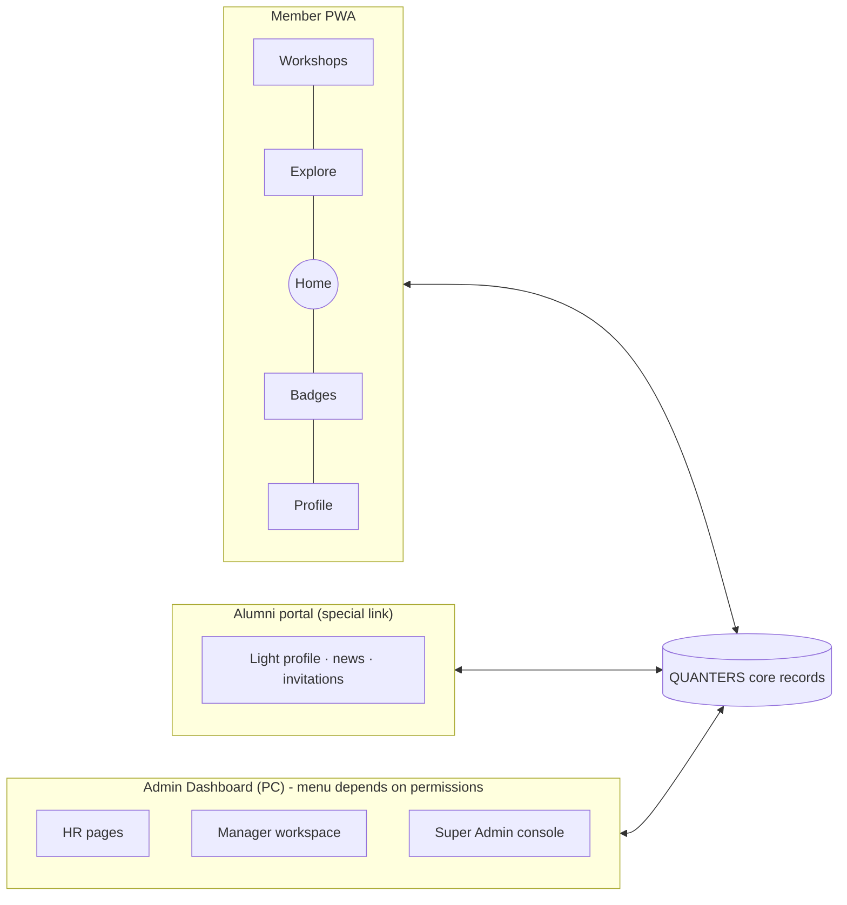
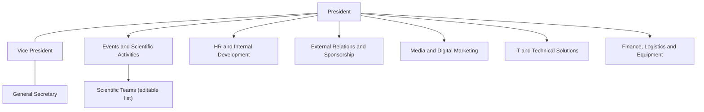
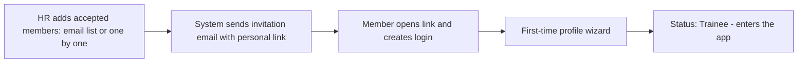
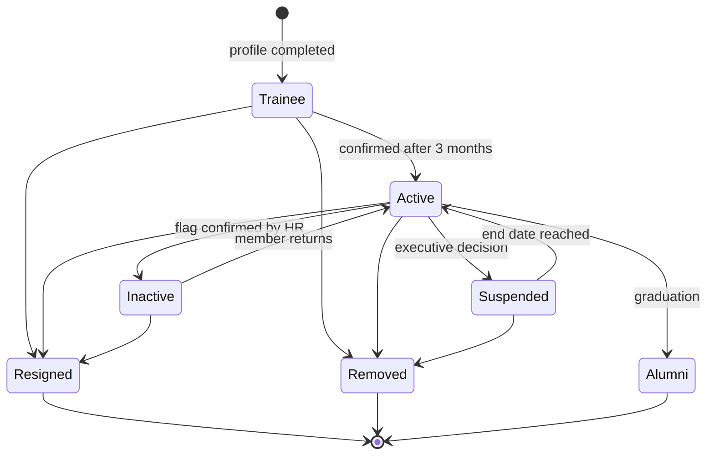
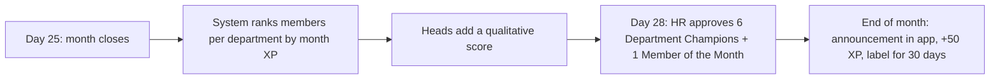
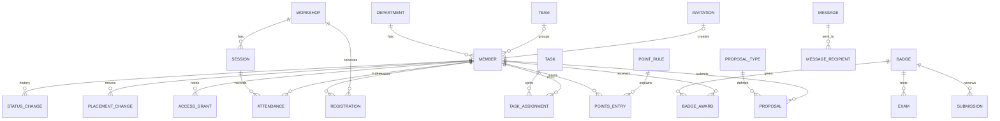

# QUANTERS: ERP and Structure Plan (v2.1)
**QUANTA Scientific Club · Faculty of Sciences · University of Algiers 1**

> [!NOTE]
> This is the **business and structure plan**: actors, data, statuses, processes, permissions and dashboards.
> It is **not** a coding or visual-design plan. The old work is archived in `C:\Users\hp\QUANTERS\_ARCHIVE_V1_2026-09\`.

<details>
<summary><b>What changed since v2</b> (click to expand)</summary>

**Added or changed**
- Members join by **email invitation** and fill their profile in the app the first time they log in.
- Alumni get a **separate access link** with a light profile.
- "Other clubs / associations" is merged with "previous volunteering" into one box. The Law Art. 7 check applies to **bureau members only**.
- **Departments are fixed.** You can't delete them, only move members between them, and every move asks for a reason.
- **Scientific teams** can be created, edited and deleted, and members can be added to or removed from them.
- Each member has **one department only**.
- **Avatars are automatically resized and compressed** on upload.
- A member becomes **Active after 3 months**.
- When a member is set to **Resigned**, the system asks for a reason and the name of the manager filling it in.
- A general **Proposals** module replaces the event-proposal workflow. It covers events, workshops, activities, internal-law amendments, collaborations and more.
- **Manager task workspace** with scores.
- **Flexible badges** (exam, on-site award, project) that can be created, edited and deleted.
- **Stats** page.
- **Copy all emails** in one click.
- **Messages can also go by email.**
- **Registration pause switch.**
- **Delegated access system.**
- **Home sits in the middle** of the bottom navigation.
- Updated permissions table.
- A **single admin dashboard** that controls everything.

**Removed**
- Motivation and ideas fields.
- Weekly time-commitment calculation.
- Wellbeing & Academic Shield module (and its quiet hours, exam truce and recovery leave rules).
- No-push hours.
- Applicant / Not-admitted states.
- Pipeline page.
- Event-proposal workflow.
- Mandatory exit interview / handover gate.

</details>

---

## 0. Guiding principles

| # | Principle |
|---|---|
| P1 | **One source of truth.** One member record, one points ledger, one attendance log. Every screen reads the same data. |
| P2 | **Nothing counts until verified.** Attendance, points, badges and status changes take effect only after server validation and/or authorised approval. |
| P3 | **Every sensitive action is signed.** The system records who did it, when, the old and new value, and the reason. |
| P4 | **Fixed skeleton, flexible content.** Departments and statuses are fixed. Teams, badges, roles, proposal types and point rules are editable. |
| P5 | **Least privilege, easy delegation.** People see only what they need, and access can be granted or revoked in one click. |
| P6 | **Simple screens.** Numbers, colours and one action per alert. Minimal text. |

---

## 1. The system at a glance



- **Member PWA**: for every accepted member.
- **Alumni portal**: a light version, reached through a dedicated alumni link.
- **Admin Dashboard**: **one** desktop dashboard for HR, department managers, the executive board and the super admin. Each person sees only the pages and actions their permissions allow (§8).

---

## 2. Organisation model



### 2.1 Departments: fixed
- The **6 departments are permanent**. They can't be deleted. Only the super admin can edit their name, description and icon.
- Each member belongs to **exactly one department**.
- **Moving a member** to another department opens a box with:
  - from → to
  - **reason (required)**
  - who did it (filled in automatically)
  - date
  The move is saved in the member's history.
- Each department has a **Head** and a **Co-Manager**. These roles are assigned in the dashboard.

### 2.2 Scientific teams: editable
- An admin can **create, edit, archive or delete** teams.
  - Delete is allowed only when the team has no members. Otherwise the team is archived.
- Each team stores: name, field, description, icon, team leader, members.
- An admin can **add members to a team** and **remove members from it**. Removal asks for a short reason and is logged.
- A member can belong to **one team at most** (optional).
- Starting list (from the Law): Physics & Astronomy · Mathematics · CS & AI · Biology & Life Sciences · Health Sciences · Chemistry & Materials.
- Optional warning when a team is outside **5–8 members**. The super admin can change these numbers.

---

## 3. Joining the app and the member record

### 3.1 How members join (invitation → first-time profile)



- **Only accepted members are invited.** There are no applicant or refused states.
- **Invitation states:** Sent → Opened → Completed. A Sent or Opened invitation can also become Expired.
  - HR can **resend** or **cancel** an invitation.
  - The link is personal, single-use and time-limited.
- **Registration switch:** the super admin can **pause or reopen registration**. While paused:
  - invitation links show "Registration is currently closed"
  - no new accounts can be created
  - existing members are not affected
- HR can **pre-fill the department** in the invitation. Otherwise the member picks one in the wizard, and HR can move them later (with a reason).

### 3.2 First-time profile wizard (what the member fills)

| Step | Fields | Visibility |
|---|---|---|
| 1. Identity | Full name · phone · avatar (photo) | Name + avatar: all members · phone: HR + self |
| 2. Studies | University major / department · academic year | All members (major) · HR (year) |
| 3. Club | How long in the club · **one** department · scientific team wish | HR + department |
| 4. Availability | Grid: Saturday … Thursday × time slots | HR + department |
| 5. Outside activities & experience | **One box:** other clubs / associations / organisations the member belongs to + previous volunteering experience (free text + optional list) | HR |
| 6. Confirm | Accept the internal-law commitment pledge (Law 8) | Stored with date |

> [!NOTE]
> **Outside activities box.** Its main purpose is to show HR what members do outside the club.
> The Law Art. 7 restriction (no student-organisation membership) applies **only to bureau / office members**. The system shows a warning **only** when a member holding a bureau role has declared such a membership.

### 3.3 Avatar and image handling
- Every uploaded image (avatars, workshop icons, badge icons, news images) is **automatically processed**:
  - checked to be a real image
  - cropped (square for avatars)
  - **resized** to a small standard size
  - **compressed** to a light web format
  - stored at a few kilobytes
  - the original is discarded
- An optional size limit per upload is set by the super admin.

### 3.4 Fields the system maintains

| Group | Fields | Written by |
|---|---|---|
| Identity | Quanter ID (e.g. QT-26-0142) · email (login) | System |
| Membership | Status · status since · status history (reason + who) · trainee start / end | HR via workflow |
| Placement | Department (one) · team (optional) · roles (Head, Co-Manager, Team Leader…) · buddy | Admin / HR |
| Points | Total XP · season XP · month XP · level | System, from the ledger |
| Recognition | Badges · labels (Star Member, Member of the Month, Department Champion) | HR / system |
| HR (private) | Attendance rate · on-time task rate · health score · risk flags · evaluations | System + HR |
| Confidential | Discipline cases | Authorised committee only |

### 3.5 Data visibility levels

| Level | Who | Examples |
|---|---|---|
| Public (in-app) | All members | Name, avatar, department, team, level, XP, badges, labels |
| Self | The member | Own status, own points history, messages, phone, email |
| Department / Team | Holders of that scope | Availability, attendance and tasks of their own people |
| HR | HR permission holders | Full record, form answers, health score, outside activities |
| Confidential | Case committee | Discipline files |

---

## 4. Membership status model

### 4.1 Official statuses (one at a time)

| Status | Meaning | Set by | Rule |
|---|---|---|---|
| **Trainee** (عضو متدرب) | Qualification period | System | When the first-time profile is completed |
| **Active** (عضو رسمي) | Member in good standing | HR (confirmation) | **3 months** + ≥75% attendance + tasks on time + positive evaluation (+ XP threshold, see D2) |
| **Inactive** | Participation needs follow-up | HR confirms a system flag | No check-in and no task delivery for 30 days → flag → HR contacts the member → Inactive |
| **Suspended** | Temporarily restricted | HR records an executive decision | Discipline decision. End date required. |
| **Resigned** | Left voluntarily | HR / manager | Box: **reason** + **name of the manager filling it** + date |
| **Removed** | Membership ended by decision | HR records the decision | Box: **reason** + decision reference + who filled it + date |
| **Alumni** | Graduated former member | HR | Moves to the alumni portal |



### 4.2 Current vs former members
- **Members list** shows Trainee, Active, Inactive and Suspended members.
- **Former Members** list has three tabs: **Resigned · Removed · Alumni**.
  - Records are never deleted. They become read-only and keep the reason, date, and who filled it.
  - **Reactivate**: HR can bring a former member back. A reason is required, and the history stays attached.

### 4.3 Recognition labels (not statuses)
- **Star Member**: given by HR for a period, with a criterion.
- **Member of the Month** (club-wide) and **Department Champion** (one per department): monthly, shown for 30 days.
- **Senior Fellow** rank (see D6).

### 4.4 Alumni portal (special access link)
- When a member becomes **Alumni**, the system sends them a **dedicated alumni access link**.
- **Alumni see:** a light profile (name, photo, graduation year, current position, field), their badge and achievement history (read-only), QUANTA news and opportunities, and invitations to alumni events.
- **Alumni don't have:** tasks, check-in obligations, points ranking, or the full member record.
- An admin can disable alumni access per person or globally.

---

## 5. ERP modules

### M1. Onboarding (after the first login)
- Light checklist per trainee: **profile complete · buddy assigned · first task before day 30 · first workshop attended**.
- Shown in the dashboard as 4 ticks per trainee. Missing ticks become alerts.

### M2. Member records & confirmation
- Trainee tracker with 3 rings: **time (3 months) · attendance (≥75%) · tasks on time**, plus an evaluation box (department head + co-manager).
- When everything is green, HR receives a **"Ready to confirm"** item → one click → status becomes Active, and the certificate reference is generated.
- Department moves and team changes always ask for a reason and are written to the member's history.

### M3. Workshops & attendance
**Workshop record**
- Icon or cover image (auto-compressed), title, category, **level** (Beginner / Intermediate / Advanced)
- Instructor, date and time, location, capacity / seats left, **XP reward**
- Description, learning objectives, materials
- Linked badge (optional)

**Card format** (respects the reference image)
- Icon on the left.
- Title and level chip.
- Date and time · location · seats left.
- XP chip.
- Arrow on the right that opens the details.

**Lifecycle**
Draft → Published (registration open) → Full / Waitlist → Running → Completed → Archived. A feedback form opens after Completed.

**Check-in modes**
1. **Member scans the workshop code** (default). A rotating QR is shown on the screen or projector.
2. **Organizer scans the member's QR**. The member's QR is shown on their Profile.
3. **Short code fallback**, time-limited.

**Validation rules**
- The code must belong to that session and be used within its time window.
- One check-in per member per session.
- Confirmed only after server validation.

**Corrections**
Only holders of the check-in permission can correct attendance. A reason is required and the change is logged.

### M4. Tasks & Task Matrix (manager workspace)
This is where department heads, co-managers and team leaders organise the work and give scores.

**4.1 Task board** (one per department, and one per event or workshop when needed)
- Columns: **To do → In progress → Delivered → Validated** (exits: Late · Cancelled).
- Filters: member, deadline, linked event, category.

**4.2 Task card fields**

| Field | Notes |
|---|---|
| Title · description | What exactly is expected |
| Category | Logistics · Media · Scientific · Organisation · Sponsorship · Technical · Other (editable list) |
| Assignee(s) | One or several members. Each assignee has **their own line and their own score**, so there is no anonymous group work. |
| Linked to | Department / team / workshop / event (optional) |
| Deadline · location / shift | |
| Checklist | Optional sub-steps |
| Attachments / proof | Files, links, photos |
| **Score** | Points the manager proposes for the task, **within the limits set by the admin** for the category (e.g. 5–50) |
| Status | See the board columns |

**4.3 Scoring flow**
1. The manager creates the task and sets its score value.
2. The member sees it in the app under Home → My tasks and confirms receipt.
3. The member marks it delivered and attaches proof.
4. The manager **validates**. They can give **the full score, a partial score, or a bonus**, plus a short feedback note (required).
5. The points go to the ledger automatically, with the reference: task, validated by, date.
6. A late delivery can apply the late-penalty rule automatically (configurable).

**4.4 Event Task Matrix view**
- The same tasks shown as a table: **member — role — time — location**.
- **Publish** sends a notification to everyone listed. Each person confirms receipt.
- It can be printed or exported.
- Recommended deadline: publish ≥5 days before the event (Law 19).

**4.5 Useful extras**
- **Task templates** for recurring work (e.g. "Workshop setup", "Event photography").
- **Bulk scoring**: give the same points to everyone who took part (e.g. all organisers of an event).
- **Optional limit on active tasks** per member (setting, default 2).

### M5. Points ledger & recognition
- Every point change is a **ledger line**: member · amount (+/−) · reason / rule · source (task, workshop, badge, manual) · who · when.
  - Lines are never edited, only reversed with a reason.
- An editable **point rules table** with default values from the HR strategy:
  - attendance at a general meeting +15
  - weekly meeting +10
  - early delivery +25
  - on-time delivery +15
  - covering a shift +30
  - giving a workshop +40
  - internal test +35
  - sponsorship +50
  - buddy +30
  - scientific article +25
  - Member of the Month +50
  - late −10
  - unjustified absence −25
  - late delivery −20
  - premises breach −30
  - unprofessional conduct −40
- Workshop attendance points come from each workshop's XP value.
- **Appeals**: a member can contest a ledger line within 48 h. HR accepts or rejects it.
- **Levels** are calculated from total XP. The thresholds are editable.
- **Seasons**: points can be read **per month / semester / season**, and a new season can be started without deleting history.

**Member of the Month cycle**



### M6. Badges (flexible)
- Badges can be **created, edited, archived and deleted**.
  - A badge that has already been awarded can only be archived, not deleted.
- **Badge fields:** name · icon (auto-compressed) · category (Science / Technology / Soft skills / Club…) · description · criteria text · XP reward · how it's earned.
- **Ways to earn a badge** (one or more per badge):
  1. **Online exam**: questions, pass mark, timer (optional), number of attempts. Graded automatically.
  2. **On-site / manual award**: HR or an authorised person **assigns** the badge to one or many members (e.g. after an on-site test), with an optional note or proof.
  3. **Project submission**: description, files, repository link, images. A reviewer approves it, asks for revision, or rejects it.
  4. **Automatic**: when a condition is met (e.g. attended all sessions of a workshop track).
- A badge can be **revoked** with a reason (logged).
- **Member view:** Unlocked / In progress / Locked, the criteria, progress, submission status and award date.

### M7. Notifications & messages
- **In-app notifications:** workshops, tasks, exams and results, reviews, points and badges, announcements, HR messages.
- **HR / official messages**
  - **Recipients:** one member · several members · a department · a team · a status (e.g. all Trainees) · everyone.
  - **Channel choice:** ☐ In-app ☐ **Email** (either or both).
  - **Priority:** Info / Action needed / Official notice.
  - **Tracking:** read / unread per recipient (in-app) and sent / failed (email).
- Private HR messages never appear on a profile.
- **Email templates** (invitation, alumni link, official notice, monthly honours) are editable by the super admin.

### M8. Proposals (all kinds of proposals in one place)
Members and managers can submit proposals from the app or the dashboard. Each **proposal type** has its own fields.

| Type | Specific fields |
|---|---|
| **Event** | Title · goal · target audience · expected attendance · date and place · budget estimate · needed departments · partners |
| **Workshop** | Title · instructor · level · objectives · sessions · materials needed · capacity · linked badge |
| **Activity** (outing, visit, competition entry…) | Type · place · date · participants · transport / logistics needs · cost |
| **Internal law amendment** | Article concerned · current text · proposed text · justification |
| **Collaboration / partnership** | Partner name and type (club, lab, company, association) · contact · form of cooperation · benefits · obligations |
| **Idea / improvement** | Area · problem · proposed solution |
| **Other** | Free description |

- **Lifecycle:** Draft → Submitted → Under review (department or executive) → **Approved / Changes requested / Rejected** → (if approved) converted into a workshop, task board, event, etc.
- **Reviewer** depends on the type:
  - department head for workshops and activities
  - executive board for events, collaborations and law amendments
- Law amendments are marked "needs 2/3 executive approval" (Law 33).
- Proposal types and their fields are **editable** by the super admin.
- The submitter is notified at every step. Reviewers write a comment on every decision.

### M9. Explore (content)
- 4 categories: **Scientific news · Event news · QUANTA news · Opportunities**.
- Post fields: title, image (auto-compressed), summary, category, date, source, link.
- Lifecycle: Draft → Review → Published → Archived. Managed by holders of the editor permission.

### M10. Discipline (Phase 2)
- Case file: offence class · summons · hearing notes · decision · notification. Restricted access.
- The ladders follow Law Art. 28 and 31. A decision that results in Suspended or Removed updates the status automatically, with the decision reference.

### M11. Exit & alumni
- **Resign** action: box with reason + name of the manager filling it + date.
- **Remove** action: box with reason + decision reference + who filled it + date.
- **Alumni** action: graduation year → status Alumni → alumni link sent.

---

## 6. Admin Dashboard (PC): one dashboard, menu depends on permissions

### 6.1 Navigation (grouped so it stays simple)

| Group | Page | What's there | Main actions |
|---|---|---|---|
| **Home** | Overview | KPI tiles + "Alerts today" (one button per alert) | Open member · message · assign |
| **People** | Members | Table of current members, with filters: department, team, year, major, status, health colour | Open member card · **Copy all emails** (of the filtered list, one click) · export · message selection |
| | Departments & Teams | 6 departments (fixed) + teams (editable), members of each | **Move member (with reason)** · create / edit / delete team · add / remove team members |
| | Former Members | Tabs: Resigned · Removed · Alumni | View history · reactivate · resend alumni link |
| | Invitations | Sent / opened / completed / expired | Add emails (paste list or file) · resend · cancel |
| **Activity** | Workshops | Workshop list, sessions, registrations, live check-in, rosters | Create workshop · open check-in screen · correct attendance |
| | Tasks | Task boards per department / event + Task Matrix view | Create task · validate · score · bulk score · publish matrix |
| | Proposals | Inbox by type and state | Review · approve / request changes / reject · convert |
| **Growth** | Points | Ledger, point rules, appeals, Member of the Month | Manual entry (reason) · reverse · approve monthly winners |
| | Badges | Badge library, exams, submissions to review | Create / edit badge · **assign badge manually** · grade |
| | **Stats** | Scores and participation charts (§6.3) | Change period · export |
| **Communication** | Messages | Sent messages with read / email status | Compose (in-app ☐ / email ☐) |
| | Explore | Posts | Write · review · publish |
| **Control** | Access & Roles | Who has which access, role templates | Grant · edit · revoke · set expiry |
| | Settings 🔒 | System switches and rules (§6.5) | Super admin only |
| | Audit log 🔒 | Every sensitive action | Filter · export |

An HR member typically sees around 8 pages. A department head sees about 4 (Members of their department, Tasks, Workshops, Stats). The super admin sees everything.

### 6.2 Overview tiles (one number + one colour each)
- Current members by status
- Trainees ready to confirm
- Trainees without a first task (day ≥ 25)
- Members at risk
- Attendance rate this month
- Days left to Member of the Month
- Pending reviews (tasks, badges, proposals)

### 6.3 Stats page
**Period selector:** this month / semester / season / custom.

| Block | Content |
|---|---|
| **Club total** | Total XP earned · number of workshops · total check-ins · tasks validated · badges awarded |
| **Departments** | Ranking by **total score** and by **average score per member** (fair to small departments) · trend line |
| **Teams** | Same ranking (total + average) · members count · activity |
| **Members** | Top members (filter by department / team / year) · full sortable list |
| **Participation** | Attendance rate over time · task on-time rate · badge distribution |

### 6.4 Member card (one screen, tabs)
- **Header:** photo · name · Quanter ID · status · department / team · level / XP · health colour · roles.
- **Tabs:**
  - **Profile:** wizard answers, outside activities
  - **Activity:** attendance, tasks, points ledger
  - **Badges**
  - **Availability**
  - **History:** status, department moves, team changes, all with reasons
  - **HR** 🔒

**Health score (HR-private):** 50% attendance (8 weeks) + 35% on-time tasks + 15% recent activity.
- 🟢 ≥70 · 🟠 50–69 · 🔴 <50
- The weights are editable in Settings.

**Automatic alerts**

| Alert | Rule | Action |
|---|---|---|
| No first task | Trainee day ≥ 25 with 0 tasks | Assign task |
| No buddy | Trainee without buddy after 7 days | Assign buddy |
| Trainee off-track | Attendance < 75% | Message |
| Silent member | 30 days with no check-in and no delivery | Message → Inactive |
| Missed deadlines | ≥ 2 late tasks this month | Notify the head |
| Ready to confirm | All trainee conditions met | Confirm |
| Team size | Team outside the configured range | Rebalance |

### 6.5 Super Admin console (Settings)
- **Registration:** ⏯ pause / reopen registration · invitation link validity · alumni access on/off
- **Structure:** edit department names and icons · team size range · proposal types and fields · task categories and score limits
- **Gamification:** point rules · levels and thresholds · seasons (start new season) · Member of the Month dates · badge categories
- **Membership rules:** trainee duration (3 months) · attendance threshold (75%) · XP threshold · inactivity days (30)
- **Communication:** email sender identity · email templates · announcement banner
- **Media:** image size limits and compression level
- **Access:** role templates · who is super admin (at least 2 people recommended)
- **Data:** export (members, points, attendance) · backups · audit log retention

---

## 7. Member PWA structure

**Bottom navigation (Home in the middle):**

```
[ Workshops ]  [ Explore ]  (( HOME ))  [ Badges ]  [ Profile ]
```

**Home button**
- The centre **Home** button is larger and raised, so it's always under the thumb.
- **When a workshop the member is registered for is live**, the Home button shows a small scan badge. Tapping it opens the **scanner** directly.
- Tapping Home again scrolls back to the top.

**Notifications**
The bell sits in the top bar, with an "HR" tab for private messages.

| Tab | Screens (max 2 levels) | Content |
|---|---|---|
| **Workshops** | List (All / Upcoming / Completed / Mine) → detail → sheets (Register, Cancel, Check-in, Feedback, Materials) | Cards in the reference format (§M3) |
| **Explore** | 4 categories → post | News and opportunities |
| **Home** | Home → task / message / proposal detail | Greeting + status · level and XP bar · next workshop · **My tasks** (with score and deadline) · Member of the Month banner · quick actions: **Scan · Exams · Submit project · Proposals** |
| **Badges** | Grid (Unlocked / In progress / Locked, by category) → badge → exam or submission | Criteria, progress, award date |
| **Profile** | Profile → edit (avatar, availability, outside activities) · settings | Name, avatar, department, team, Quanter ID + personal QR, status, level, XP, badges, skills, history |

**Role tools inside the app** (mobile shortcuts for people with permissions; the full work happens in the dashboard)
- **Check-in screen** for check-in operators.
- **Quick task validation** for managers.

---

## 8. Access & roles (smart delegation)

### 8.1 How access works
Every access right has four parts:

| Part | Options |
|---|---|
| **What** (capability) | Members · Workshops · Check-in · Tasks · Points · Badges · Stats / KPI · Messages · Explore · Proposals · Former members · Cases · Settings · Audit |
| **Level** | **View** · **Edit** · **Approve** · **Manage** (includes delete and delegate) |
| **Where** (scope) | Whole club · one department · one team · **one workshop or event** |
| **Until** | Permanent · or an **expiry date** (e.g. end of the event) |

**Example:** *"Give Amine **Check-in — Edit** on **Workshop: Python for Scientists** until **14 Nov**."* When the date passes, the access disappears on its own.

### 8.2 Role templates (ready-made bundles, editable)

| Template | Typical access |
|---|---|
| **Super Admin** | Everything, including Settings and Access |
| **Executive** (President / VP / SG) | View all · approve proposals · view stats · record decisions |
| **HR Head** | Manage Members, Points, Badges, Messages, Former members · delegate HR rights |
| **HR Member** | What the HR Head grants (e.g. View members, Edit points, Assign badges) |
| **Department Head** | Manage Tasks + View members of **own department** · score tasks · Stats of own department |
| **Co-Manager** | Same as the head of the same department (no delete) |
| **Team Leader** | Tasks + members of **own team** |
| **Workshop Organizer** | Manage **own workshops** + Check-in on them |
| **Check-in Operator** | Check-in on assigned workshops / events only |
| **Reviewer** | Grade exams / projects for assigned badges |
| **Editor** | Explore posts |
| **KPI Viewer** | View Stats only (no personal data) |
| **Member** | The app only |
| **Alumni** | The alumni portal only |

### 8.3 Delegation rules
- A person can only **grant access they already hold**, inside **their own scope**, and at the **same level or lower**.
  - **Example:** the HR Head can give an HR member "Points — View" but not "Settings".
- **Sensitive rights** can be granted **only by the super admin or the HR Head**:
  - see phones and emails
  - export data
  - confidential cases
  - Settings
  - Access
- **Revoke** is one click. Removing someone's role (e.g. a Head steps down) removes all access tied to it.
- The **Access & Roles** page shows, per person, everything they can do, who granted it and when it expires.
- Every grant, edit and revoke is written to the audit log.

---

## 9. Core data entities (the ERP backbone)



Supporting records: **Explore post · Monthly award · Appeal · Setting · Audit entry · Alumni profile · Email template**.

---

## 10. Business rules register (all editable in Settings)

| Rule | Default |
|---|---|
| Trainee duration | **3 months** |
| Confirmation attendance | ≥ 75% |
| Confirmation XP | 150 (see D2) |
| Inactivity flag | 30 days with no check-in and no delivery |
| First task deadline for trainees | Day 30 |
| Buddy assignment | Within 7 days |
| Max active tasks per member | 2 (optional) |
| Task score limits | Per category (e.g. 5–50) |
| Points appeal window | 48 h |
| Member of the Month | 25 → 28 → end of month |
| Task matrix publication | ≥ 5 days before event |
| Team size range | 5–8 (warning only) |
| Invitation link validity | 7 days |
| Image limits | Small standard size, compressed |

---

## 11. Audit log
The following actions are logged:
- status change
- department move or team change
- points manual entry or reversal
- attendance correction
- badge award or revocation
- task validation and score
- proposal decision
- message sent
- access granted or revoked
- settings changed
- registration paused or reopened
- data export

Each entry stores **who · when · what · old → new · reason**.

---

## 12. Decisions still needed

| # | Question | Options |
|---|---|---|
| D1 | Time slots in the availability grid | Morning / Afternoon / Evening, or hour ranges |
| D2 | XP threshold to become Active | Keep 150 / remove |
| D3 | Who endorses confirmation | Head + Co-Manager + HR / Head + HR |
| D4 | Suspension maximum | 1 month / 2 weeks |
| D5 | Appeal of a removal | None / 7 days to the Advisory Board |
| D6 | Senior Fellow criteria | 2 badges / 4 badges (+ XP, 1 year) |
| D7 | Rankings visible to members | All / Top 10 per department / own position only |
| D8 | Who is super admin | President + IT Head (recommended) / other |
| D9 | Can members submit all proposal types, or only managers for some (e.g. law amendment)? | All / restricted per type |

---

## 13. Release phases

| Phase | Contents |
|---|---|
| **1: Core** | Invitations + registration switch + first-time wizard · member records, statuses, Former list, alumni link · departments (move with reason) + teams (CRUD) · workshops + QR check-in · tasks with scoring · points ledger + Member of the Month · badges (exam, manual, project) · Explore · messages (in-app + email) · Stats · Access & Roles · Settings · audit |
| **2: Governance** | Proposals (all types) · discipline cases · trainee evaluations · task matrix publishing · monthly department reports |
| **3: Extended** | Alumni events and directory · finance and inventory · advanced social features |

---

## 14. Success indicators
- % of invitations completed
- Trainee → Active rate after 3 months
- 2nd-month retention of new members
- Monthly attendance rate
- % of tasks validated with feedback
- Member of the Month held every month
- Average review time for tasks, badges and proposals
