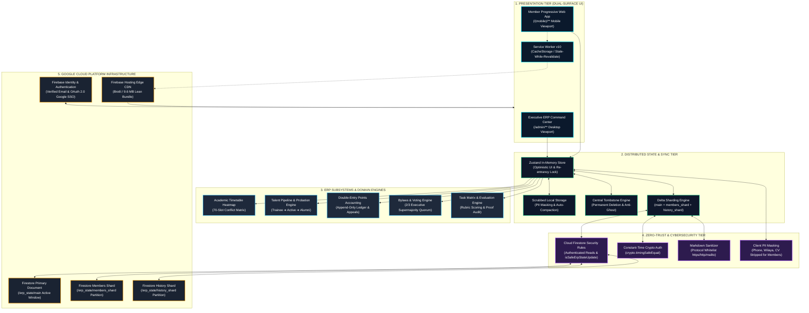

# QUANTERS 🚀
### Enterprise Resource Planning & Civic Operations Management Operating System
**QUANTA Scientific Club** · *Faculty of Sciences, University of Algiers 1 (Benyoucef Benkhedda)*

<div align="center">


[](https://quanters.web.app)
[](https://nextjs.org/)
[](https://react.dev/)
[](https://www.typescriptlang.org/)
[](https://tailwindcss.com/)
[](https://firebase.google.com/)
[](https://quanters.web.app)
[](docs/screenshots/admin-settings.png)
[](manual/QUANTERS_App_Manual_2026-2027.pdf)
[](manual/QUANTERS_Social_Post_Master_Perfect.jpg)
[](LICENSE)

[**Live Web Application**](https://quanters.web.app) · [**Official Manual (PDF)**](manual/QUANTERS_App_Manual_2026-2027.pdf) · [**Launch Media Kit**](manual/QUANTERS_Social_Post_Master_Perfect.jpg) · [**Architecture Graph**](#-erp-system-architecture-graph) · [**RBAC Capability Matrix**](#-role-based-access-control-rbac-capability-matrix) · [**Deployment**](#-deployment--setup)

</div>

---

## 📌 Executive Overview

**QUANTERS** is an enterprise-grade Civic Operations and Resource Planning (ERP) platform custom-architected for **QUANTA Scientific Club** at the Faculty of Sciences, University of Algiers 1.

Engineered to operate reliably under variable mobile network bandwidths and rigorous academic schedules, QUANTERS unifies governance, talent lifecycles, workshop operations, academic scheduling, and points accounting of a 500+ member scientific organization across two specialized interfaces:

1. **The Executive ERP Command Center (`/admin/**`)**: A desktop-optimized, high-density operations suite empowering the Executive Bureau, HR Directorate, and Department Heads to coordinate member pipelines, resolve academic schedule overlaps through an availability heatmap, validate deliverables, audit append-only ledgers, and execute constitutional amendments requiring formal quorums.
2. **The Mobile Member Progressive Web App (`src/app/(mobile)/**`)**: A resilient, offline-first smartphone client enabling club members to access live workshop schedules, verify attendance via dynamic QR and 6-digit session tokens, sit for timed STEM certification exams, submit project deliverables, and track their civic rank progression.

---

## 📸 Platform Interface Gallery

### Executive ERP Command Center
The administrative cockpit provides live situational awareness across all club divisions. It integrates operational telemetry, points solvency monitors, active workshop registration loads, and the proprietary **7-Day Member Availability Heatmap**.

<div align="center">
  
</div>

<br/>

### 7-Day Academic Member Availability Heatmap
Aggregates hourly university course schedules across five faculty departments to pinpoint optimal masterclass and hackathon windows with zero timetable collisions.

<div align="center">
  
</div>

<br/>

### Member Administration & Probation Machine (`/admin/members`)
Enforces the mandatory 30-day Trainee probation lifecycle, performance evaluations, disciplinary status freezes, and alumni archival with an immutable audit log.

<div align="center">
  
</div>

<br/>

### STEM Badges & Certification Exams (`/admin/badges`)
Skill taxonomy management supporting five certification tracks (Python Core, Applied Data Science, Web Development, Embedded Systems, and Scientific Journalism) with timed examinations and passing grade thresholds.

<div align="center">
  
</div>

<br/>

### Double-Entry Points Ledger & Appeals Tribunal (`/admin/points`)
Audit trail capturing every transaction across tasks, workshops, and exams, backed by transparent member appeals and administrative reversals.

<div align="center">
  
</div>

<br/>

### Constitutional Governance & Internal Laws (`/admin/settings`)
Automates the enforcement of QUANTA's official Internal Law (*Règlement Intérieur*), featuring automated 2/3 executive board supermajority quorum requirements for amendments, quota saving profiles, and system telemetry controls.

<div align="center">
  
</div>

<br/>

### Mobile Member Progressive Web App (`/home` & `/profile`)
Optimized for mobile touchscreens with offline-first persistence, native biometric/credential prompts, dynamic attendance QR scanning, and personalized academic portfolios.

<div align="center">
  
  
</div>

---

## 🏛️ ERP System Architecture Graph



---

## 🛡️ Role-Based Access Control (RBAC) Capability Matrix

QUANTERS implements a granular, role-based capability matrix across eleven organizational roles. All privileges are validated both in client route guards and server-side Cloud Firestore Security Rules:

| Organizational Role | App Access Scope | Member Management | Task Assignment & Scoring | Workshop Operations | Points Ledger Adjustments | Governance & Internal Laws | Exam & Badge Authoring | Audit Log Access |
| :--- | :--- | :---: | :---: | :---: | :---: | :---: | :---: | :---: |
| **Super Admin** | Full System (`/admin`, `/`, API) | Full (CRUD, Roles, Bans) | Full (Assign, Score, Override) | Full (Create, Edit, Archive) | Full (Manual Adjust, Reverse) | Full (Vote, Force Enact, Quorum) | Full (Create, Edit, Publish) | Full Immutable Access |
| **Executive** | Executive ERP (`/admin`, `/`) | Full (Promote, Freeze, Review) | Full (Assign, Score, Validate) | Full (Create, Check-in, Manage) | Propose & Approve Reversals | Supermajority Voting ($\lceil \frac{2N}{3} \rceil$) | Full Access | Full Access |
| **HR Head** | HR & Talent Suite (`/admin/members`) | Full Lifecycle (Trainee ➔ Active) | View & Assign HR Tasks | Create & Coordinate | Propose Adjustments | View Laws | Review Applicants | View Talent Logs |
| **Department Head** | Department Cockpit (`/admin/**`) | Department Members Only | Dept Tasks Only (Anti-Self-Score) | Dept Workshops Only | Propose Dept Points | View Laws | Author Dept Exams | View Dept Logs |
| **Co-Manager** | Operational Suite (`/admin/**`) | Review Trainees (Endorsement) | Assign & Review Deliverables | Session Coordination | View Ledger | View Laws | Assist Exams | View Operational Logs |
| **Scientific Team Leader** | Scientific Workspace (`/admin/tasks`) | Scientific Team Members | Scientific Tasks (Anti-Self-Score) | Scientific Sessions | View Ledger | View Laws | Author Team Badges | View Team Logs |
| **Member (Active)** | Member PWA (`/(mobile)/**`) | Self Profile KYC Only | Claim Tasks, Submit Deliverables | Register & Check-In (QR/Code) | View Own Ledger & Appeal | View Enacted Laws | Take Exams & Quizzes | Self History Only |
| **Trainee (Probationary)** | Member PWA (`/(mobile)/**`) | Self Profile KYC Only | Assigned Onboarding Tasks Only | Attend Registered Sessions | View Own Trainee XP | View Enacted Laws | Take Novice Quizzes | Self History Only |
| **Alumni** | Member PWA (Read-Only Archive) | Legacy Profile Only | Historical Archives Only | Observer Attendance | View Lifetime Ledger | View Enacted Laws | View Earned Badges | Self Archive Only |
| **KPI Viewer** | Read-Only Admin (`/admin/**`) | View Directory Only | View Matrix (No Mutation) | View Registrations | View Solvency Graphs | View Law Status | View Analytics | Read-Only Audit |
| **Editor** | Content Management (`/admin/**`) | Read-Only Directory | View Tasks | Edit Workshop Descriptions | View Ledger | View Laws | Edit Badge Text | Content Logs Only |

---

## ⚡ Firebase Spark Free-Tier Economics

The platform has been mathematically optimized to guarantee zero-cost operation under the Google Cloud Firebase Spark free tier:

| Cloud Resource | Spark Free Tier Limit | QUANTERS Real-World Consumption | Headroom & Operational Capacity |
| :--- | :---: | :---: | :--- |
| **Firestore Reads** | 50,000 / day | ~3 reads per cold session; 1 read idle sync | **~16,666 daily visits** (500 members $\times$ 10 visits = <30% quota) |
| **Firestore Writes** | 20,000 / day | ~2 writes per mutation (action + shard) | **~10,000 member actions / day** (check-ins, exams, tasks) |
| **Firestore Deletes** | 20,000 / day | Near-zero (handled by tombstones) | **Safe** |
| **Document Size Limit** | 1,048,576 bytes (1 MiB) | Dual-sharding splits payload across 3 documents | **Supports ~2,000 members** before schema changes |
| **Hosting Bandwidth** | 10 GB / month (~360 MB/day) | Repeat visits = **0 KB static transfer** (PWA cache) | **~24,000 repeat sessions / day** |
| **Hosting Storage** | 10 GB total stored files | Total production deployment: **6.09 MB** | **0.06% of quota used** (99.94% free storage headroom) |

---

## 🔒 Level-4 Forensic Cybersecurity & Zero-Trust Controls

| Security Vector | Threat Vector | Applied Forensic Remediation | Code Location |
| :--- | :--- | :--- | :--- |
| **Database Read Boundary** | Unauthenticated scraping of member roster | Enforced `allow read: if isAuthenticated();` on `/erp_state/{docId}`. | [`firestore.rules`](file:///c:/Users/hp/QUANTERS/firestore.rules#L1026) |
| **Bootstrap Super Admin** | Email spoofing without inbox ownership | Required `request.auth.token.email_verified == true` for bootstrap admin accounts. | [`firestore.rules`](file:///c:/Users/hp/QUANTERS/firestore.rules#L185) |
| **Administrative State Tampering** | Unauthorized mutation of bylaws, roles, or points | Hardened `isSafeErpStateUpdate()` to strictly prohibit non-admin updates to `settings`, `accessGrants`, `pointRules`, and `departments`. | [`firestore.rules`](file:///c:/Users/hp/QUANTERS/firestore.rules#L312) |
| **Stored Cross-Site Scripting (XSS)** | Malicious URLs in library articles (`javascript:...`) | Enforced strict protocol whitelist (`https:`, `http:`, `mailto:`, `#`) in markdown renderer. | [`src/components/shared/MarkdownArticleRenderer.tsx`](file:///c:/Users/hp/QUANTERS/src/components/shared/MarkdownArticleRenderer.tsx) |
| **PII Data Exposure** | Phone, wilaya, and CV leaks in browser storage | Stripped sensitive personal contact details in client cache for ordinary members. | [`src/lib/store/useQuantersStore.ts`](file:///c:/Users/hp/QUANTERS/src/lib/store/useQuantersStore.ts) |
| **Storage Pressure Crashes** | Recursive quota compaction stack overflows | Implemented re-entrancy lock `isCompactingQuota` in state persistence layer. | [`src/lib/store/useQuantersStore.ts`](file:///c:/Users/hp/QUANTERS/src/lib/store/useQuantersStore.ts) |
| **Ghost Record Resurrection** | Offline devices restoring deleted entities | Added central tombstone ingestion (`deletedIdsByCollection`) on snapshot sync. | [`src/lib/store/useQuantersStore.ts`](file:///c:/Users/hp/QUANTERS/src/lib/store/useQuantersStore.ts) |
| **Exam Cheating & Leakage** | Inspecting client payloads for exam answers | Server-side redaction strips `correctIndex` from exams and daily quizzes for unprivileged members. | [`src/lib/server/db.ts`](file:///c:/Users/hp/QUANTERS/src/lib/server/db.ts) |
| **Brute-Force Rate Limiting** | Password guessing attacks | Exponential lockout enforced via `useAuthSecurity` (5-attempt lockout threshold). | [`src/lib/utils/authSecurity.ts`](file:///c:/Users/hp/QUANTERS/src/lib/utils/authSecurity.ts) |

---

## 🛠️ Technology Stack

```
QUANTERS Enterprise Technology Stack
├── Framework:            Next.js 15.5.28 (React 19, TypeScript 5.7, App Router)
├── Styling & Design:     Tailwind CSS 3.4.17, Lucide React Icons
├── Client State:         Zustand 5.0.2 (Optimistic UI & Custom Delta Synchronization)
├── Cloud Infrastructure: Google Cloud Platform / Firebase
│   ├── Database:         Cloud Firestore (Multi-Shard Partitioning)
│   ├── Authentication:   Firebase Auth (Email Verification & Google OAuth 2.0)
│   └── Edge Hosting:     Firebase Hosting (Brotli Compression, Global Edge CDN)
├── Offline & PWA:        Service Worker v10, Web App Manifest V3, CacheStorage API
└── Verification & E2E:   Playwright Multi-Viewport Test Suite (iPhone 14, Pixel 7, Desktop 1080p)
```

---

## 🚀 Deployment & Setup

### Prerequisites
- **Node.js**: `v18.18.0` or higher (Node 20+ LTS recommended)
- **Firebase CLI**: `npm install -g firebase-tools`

### 1. Clone & Install
```bash
git clone https://github.com/ayoubsarri/QUANTERS.git
cd QUANTERS
npm install
```

### 2. Configure Environment Variables
Create `.env.local` in the project root:
```env
# Administrative API Secret (Must be 16+ characters)
QUANTERS_ADMIN_SECRET=your_secure_admin_secret_token_here

# Firebase Web Client Configuration
NEXT_PUBLIC_FIREBASE_API_KEY=your_firebase_web_api_key
NEXT_PUBLIC_FIREBASE_AUTH_DOMAIN=quanters-d0312.firebaseapp.com
NEXT_PUBLIC_FIREBASE_PROJECT_ID=quanters-d0312
NEXT_PUBLIC_FIREBASE_STORAGE_BUCKET=quanters-d0312.firebasestorage.app
NEXT_PUBLIC_FIREBASE_MESSAGING_SENDER_ID=815338551488
NEXT_PUBLIC_FIREBASE_APP_ID=1:815338551488:web:2494e9a885cfae6774d525
NEXT_PUBLIC_FIREBASE_MEASUREMENT_ID=G-VX6YS3CHCX
```

### 3. Build & Typecheck
```bash
# Verify 100% clean TypeScript compilation (0 errors)
npx tsc --noEmit

# Compile lean static production bundle (40 routes in ~9.6 MB)
npm run build
```

### 4. Deploy to Firebase
```bash
# Authenticate CLI
firebase login

# Deploy Security Rules and Edge Hosting
firebase deploy --only firestore:rules,hosting
```

---

## 📂 Repository File Structure

```
QUANTERS
├── data/
│   └── quanters-db.json              # Server persistent fallback database
├── docs/
│   ├── manual/                       # Official Platform User Manual (HTML & PDF)
│   └── screenshots/                  # Verified high-resolution platform screenshots
├── manual/                           # Official Platform Publications & Launch Media Kit
│   ├── QUANTERS_App_Manual_2026-2027.pdf # 16-Page Master Operating Manual (High-DPI PDF)
│   ├── QUANTERS_Social_Post_Master_Perfect.png # 2400×2400 1:1 Social Media Launch Poster
│   ├── facebook_post_master_perfect.html       # Standalone master poster HTML
│   ├── email_template.html                     # Responsive institutional welcome email
│   ├── build_manual.js                         # Headless manual compilation engine
│   └── assets/                                 # Institutional crests & mascot assets
├── public/
│   ├── brand/                        # Brand identity assets, logos, and WebP media
│   │   ├── admin_overview_banner_bg.webp # Mascot hero banner
│   │   ├── welcome_loop.mp4          # Optimized looped branding video
│   │   ├── QUANTERS_white_logo.svg   # Official club vector emblem
│   │   └── univ_quanta_asset2.png    # Faculty of Sciences university crest
│   ├── icons/                        # PWA maskable icons (72px to 512px)
│   ├── manifest.json                 # Web App Manifest V3 specification
│   └── sw.js                         # Service Worker v10 with cache segregation
├── src/
│   ├── app/
│   │   ├── (mobile)/                 # Member smartphone PWA routes
│   │   ├── admin/                    # Executive ERP Command Center routes
│   │   └── api/
│   │       └── erp/route.ts          # Server API with timing-safe auth & deltas
│   ├── components/
│   │   ├── admin/                    # Administrative dashboard components
│   │   ├── mobile/                   # Mobile shell and QR scanners
│   │   └── shared/                   # Field icons, logos, offline alerts
│   └── lib/
│       ├── data/                     # Seed data and constitutional laws
│       ├── firebase/                 # Firebase SDK client initialization & auth
│       ├── server/db.ts              # Server DB engine & answer redaction
│       ├── store/                    # Zustand store with optimistic synchronization
│       ├── types/erp.ts              # Comprehensive TypeScript type system
│       └── utils/                    # Cryptography, auth, and image compressors
├── firestore.rules                   # Cloud Firestore Zero-Trust Security Rules
├── next.config.ts                    # Next.js configuration & CSP HTTP headers
├── tailwind.config.ts                # Tailwind design tokens & typography
├── LICENSE                           # Proprietary Club License
└── README.md                         # Platform Documentation
```

---

## 👥 Scientific Club Leadership & Credits

**QUANTA Scientific Club**  
*Faculty of Sciences, University of Algiers 1 (Benyoucef Benkhedda)*  
- **Official Inquiries**: `contact@quanta-club.dz` · `quantaclubdz@gmail.com`
- **Lead Architecture & Engineering**: Developed by the QUANTA Executive & IT Technical Committee.

---

## 📄 License & Governance

Copyright (c) 2026 **QUANTA Scientific Club**. Faculty of Sciences, University of Algiers 1. All Rights Reserved.  
This software platform, design assets, and administrative documentation are proprietary and confidential to QUANTA Scientific Club. Unauthorized copying, distribution, modification, or commercial use is strictly prohibited. See [LICENSE](LICENSE) for terms.
