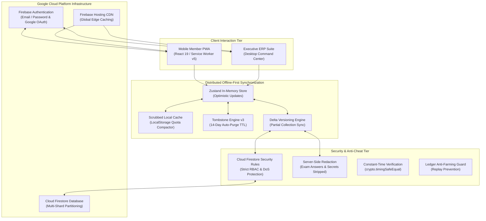

# QUANTERS 🚀

<div align="center">


### Enterprise Resource Planning & Civic Gamification Platform
**QUANTA Scientific Club** · *Faculty of Sciences, University of Algiers 1 (Benyoucef Benkhedda)*

[](https://quanters.web.app)
[](https://nextjs.org/)
[](https://react.dev/)
[](https://www.typescriptlang.org/)
[](https://tailwindcss.com/)
[](https://firebase.google.com/)
[](docs/screenshots/admin-settings.png)

[**Explore Live Production**](https://quanters.web.app) · [**Architecture Documentation**](#architecture--technical-stack) · [**Security Dossier**](#forensic-security--anti-cheat-hardening) · [**Local Setup**](#quick-start--local-development)

</div>

---

## 🌟 Overview

**QUANTERS** is an enterprise-grade scientific club ERP (Enterprise Resource Planning) and Progressive Web Application (PWA) engineered from the ground up for **QUANTA Scientific Club** at the University of Algiers 1.

It unifies **civic gamification**, **academic KYC**, **STEM skill certifications**, **project incubation**, **workshop logistics**, **task dispatching**, and **executive constitutional governance** into a synchronized, offline-first platform. Built to operate seamlessly under restricted mobile bandwidth across Algerian university campuses, QUANTERS pairs an offline-first mobile member experience with a desktop executive command center.

---

## 📸 Platform Showcase

### 1. Executive ERP Command Center (`/admin/overview`)
The central nervous system for the executive bureau. Displays real-time club telemetry, department allocations, financial balance, active workshop registration loads, and the **7-Day Academic Availability Heatmap** aggregating member university schedules to schedule events without schedule conflicts.

<div align="center">
  
</div>

<br/>

### 2. 7-Day Member Availability Heatmap & Academic Telemetry
Calculates hourly availability across all club members by day of the week, identifying peak attendance windows for masterclasses and hackathons while accounting for university commute times and curfew boundaries.

<div align="center">
  
</div>

<br/>

### 3. Member Directory & Status Machine (`/admin/members`)
Granular member administration supporting probation monitoring (Trainee 30-day lifecycle), active status tracking, pause/resume freeze management, departmental transfers, and disciplinary records with immutable audit logs.

<div align="center">
  
</div>

<br/>

### 4. STEM Badges & Certification Exams (`/admin/badges` & `/exams`)
Skill taxonomy management offering tiered certification tracks in Python, Data Science, Web Development, Robotics, and Scientific Research. Features timed examinations with passing grade thresholds and automatic rank elevation.

<div align="center">
  
</div>

<br/>

### 5. Points Ledger & Manual Adjustments (`/admin/points`)
Full double-entry ledger tracking all XP transactions across workshops, tasks, badge examinations, and daily quizzes. Supports transparent member appeals and administrative reversals.

<div align="center">
  
</div>

<br/>

### 6. Constitutional Governance & Internal Laws (`/admin/settings`)
Enforces the QUANTA Internal Law (*Règlement Intérieur*) with automated 2/3 executive board supermajority quorum requirements for constitutional amendments, automated quota savers, and system telemetry controls.

<div align="center">
  
</div>

<br/>

### 7. Mobile Member Progressive Web App (`/home` & `/profile`)
The primary member surface designed for smartphones. Offers native installation via PWA Manifest V3, customized daily scientific quotes, daily science quiz challenges, instant QR check-in, and personal academic KYC portfolios.

<div align="center">
  
  
</div>

---

## 🏛️ Platform Architecture & Functional Modules



### 1. Mobile Member Surface (`src/app/(mobile)/**`)
- **Cinema Welcome Portal (`/welcome`)**: Lightweight, 1.6 MB looped branding video with clean translucent glass login/register portals, native mobile password generator triggers, and zero plaintext credentials.
- **Home Dashboard (`/home`)**: Real-time schedule ticker, current tier progress indicator, next enrolled workshops, and quick action launcher.
- **Workshop Lifecycle (`/workshops` & `/checkin`)**: Live catalog, capacity gauges, real-time waitlists, and projector QR / 6-digit code attendance validator.
- **Badge Examinations & Projects (`/exams` & `/projects/submit`)**: Timed MCQ evaluations, code repository submissions, and peer project incubation.
- **Science Exploration Engine (`/explore`)**: Daily science quizzes with server ledger deduplication, 365 daily quotes, and curated scientific literature feeds.
- **Profile & Academic KYC (`/profile`)**: Academic year, field of study, equipment inventory (laptops, microcontrollers), late-stay capacity, and weekly study availability matrix.

### 2. Executive ERP Command Center (`src/app/admin/**`)
- **Availability Heatmap (`/admin/overview`)**: Aggregates member weekly schedules into an interactive 7-day grid, factoring in Friday prayers and academic shifts.
- **Lifecycle Management (`/admin/members`)**: Trainee 30-day onboarding checkpoints, suspension freezes, resignation records, and alumni roll calls.
- **Task Dispatcher & Validation Matrix (`/admin/tasks`)**: Assign tasks to individuals or teams, track delivery proofs, and award validation XP with managerial feedback.
- **Internal Laws & Quorum Engine (`/admin/settings`)**: Requires 2/3 executive board supermajority approvals calculated via $\lceil \frac{2N}{3} \rceil$ for constitutional changes.
- **Quota Saver & History Sharding (`/admin/settings`)**: Compresses avatars, truncates in-memory message history, and shards overflow audit logs to `/erp_state/history_shard` to preserve Firestore Spark free tier limits.

---

## 🛡️ Forensic Security & Anti-Cheat Hardening

The QUANTERS codebase has undergone a **Level-4 forensic cybersecurity audit** adhering to **OWASP Top 10** and **ASVS Level 3** standards:

| Security Vector | Vulnerability Mitigated | Architectural Remediation |
| :--- | :--- | :--- |
| **Password Security** | Plaintext password leaks | Complete eradication of plaintext credentials; passwords hashed with PBKDF2/SHA-256 and salted. Sensitive auth fields scrubbed prior to state broadcast or local caching. |
| **Server API Auth** | Timing attacks on admin secret | Integrated `crypto.timingSafeEqual` in `src/app/api/erp/route.ts` with a 16-character minimum secret floor. |
| **Administrative Mutations** | Unprivileged state modification | Enforced strict privilege checks on `POST /api/erp`. Unauthenticated callers cannot mutate `settings`, `accessGrants`, `pointRules`, `departments`, `ledger`, or `grievances`. |
| **Cloud Firestore Rules** | Seat exhaustion DoS & spoofing | Added `!(uid in oldList)` check to prevent duplicate array entries from zeroing workshop seats. Subcollections enforce strict field schema validation. |
| **Task Scoring Integrity** | Self-scoring & double-dipping | Implemented strict self-validation lockout (`currentMemberId !== memberId`) and prohibited re-scoring already validated deliverables. |
| **Exam & Quiz Anti-Cheat** | Client answer disclosure | Stripped `correctIndex` from exam questions and `correctId` and `explanation` from daily quizzes on all unprivileged endpoints in `src/lib/server/db.ts`. |
| **Service Worker Cache** | API delta cache poisoning | `public/sw.js` explicitly bypasses authenticated requests and delta queries (`!hasAuth && !isDeltaQuery`), caching only complete master snapshots. |
| **Browser Compatibility** | Safari Private Browsing crash | All `localStorage` interactions wrapped in `try...catch` blocks to protect against `DOMException: SecurityError`. |
| **URL Sanitization** | Phishing & open redirect vectors | Routed all external user-supplied links (`portfolioUrl`, `githubUrl`, `cvUrl`, `repoUrl`) through `sanitizeExternalUrl()`. |
| **Storage Quota Engine** | Indefinite tombstone leakage | Migrated to `quanters-tombstones-v3` featuring a 14-day TTL auto-purge mechanism. |

---

## 💻 Tech Stack

- **Framework**: [Next.js 15.5.28](https://nextjs.org/) (App Router, Turbopack, Standalone & Static Export)
- **UI & Animation**: [React 19](https://react.dev/), [Tailwind CSS 3.4](https://tailwindcss.com/), [Lucide React](https://lucide.dev/)
- **State Management**: [Zustand 5](https://zustand-demo.pmnd.rs/) with optimistic client-side synchronization
- **Backend & Cloud**: [Google Cloud Firestore](https://firebase.google.com/docs/firestore), [Firebase Authentication](https://firebase.google.com/docs/auth), [Firebase Hosting](https://firebase.google.com/docs/hosting)
- **Offline & PWA**: Custom Service Worker v5, Web App Manifest V3, CacheStorage API
- **Testing & Tooling**: [Playwright](https://playwright.dev/) End-to-End Test Suite, Python 3 verification scripts

---

## ⚡ Quick Start & Local Development

### Prerequisites
- **Node.js**: `v18.18.0` or higher
- **Package Manager**: `npm` (comes with Node.js)
- **Firebase CLI**: `npm install -g firebase-tools`

### 1. Clone the Repository
```bash
git clone https://github.com/ayoubsarri/QUANTERS.git
cd QUANTERS
```

### 2. Install Dependencies
```bash
npm install
```

### 3. Environment Configuration
Create a `.env.local` file in the root directory:
```env
# Administrative API Secret (Minimum 16 characters)
QUANTERS_ADMIN_SECRET=your_super_secret_admin_token_here_32chars

# Firebase Configuration
NEXT_PUBLIC_FIREBASE_API_KEY=AIzaSy...
NEXT_PUBLIC_FIREBASE_AUTH_DOMAIN=quanters-d0312.firebaseapp.com
NEXT_PUBLIC_FIREBASE_PROJECT_ID=quanters-d0312
NEXT_PUBLIC_FIREBASE_STORAGE_BUCKET=quanters-d0312.firebasestorage.app
NEXT_PUBLIC_FIREBASE_MESSAGING_SENDER_ID=1073822165036
NEXT_PUBLIC_FIREBASE_APP_ID=1:1073822165036:web:...
```

### 4. Run Development Server
```bash
npm run dev
```
Open [http://localhost:3000](http://localhost:3000) in your browser.

### 5. Typecheck & Validate
```bash
# Verify TypeScript types (0 errors)
npx tsc --noEmit

# Validate Firestore Security Rules
firebase-tools firestore:rules:validate firestore.rules
```

### 6. Build for Production
```bash
# Compiles both static export (out/) and server bundle (.next/)
node scripts/build_firebase_out.mjs
```

### 7. Deploy to Firebase
```bash
# Login to Firebase
firebase login

# Deploy Security Rules and Hosting
firebase deploy --only firestore:rules,hosting
```

---

## 📁 Repository Structure

```
c:\Users\hp\QUANTERS
├── data/
│   └── quanters-db.json            # Server-side persistent JSON database fallback
├── docs/
│   └── screenshots/                # High-resolution platform documentation screenshots
├── public/
│   ├── brand/                      # Brand identity assets, logos, and WebP media
│   ├── manifest.json               # Progressive Web App Manifest V3
│   └── sw.js                       # Service Worker v5 (Offline cache segregation)
├── scripts/
│   ├── build_firebase_out.mjs      # Production build pipeline (Static out/ + .next/)
│   └── verify_remediations_full.py # Playwright automated E2E test verification suite
├── src/
│   ├── app/
│   │   ├── (mobile)/               # Member smartphone PWA routes
│   │   │   ├── checkin/            # QR & 6-digit attendance check-in
│   │   │   ├── exams/              # STEM badge certification exams
│   │   │   ├── explore/            # Daily science quiz & article feed
│   │   │   ├── home/               # Member mobile home dashboard
│   │   │   ├── profile/            # Academic KYC & skills portfolio
│   │   │   ├── welcome/            # Cinema entrance & credentials portal
│   │   │   └── workshops/          # Workshop catalog & seats registration
│   │   ├── admin/                  # Executive ERP Command Center routes
│   │   │   ├── badges/             # Badge taxonomy & exam creator
│   │   │   ├── members/            # Member lifecycle & status machine
│   │   │   ├── overview/           # 7-day availability heatmap & KPIs
│   │   │   ├── points/             # Points ledger & appeals tribunal
│   │   │   ├── settings/           # Constitutional governance & quota saver
│   │   │   └── tasks/              # Task matrix & deliverable scoring
│   │   └── api/
│   │       └── erp/route.ts        # Next.js Server API for state sync
│   ├── components/
│   │   ├── admin/                  # Administrative UI components
│   │   ├── mobile/                 # Mobile shell and QR scanners
│   │   └── shared/                 # Field icons, logos, offline alerts
│   └── lib/
│       ├── data/                   # Seed data and constitutional laws
│       ├── firebase/               # Firebase SDK client initialization & auth
│       ├── server/db.ts            # Server JSON DB engine & redaction utilities
│       ├── store/                  # Zustand store with optimistic synchronization
│       ├── types/erp.ts            # Comprehensive TypeScript type definitions
│       └── utils/                  # Cryptography, auth, and image compressors
├── firestore.rules                 # Cloud Firestore Security Rules
├── next.config.ts                  # Next.js configuration & CSP HTTP headers
└── tailwind.config.ts              # Tailwind design tokens & typography
```

---

## 📜 Governance & Constitutional Quorum

QUANTERS implements the official **Internal Law** (*Règlement Intérieur*) of QUANTA Scientific Club:
- **Article 4 (Membership Lifecycle)**: Trainees undergo a mandatory 30-day probationary period requiring evaluation by Department Heads and Co-Managers before promotion to Active Member.
- **Article 7 (Constitutional Amendments)**: Modifying internal laws requires an executive board supermajority vote ($\ge \lceil \frac{2N}{3} \rceil$ affirmative votes from eligible active executives), recorded in the system audit trail.
- **Article 12 (Disciplinary Suspensions)**: Members facing disciplinary sanctions enter a paused status, during which task and workshop XP accrual is frozen until formal executive review.

---

## 👥 Scientific Club Leadership

**QUANTA Scientific Club**  
*Faculty of Sciences, University of Algiers 1 (Benyoucef Benkhedda)*  
- **Official Contact**: `quantaclubdz@gmail.com` · `hr.quanta@univ-alger.dz`
- **Platform Engineering**: Developed by the QUANTA Executive & IT Technical Committee.

---

## 📄 License

This software is developed for the administration and members of **QUANTA Scientific Club**.  
All rights reserved © 2026 QUANTA Scientific Club. Distributed under the [MIT License](LICENSE).
