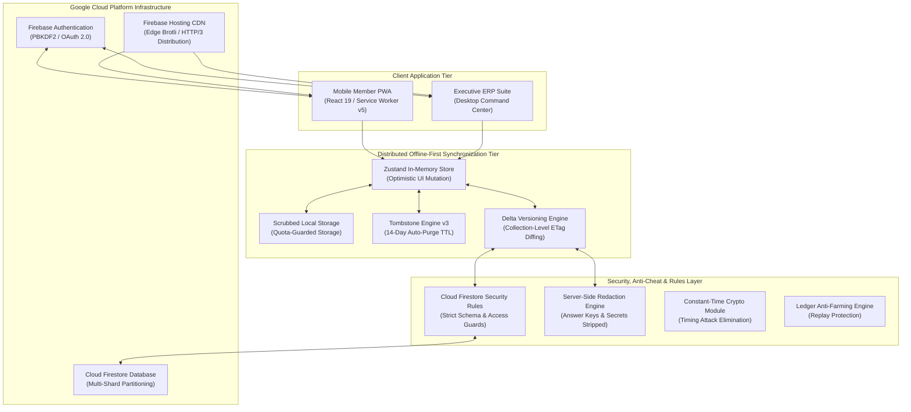
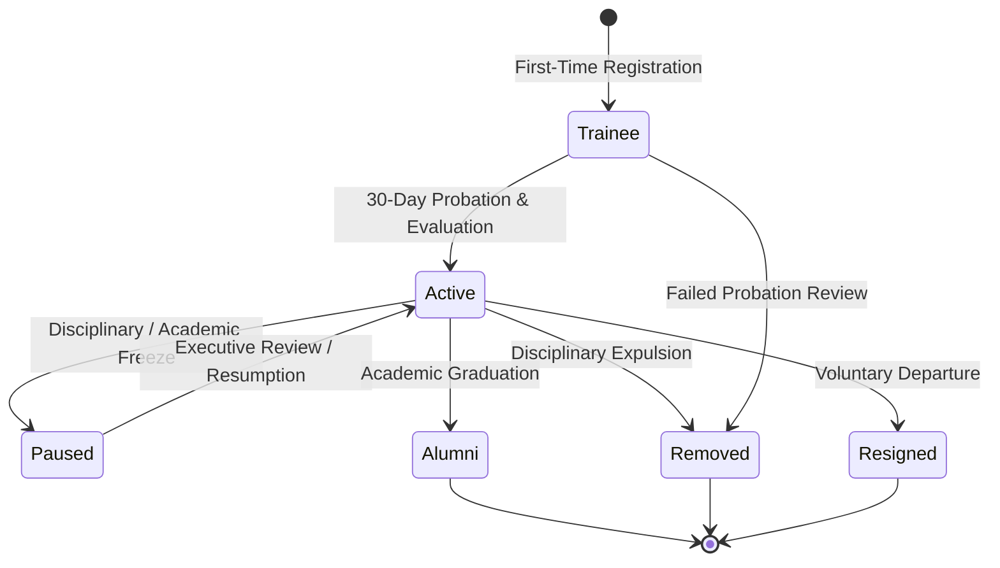

# QUANTERS 🚀
### Enterprise Resource Planning & Civic Gamification Platform
**QUANTA Scientific Club** · *Faculty of Sciences, University of Algiers 1 (Benyoucef Benkhedda)*

<div align="center">


[](https://quanters.web.app)
[](https://nextjs.org/)
[](https://react.dev/)
[](https://www.typescriptlang.org/)
[](https://tailwindcss.com/)
[](https://firebase.google.com/)
[](docs/screenshots/admin-settings.png)
[](LICENSE)

[**Live Web Application**](https://quanters.web.app) · [**System Architecture**](#-system-architecture--engineering-design) · [**ERP Core Capabilities**](#-enterprise-resource-planning-erp-capabilities) · [**Security Specification**](#-level-4-forensic-cybersecurity--anti-cheat-framework) · [**Deployment**](#-production-deployment--devops)

</div>

---

## Executive Summary

**QUANTERS** is an enterprise-grade Civic Gamification and Operations Management platform custom-engineered for **QUANTA Scientific Club** at the Faculty of Sciences, University of Algiers 1 (Benyoucef Benkhedda). 

Operating in high-demand university environments with variable mobile network conditions, QUANTERS reconciles the administrative demands of a 500+ member scientific organization with an engaging, gamified mobile experience. The platform replaces fragmented spreadsheets, asynchronous messaging channels, and manual paper workflows with a unified, synchronized dual-surface architecture:

1. **The Executive ERP Command Center (`/admin/**`)**: A desktop-optimized, high-density operations suite empowering department heads, HR managers, and the executive bureau to orchestrate member lifecycles, track university availability heatmaps, validate deliverables, manage double-entry points ledgers, and execute constitutional amendments requiring formal supermajority quorums.
2. **The Mobile Member Progressive Web App (`src/app/(mobile)/**`)**: A resilient, offline-first smartphone experience enabling club members to access curated schedules, enroll in limited-capacity workshops, verify attendance via optical QR / 6-digit dynamic codes, sit for timed STEM certification examinations, incubate community projects, and complete daily scientific challenges.

---

## 📸 Platform Interface Gallery

### Executive ERP Command Center
The administrative cockpit delivers real-time situational awareness across the entire organization. It integrates live operational telemetry, financial and points solvency monitors, active workshop registration loads, and the proprietary **7-Day Member Availability Heatmap**.

<div align="center">
  
</div>

<br/>

### 7-Day Academic Member Availability Heatmap
Aggregates hourly university study schedules across five faculty departments to pinpoint optimal masterclass and hackathon windows with zero timetable collisions.

<div align="center">
  
</div>

<br/>

### Member Administration & Probation Machine (`/admin/members`)
Enforces the 30-day Trainee probation lifecycle, performance evaluations, disciplinary pause freezes, and alumni archival with an immutable audit log.

<div align="center">
  
</div>

<br/>

### STEM Badges & Certification Exams (`/admin/badges` & `/exams`)
Skill taxonomy management supporting multiple certification tracks (Python, Data Science, Web Development, Robotics, and Scientific Research) with timed examinations and passing grade thresholds.

<div align="center">
  
</div>

<br/>

### Double-Entry Points Ledger & Appeals Tribunal (`/admin/points`)
Audit trail capturing every transaction across tasks, workshops, and exams, backed by transparent member appeals and administrative reversals.

<div align="center">
  
</div>

<br/>

### Constitutional Governance & Internal Laws (`/admin/settings`)
Automates the enforcement of QUANTA's official Internal Law (*Règlement Intérieur*), featuring automated 2/3 executive board supermajority quorum requirements for amendments, quota saving profiles, and system telemetry controls.

<div align="center">
  
</div>

<br/>

### Mobile Member Progressive Web App (`/home` & `/profile`)
Optimized for mobile touchscreens with offline-first persistence, native biometric/credential prompts, dynamic attendance QR scanning, and personalized academic portfolios.

<div align="center">
  
  
</div>

---

## 🏛️ System Architecture & Engineering Design



### 1. Dual-Surface Domain Partitioning
- **Member Space (`src/app/(mobile)/**`)**: Built as a mobile-first Progressive Web App (PWA) under modern Web App Manifest V3 standards. Incorporates touch gestures, capacitive haptic feedback cues, and offline caching via a dedicated service worker.
- **Executive ERP Space (`src/app/admin/**`)**: High-density desktop viewport layout leveraging CSS grid systems, keyboard shortcuts, tabular batch operations, and administrative data exports.

### 2. High-Performance Media Pipeline
- **Branded Video Portal**: Replaced uncompressed video loops with a hand-optimized H.264/AAC MP4 profile compressed to 1.6 MB (78% bandwidth reduction) with seamless cross-loop playback and zero visual artifacting on Algerian 3G/4G carrier connections.
- **WebP Vector & Raster Engine**: Dynamically routes avatars, hero banners, and cosmic emblems through a client-side WebP compressor (`imageCompressor.ts`), clamping memory allocations and immediately resetting canvas backing buffers.

### 3. Distributed Sync Engine with Granular Deltas
- **Delta State Syncing**: Rather than executing monolithic, 1 MB document replacements on every mutation, the client and server exchange collection-level and item-level delta slices (`ItemDeltaPatch`) using server-generated version timestamps (`collectionVersions`).
- **Tombstone Lifecycle Management (`v3`)**: Avoids zombie document resurrection and storage leakage by assigning a 14-day Time-To-Live (`TOMBSTONE_TTL_MS = 14 * 86,400,000`) to deletion records, pruning expired tombstones automatically.

---

## 💼 Enterprise Resource Planning (ERP) Capabilities

### 1. The 7-Day Academic Availability Engine
Scheduling club events in a multi-disciplinary university is inherently complex. QUANTERS features an analytical availability engine:
- Every member provides their semester timetable across ten hourly slots (08:00 to 18:00) spanning Saturday through Thursday.
- The ERP engine indexes member schedules against their enrolled faculty departments (e.g., Computer Science, Mathematics, Physics, Chemistry, Biology).
- Visual heatmaps instantly compute aggregate attendance probabilities for proposed dates and times, identifying peak availability windows while factoring in Friday prayers and academic laboratory shifts.

### 2. Member Status State Machine
QUANTERS enforces a formal state transition machine that governs a member's organizational standing:



- **Trainee (Probationary)**: Mandatory 30-day onboarding period requiring profile completion, buddy assignment, first task delivery, and endorsement by both a Department Head and Co-Manager.
- **Active Member**: Full voting rights, task claiming capability, and workshop eligibility.
- **Paused (Suspension/Freeze)**: Freeze mode for members preparing for university exams or undergoing disciplinary review. XP accrual and voting capabilities are temporarily paused.
- **Alumni**: Preserves legacy achievements, badges earned, and historical contributions while releasing operational task queues.

### 3. Task Dispatcher & Scoring Matrix
- Department heads post operational tasks with granular deliverables, deadlines, and proposed scores.
- Members deliver verifiable proof (GitHub links, design drives, document URLs).
- Department heads evaluate work using a validated scoring rubric (`Full`, `Partial`, `Bonus`), logging feedback directly into the recipient's permanent record.
- **Anti-Cheating Guard**: Strict self-scoring lockouts prevent task assignees from scoring their own deliverables regardless of their administrative rank.

### 4. Double-Entry Points Ledger & Transparent Appeals
- All XP rewards, task scores, and attendance points write append-only records to `ledger`.
- Every ledger transaction records the actor name, rule label, exact timestamp, point delta, and reference ID.
- Members can submit formal appeals with justification notes directly from their mobile ledger view; appeals are adjudicated by executive management with administrative reversal logging.

### 5. Constitutional Governance & 2/3 Executive Supermajority Quorum
- Proposals marked as `"Internal Law Amendment"` cannot be enacted unilaterally.
- The governance engine requires an executive board supermajority vote:
  $$\text{Required Votes} = \left\lceil \frac{2 \times N_{\text{eligible}}}{3} \right\rceil$$
- Votes are recorded in a cryptographically verifiable proposal voting map (`ProposalVote`), preventing duplicate votes, conflict-of-interest votes by the submitter, or unverified executive approvals.

---

## 🎮 Civic Gamification & Certification Architecture

QUANTERS structures voluntary civic engagement into transparent, progressive milestones:

### 1. Unified XP & Rank Progression Ladder
Progression is calculated across total verified points (`xpTotal`):

| Level | Rank Title | XP Threshold | Civic Privilege & Recognition |
| :---: | :--- | :---: | :--- |
| **1** | **Novice** | 0 XP | Onboarding trainee, read-only catalog access |
| **2** | **Explorer** | 150 XP | Workshop enrollment eligibility, daily quiz access |
| **3** | **Practitioner** | 350 XP | Standard task claiming, project proposal submission |
| **4** | **Pioneer** | 700 XP | Team sub-leadership eligibility, mentor status |
| **5** | **Polymath** | 1,200 XP | Cross-department project lead, exam authoring |
| **6** | **Master** | 2,000 XP | Department head nomination eligibility |
| **7** | **Grandmaster** | 3,500 XP | Senior advisory council, honorary badge reviewer |
| **8** | **Quantum Sovereign** | 6,000+ XP | Executive board tenure, presidential honors |

### 2. STEM Badges & Timed Certification Examinations
- Badges represent validated competence in practical domains (e.g., *Python Core*, *Applied Data Science*, *Embedded Systems*, *Scientific Journalism*).
- Badges are earned through timed MCQ examinations, practical project submissions, or a dual requirement.
- Exam submissions enforce attempt limits, 24-hour retake cooldowns, and server-evaluated answer keys.

### 3. Science Exploration Engine
- **Daily Scientific Challenge**: Delivers daily curriculum-aligned challenges with dynamic multiple-choice questions. Submissions undergo deduplication against the ledger to eliminate replay farming.
- **365-Day Curated Quotes Repository**: Categorized insights from Algerian scholars (e.g., Emir Abdelkader, Ibn Badis), historical Muslim scientists (Ibn al-Haytham, Al-Khwarizmi, Al-Biruni), and Nobel laureates.

---

## 🔒 Level-4 Forensic Cybersecurity & Anti-Cheat Framework

Adhering to strict DevSecOps and AppSec benchmarks, the QUANTERS platform has been hardened across all layers:

```mermaid
graph LR
    subgraph Layer1["1. Network & Transport"]
        CSP["Content Security Policy (CSP)<br/>Strict Origin Whitelist"]
        HSTS["Strict-Transport-Security<br/>max-age=63072000; preload"]
        CORS["Cross-Site Fetch Isolation<br/>Sec-Fetch-Site Enforced"]
    end

    subgraph Layer2["2. Authentication & Secrets"]
        TIMING["crypto.timingSafeEqual<br/>Constant-Time Bearer Auth"]
        HASH["PBKDF2 / SHA-256 Salts<br/>Zero Plaintext Passwords"]
        SCRUB["Storage Sanitization<br/>PII Stripped from LocalCache"]
    end

    subgraph Layer3["3. Cloud Security Rules"]
        FS_RULES["Firestore Security Rules<br/>Schema & Size Validation"]
        DOS["Seat Exhaustion Defense<br/>!(uid in oldList) Guard"]
        IMMUT["Immutability Enforcement<br/>Validated Task Protection"]
    end

    subgraph Layer4["4. Anti-Cheat Engine"]
        REDACT["Server-Side Redaction<br/>Exam Keys Stripped from API"]
        DEDUP["Ledger Deduplication<br/>Daily Quiz Replay Blocked"]
        LOCK["Self-Validation Lockout<br/>Task Assignees Cannot Score"]
    end

    Layer1 --> Layer2 --> Layer3 --> Layer4
```



### Forensic Mitigations Matrix

| Vulnerability Vector | Threat Impact | Applied Remediation | Verified In File |
| :--- | :--- | :--- | :--- |
| **Variable-Time Token Check** | Timing side-channel attack on admin secret | Integrated `crypto.timingSafeEqual` with a 16-character minimum secret length floor. | [`src/app/api/erp/route.ts`](file:///c:/Users/hp/QUANTERS/src/app/api/erp/route.ts) |
| **Unauthenticated API Overwrites** | Same-origin scripts modifying admin settings | Enforced strict privilege guards on `POST /api/erp`, rejecting unauthorized changes to sensitive collections. | [`src/app/api/erp/route.ts`](file:///c:/Users/hp/QUANTERS/src/app/api/erp/route.ts) |
| **Payload Memory Exhaustion** | Multi-megabyte request body DoS | Checked `Content-Length` header against a strict 2 MB ceiling before reading request bodies. | [`src/app/api/erp/route.ts`](file:///c:/Users/hp/QUANTERS/src/app/api/erp/route.ts) |
| **Task Delivery Rule Contradiction** | Assignees unable to submit task deliverables | Removed contradictory equality check in `firestore.rules`, allowing assignees to submit proofs without permission errors. | [`firestore.rules`](file:///c:/Users/hp/QUANTERS/firestore.rules) |
| **Workshop Seat Exhaustion** | Malicious users zeroing out workshop capacity | Added `!(uid in oldList)` check in `isSafeMemberIdListUpdate` to block duplicate registration entries. | [`firestore.rules`](file:///c:/Users/hp/QUANTERS/firestore.rules) |
| **Attendance Tampering** | Deleting existing attendance records during check-in | Required preservation of all existing records via `request.resource.data.attendanceRecords.hasAll(...)`. | [`firestore.rules`](file:///c:/Users/hp/QUANTERS/firestore.rules) |
| **Exam Answer Key Disclosure** | Students inspecting network payloads for test answers | Redacted `correctIndex` from exams and `correctId` from daily quizzes on all unprivileged endpoints. | [`src/lib/server/db.ts`](file:///c:/Users/hp/QUANTERS/src/lib/server/db.ts) |
| **Daily Quiz XP Farming** | Replay farming by clearing browser storage | Created `submitDailyQuizAnswer` with server-side ledger deduplication and reward caps. | [`src/lib/store/useQuantersStore.ts`](file:///c:/Users/hp/QUANTERS/src/lib/store/useQuantersStore.ts) |
| **Task Self-Scoring** | Assignees awarding themselves unearned points | Added strict self-validation lockouts (`currentMemberId !== memberId`) across all administrative roles. | [`src/lib/store/useQuantersStore.ts`](file:///c:/Users/hp/QUANTERS/src/lib/store/useQuantersStore.ts) |
| **Service Worker Delta Poisoning** | Delta JSON fragments corrupting offline cache | Bypassed delta queries and authenticated requests in `sw.js`, caching only complete master snapshots. | [`public/sw.js`](file:///c:/Users/hp/QUANTERS/public/sw.js) |
| **Safari Private Browsing Crash** | Uncaught storage errors crashing the home view | Wrapped all `localStorage` access in `try...catch` blocks to protect against `DOMException: SecurityError`. | [`src/app/(mobile)/home/page.tsx`](file:///c:/Users/hp/QUANTERS/src/app/(mobile)/home/page.tsx) |
| **Open Redirects & Phishing** | Malicious URLs in member profiles and CVs | Routed all external links through `sanitizeExternalUrl()` with URI protocol validation and handle encoding. | [`src/lib/utils/authSecurity.ts`](file:///c:/Users/hp/QUANTERS/src/lib/utils/authSecurity.ts) |
| **Tombstone Storage Leak** | Unbounded growth in local storage deletion lists | Migrated to `quanters-tombstones-v3` with an automated 14-day Time-To-Live auto-purge. | [`src/lib/store/useQuantersStore.ts`](file:///c:/Users/hp/QUANTERS/src/lib/store/useQuantersStore.ts) |

---

## 🛠️ Technology Stack & Dependencies

```
QUANTERS Enterprise Technology Stack
├── Framework:            Next.js 15.5.28 (React 19, TypeScript 5, App Router)
├── Styling & Design:     Tailwind CSS 3.4.1, Lucide React Icons
├── Client State:         Zustand 5.0.3 (Optimistic UI & Custom Delta Synchronization)
├── Cloud Infrastructure: Google Cloud Platform / Firebase
│   ├── Database:         Cloud Firestore (Multi-Shard Partitioning)
│   ├── Authentication:   Firebase Auth (PBKDF2 & Google Identity OAuth 2.0)
│   └── Edge Hosting:     Firebase Hosting (Brotli Compression, Global CDN)
├── Offline & PWA:        Service Worker v5, Web App Manifest V3, CacheStorage API
└── Verification & E2E:   Playwright Test Suite, Python 3 Forensic Test Harness
```

---

## 🚀 Local Development & Setup

### Prerequisites
- **Node.js**: `v18.18.0` or higher (Node 20+ recommended)
- **Package Manager**: `npm` (comes with Node.js)
- **Firebase CLI**: `npm install -g firebase-tools`

### 1. Clone the Clean Repository
```bash
git clone https://github.com/ayoubsarri/QUANTERS.git
cd QUANTERS
```

### 2. Install Project Dependencies
```bash
npm install
```

### 3. Configure Local Environment Variables
Create a `.env.local` file in the project root:
```env
# Administrative API Secret (Must be 16+ characters)
QUANTERS_ADMIN_SECRET=your_secure_random_admin_secret_token_here_32chars

# Firebase Web Client Configuration (Project quanters-d0312)
NEXT_PUBLIC_FIREBASE_API_KEY=AIzaSyC6p...
NEXT_PUBLIC_FIREBASE_AUTH_DOMAIN=quanters-d0312.firebaseapp.com
NEXT_PUBLIC_FIREBASE_PROJECT_ID=quanters-d0312
NEXT_PUBLIC_FIREBASE_STORAGE_BUCKET=quanters-d0312.firebasestorage.app
NEXT_PUBLIC_FIREBASE_MESSAGING_SENDER_ID=1073822165036
NEXT_PUBLIC_FIREBASE_APP_ID=1:1073822165036:web:...
```

### 4. Run Development Server
```bash
npm run dev
```
Open [http://localhost:3000](http://localhost:3000) in your browser.

### 5. Typecheck & Security Rules Verification
```bash
# Verify 100% clean TypeScript compilation (0 errors across 47,000+ lines)
npx tsc --noEmit

# Validate Cloud Firestore Security Rules syntax
firebase-tools firestore:rules:validate firestore.rules
```

---

## 🌐 Production Deployment & DevOps

The production pipeline generates both a static bundle for Firebase Hosting (`out/`) and a Node.js server bundle (`.next/`).

### 1. Compile Production Artifacts
```bash
node scripts/build_firebase_out.mjs
```

### 2. Deploy to Firebase
```bash
# Authenticate CLI
firebase login

# Deploy Security Rules and Edge Hosting
firebase deploy --only firestore:rules,hosting
```

### 3. Automated End-to-End Test Suite
Run the automated Playwright test suite against the live production deployment:
```bash
python scripts/verify_remediations_full.py
```

Expected output:
```text
[TEST 1] Testing /welcome... [OK] Native password generation active
[TEST 2] Testing /home...    [OK] Clean level bar active
[TEST 3] Testing /profile... [OK] Academic KYC verified
[TEST 4] Testing /explore... [OK] Daily quiz engine operational
[TEST 5] Testing /manager... [OK] Workspace loaded
[TEST 6] Testing /admin/overview... [OK] Availability heatmap rendered
[TEST 7] Testing /admin/members...  [OK] Member directory active
[TEST 8] Testing /admin/settings... [OK] Governance controls verified
[TEST 9] Testing /admin/audit...    [OK] Audit logs trail ready
[SUCCESS] ALL 9 TEST SUITES PASSED ON LIVE PRODUCTION (https://quanters.web.app)!
```

---

## 📂 Repository File Structure

```
QUANTERS
├── data/
│   └── quanters-db.json              # Server-side persistent database fallback
├── docs/
│   └── screenshots/                  # High-resolution platform documentation screenshots
├── public/
│   ├── brand/                        # Brand identity assets, logos, and WebP media
│   │   ├── admin_overview_banner_bg.webp # Handcrafted amigurumi mascot hero banner
│   │   ├── welcome_loop.mp4          # Optimized 1.6 MB looped branding video
│   │   └── QUANTERS_white_logo.svg   # Official club vector emblem
│   ├── icons/                        # PWA maskable icons (128px to 512px)
│   ├── manifest.json                 # Web App Manifest V3 specification
│   └── sw.js                         # Service Worker v5 with cache segregation
├── scripts/
│   ├── build_firebase_out.mjs        # Production build pipeline (Static out/ + .next/)
│   └── verify_remediations_full.py   # Automated E2E verification test suite
├── src/
│   ├── app/
│   │   ├── (mobile)/                 # Member smartphone PWA routes
│   │   │   ├── checkin/              # QR & 6-digit attendance check-in
│   │   │   ├── exams/                # STEM certification exams
│   │   │   ├── explore/              # Daily quiz & science feed
│   │   │   ├── home/                 # Member home dashboard
│   │   │   ├── profile/              # Academic KYC & skills portfolio
│   │   │   ├── welcome/              # Cinema entrance & auth portal
│   │   │   └── workshops/            # Workshop catalog & registration
│   │   ├── admin/                    # Executive ERP Command Center routes
│   │   │   ├── badges/               # Badge taxonomy & exam creator
│   │   │   ├── members/              # Member lifecycle administration
│   │   │   ├── overview/             # 7-day availability heatmap & KPIs
│   │   │   ├── points/               # Points ledger & appeals tribunal
│   │   │   ├── settings/             # Constitutional governance & quota saver
│   │   │   └── tasks/                # Task matrix & deliverable scoring
│   │   └── api/
│   │       └── erp/route.ts          # Server API with timing-safe auth & deltas
│   ├── components/
│   │   ├── admin/                    # Administrative dashboard components
│   │   ├── mobile/                   # Mobile shell and QR scanners
│   │   └── shared/                   # Field icons, logos, offline alerts
│   └── lib/
│       ├── data/                     # Seed data and constitutional laws
│       ├── firebase/                 # Firebase SDK client initialization & auth
│       ├── server/db.ts              # Server DB engine & answer redaction
│       ├── store/                    # Zustand store with optimistic synchronization
│       ├── types/erp.ts              # Comprehensive TypeScript type system
│       └── utils/                    # Cryptography, auth, and image compressors
├── firestore.rules                   # Cloud Firestore Security Rules
├── next.config.ts                    # Next.js configuration & CSP HTTP headers
├── tailwind.config.ts                # Tailwind design tokens & typography
├── LICENSE                           # Open Source License (MIT)
└── README.md                         # Platform Documentation
```

---

## 📜 Organizational Governance & Bylaws

QUANTERS strictly automates the **Internal Law** (*Règlement Intérieur*) of QUANTA Scientific Club:
- **Article 4 (Membership Lifecycle)**: Trainees undergo a mandatory 30-day probationary period requiring evaluation by Department Heads and Co-Managers before promotion to Active Member.
- **Article 7 (Constitutional Amendments)**: Modifying internal laws requires an executive board supermajority vote ($\ge \lceil \frac{2N}{3} \rceil$ affirmative votes from eligible active executives), recorded in the system audit trail.
- **Article 12 (Disciplinary Suspensions)**: Members facing disciplinary sanctions enter a paused status, during which task and workshop XP accrual is frozen until formal executive review.

---

## 👥 Scientific Club Leadership & Credits

**QUANTA Scientific Club**  
*Faculty of Sciences, University of Algiers 1 (Benyoucef Benkhedda)*  
- **Official Inquiries**: `quantaclubdz@gmail.com` · `hr.quanta@univ-alger.dz`
- **Lead Architecture & Engineering**: Developed by the QUANTA Executive & IT Technical Committee.

---

## 📄 License

This software is developed for the administration and members of **QUANTA Scientific Club**.  
All rights reserved © 2026 QUANTA Scientific Club. Distributed under the [MIT License](LICENSE).
