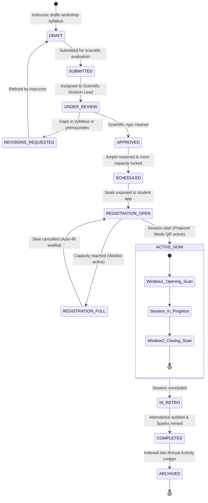
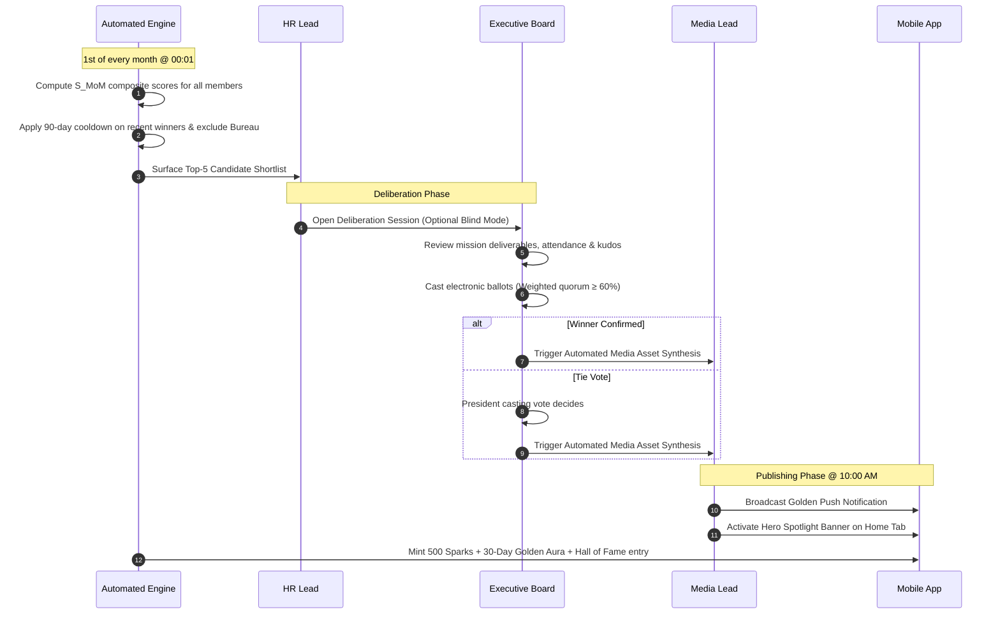

# QUANTERS: Master Sociological, Behavioral & Enterprise Blueprint
## A Deep Academic, Operational, and Architectural Study for QUANTA Scientific Club
**Affiliation:** Faculty of Sciences, University of Algiers 1 Benyoucef Benkhedda (*جامعة الجزائر 1 – بن يوسف بن خدة • كلية العلوم*)  
**Institutional Entity:** QUANTA Scientific Club (*النادي العلمي كوانتا*)  
**Motto:** «المستقبل لنا • THE FUTURE IS OURS»  
**Document Class:** Master Sociological Study, Behavioral Gamification Specification & Enterprise Operations Manual  

---

## Executive Summary & Foundational Paradigm Shift

Running an elite university scientific club at a premier faculty of sciences involves coordinating hundreds of active student members, executing dozens of technical workshops, academic symposia, and research visits, and managing complex logistics across large university amphitheatres and laboratories.

Yet, university scientific clubs in Algeria and globally face an endemic structural pathology: **The "Day-One Euphoria" followed by massive, silent student attrition (75% to 85% drop-off within 4 to 6 weeks)**. 

This master study provides the definitive, scientifically grounded blueprint for the **QUANTERS** mobile and administrative ecosystem. It resolves this systemic crisis through five revolutionary pillars:

1. **The Institutional Mindset Paradigm (التحول من التطوع إلى الفكر المؤسسي والعمليات الاحترافية):** Eliminating the casual, patronizing language of "تطوع" (volunteering) in favor of **«المهام والعمليات» (Missions & Operations)**. Treating students as junior researchers, systems engineers, supply chain managers, and media directors in a pre-professional enterprise.
2. **Student KYC & 5x9 Academic Timetable Heatmaps:** A comprehensive "Know Your Member" profiling engine that maps each student's course schedule (Sunday–Thursday, 08:00–17:00), academic cycle (L1 to PhD), and skill matrix. The platform enforces an **In-Lecture Shield** and **Automated Exam-Mode Freezes**, guaranteeing that the club **never interrupts studies or causes exam guilt**.
3. **Consumer Gamification Benchmarks (Duolingo, Strava, GitHub):** Replacing juvenile arcade tokens with academic prestige:
   - **Duolingo:** Daily loss-aversion streak loops (`🔥`), Archimedes Shields (streak freezes), circadian morning/evening chests, and 30-member Dunbar league cohorts.
   - **Strava:** Peer Kudos, relative effort tracking, and burnout prevention.
   - **GitHub:** 52-week scientific contribution heatmaps and 1-tap portfolio exports for CVs and Master's applications.
4. **The "Member of the Month" (عضو الشهر) Tradition & Top 10 Algorithm:** An equitable, multi-dimensional scoring equation that balances month XP, mission reliability on time, verified attendance punctuality, and peer kudos, combined with a **50% recency dampener** to permanently prevent senior monopoly and celebrate fresh junior talent (Rising Stars).
5. **Member-Initiated QR Attendance Check-In (Member Scans Code):** Eliminating 30-minute door queues. Amphitheatre presentation screens display a 15-second dynamic rolling TOTP QR code that **attendees scan from their seats in seconds**.
6. **Dedicated Admin Platform (QAMP):** A responsive web, tablet, and mobile console for the Executive Board and Cell Leads, featuring **Amphi Projector Mode**, **AMPB Mission Matchmaking**, and a **Skill Badge Verification Desk**.
7. **Absolute Purge of Legalistic Jargon & Bloat:** Zero references to external administrative codes like Law 23-07, and complete elimination of heavy campus GIS maps (FC MAP). Pure, light, and intuitive UI/UX.

---

# 1. Sociology & Organizational Psychology of University Scientific Clubs

## 1.1. Why Do STEM Students Join Scientific Clubs? (The Hidden Drivers)
Students in exact sciences, computer science, physics, biology, chemistry, and mathematics possess an analytical, goal-oriented mindset. Their motivations differ sharply from general student associations:

### A. Bridging the Curricular Deficit (سد الفجوة الأكاديمية)
* **The Reality:** University lecture halls often focus on abstract theory, formal proofs, and dated laboratory scripts.
* **The Need:** Students crave live code, microcontrollers, astronomical telescopes, applied AI models, and real-world experiments. The scientific club acts as an **open applied laboratory** where theoretical concepts take physical form.

### B. Scientific Identity Construction (بناء الهوية العلمية)
* According to Social Identity Theory (Tajfel & Turner), students strive to move from being an anonymous matricule number in an amphitheatre of 400 peers to becoming an active scientific agent: *"I am a quantum computing researcher in QUANTA's physics cell,"* or *"I am an infrastructure lead managing our club platforms."*

### C. Career Equity & Proof of Craft (بناء السيرة الذاتية ومعرض الأعمال)
* Students realize that high academic grades alone no longer guarantee prestigious master's admissions, research scholarships, or tech employment. They join to build a verifiable portfolio: projects completed, workshops taught, and events coordinated.

### D. The Micro-Leadership Incubator (الحاضنة المصغرة للقيادة)
* In a low-risk, supportive environment, students learn project management, stakeholder negotiation, and team coordination—skills never taught in standard science curricula.

---

## 1.2. The Anatomy of Student Attrition: Why Do 80% Drop Out?

Field studies of Algerian student organizations identify four catastrophic failure modes that QUANTERS is specifically designed to eradicate:

```
┌─────────────────────────────────────────────────────────────────────────────┐
│                 THE 4 FATAL TRAPS OF CASUAL STUDENT VOLUNTEERING            │
└──────────────────────────────────────┬──────────────────────────────────────┘
                                       ▼
 ┌───────────────────────┐   ┌───────────────────────┐   ┌───────────────────────┐
 │ 1. Academic Crunch    │   │ 2. WhatsApp Anarchy   │   │ 3. Cheap Free Labor   │
 │ • Lecture conflicts   │   │ • 2:00 AM notifications│  │ • Moving chairs       │
 │ • Exam guilt          │──▶│ • Lost announcements  │──▶│ • Zero credit         │
 │ • Involuntary dropout │   │ • Notification fatigue│   │ • Psychological breach│
 └───────────────────────┘   └───────────────────────┘   └───────────────────────┘
                                       │
                                       ▼
                       ┌───────────────────────────────┐
                       │ 4. Ringelmann Social Loafing  │
                       │ • "Someone else will do it"   │
                       │ • Executive burnout           │
                       └───────────────────────────────┘
```

1. **The Academic & Exam Crunch:**
   - When club activities clash with scheduled lectures, lab practicals (TP), or upcoming examinations, students experience acute **Study Guilt**. If the club requires them to compromise their academic performance, their natural defense mechanism is silent abandonment.
2. **WhatsApp & Telegram Communication Anarchy:**
   - Unregulated messaging groups flood students with hundreds of informal messages, memes, and late-night calls. Crucial assignments get lost. Students mute groups permanently, marking their "organizational death."
3. **The "Cheap Free Labor" Trap (فخ العمالة الرخيصة):**
   - High-potential students join hoping to program robots or design experiments, only to be summoned by executives exclusively to carry furniture, paste posters, or guard doorways. This severe breach of the psychological contract produces deep resentment.
4. **The Ringelmann Effect & Diffusion of Responsibility:**
   - When task requests are broadcast generally into a group (*"Who can help tomorrow?"*), collective responsibility disperses to zero. The same 3–4 executive leaders overwork themselves into burnout, while 200 members remain passive spectators.

---

## 1.3. The Institutional Mindset Paradigm (التحول نحو الفكر المؤسسي)

QUANTERS systematically re-engineers the relationship between student and club:

| Old Casual Volunteering (❌ تطوع عشوائي) | New Institutional Operations (✅ مهام وعمليات كوانترز) |
| :--- | :--- |
| **تطوع / متطوع (Volunteering / Volunteer)** | **مهام وعمليات مؤسسية (Missions & Operations)** |
| **مساعدة عامة (Helping out)** | **إدارة سلاسل الإمداد الميدانية (Field Operations Management)** |
| **منشورات واتساب (WhatsApp callout)** | **تكليف ذكي متطابق مع الجدول (KYC-Matched Task Dispatch)** |
| **ساعات غير موثقة (Uncredited time)** | **سجل كفاءات معتمد ومحفظة إنجازات (Verified Skills & Portfolio)** |
| **إحراج وإجبار (Guilt-tripping)** | **حماية الحصص وتجميد الامتحانات (Academic Protection Shield)** |

---

# 2. Student KYC (Know Your Member) Architecture

The **Student KYC** module transforms anonymous club rosters into an intelligent, responsive operational matrix. It is completed during a 3-minute frictionless onboarding flow and editable in profile settings.

```
                  ┌─────────────────────────────────────────┐
                  │    STUDENT KYC PROFILE ARCHITECTURE     │
                  └────────────────────┬────────────────────┘
                                       │
     ┌───────────────────┬─────────────┴─────────────┬───────────────────┐
     │                   │                           │                   │
┌────┴────────────┐ ┌────┴────────────┐ ┌────────────┴────┐ ┌────────────┴────┐
│ 1. الأكاديميا   │ │ 2. بنك المهارات │ │ 3. الخريطة      │ │ 4. متجهات       │
│ والتحصيل        │ │ والكفاءات       │ │ الحرارية للتوفر │ │ النمو الفردي    │
├─────────────────┤ ├─────────────────┤ ├─────────────────┤ ├─────────────────┤
│• التخصص العلمي  │ │• مهارات تقنية   │ │• شبكة 5×9 أسبوعية│ │• ماذا أريد أن   │
│• الطور (L1-PhD) │ │• مهارات إعلامية │ │• أوقات المحاضرات│ │  أتعلم؟ (Learn) │
│• مؤشر العبء     │ │• مهارات تنظيمية │ │• حظر التشويش    │ │• ماذا أستطيع أن │
│  الدراسي        │ │• مستويات (1-4)  │ │• تجميد الامتحانات│ │  أقدم؟(Deliver) │
└─────────────────┘ └─────────────────┘ └─────────────────┘ └─────────────────┘
```

## 2.1. The 5x9 Academic Availability Heatmap
* **The University Grid:** Corresponds to the standard Algerian academic timetable:
  - **Days (5):** Sunday (الأحد), Monday (الإثنين), Tuesday (الثلاثاء), Wednesday (الأربعاء), Thursday (الخميس).
  - **Slots (9 per day):** 08:00–09:00 through 16:00–17:00.
* **Slot Classifications:**
  - `LECTURE_LOCKED`: Official lectures, TDs, and TPs. The platform places a **hard lock** on this window.
  - `TRANSIT`: Commute and bus hours.
  - `FREE_GAP`: Study breaks and free gaps on campus (ideal for quick micro-tasks or reading digests).
  - `AVAILABLE_OPS`: Time dedicated to active club operations.

## 2.2. The Anti-Crunch & Zero-Distraction Protections
1. **In-Lecture Shield:** The administrative algorithm mathematically excludes any student from mission candidacy if the task overlaps with their locked academic hours.
2. **Nocturnal Quiet Hours (23:00 – 07:30):** The app suppresses all push notifications, alerts, and task broadcasts during nighttime to protect student sleep hygiene.
3. **Automated Exam-Mode Freeze:** Two weeks prior to official university examinations, the club enters stasis. Streaks auto-freeze, mission dispatching halts, and notifications are silenced.
4. **Weekly Workload Cap:** A member can take a maximum of **2 operational missions per week** (total $< 5$ hours), preventing over-commitment.

## 2.3. Dual-Vector Alignment Engine ($\vec{V}_{\text{learn}} \leftrightarrow \vec{V}_{\text{contribute}}$)
To ensure equitable growth, every student defines two vectors:
- $\vec{V}_{\text{learn}}$: Competencies they wish to acquire (e.g. *Quantum Physics modeling, UI/UX design*).
- $\vec{V}_{\text{contribute}}$: Skills they currently offer (e.g. *Python scripting, photography, AV setup*).
*System Rule:* If a member delivers an operational mission from their contribution vector, the system automatically grants them priority access to a workshop from their learning vector.

---

# 3. Consumer Gamification Engine: Benchmarks & Behavioral Mechanics

Rather than superficial casino tokens ("coins"), QUANTERS deploys **academic prestige and institutional mastery**, drawing directly from verified behavioral benchmarks:

```
┌────────────────────────────────────────────────────────────────────────┐
│                   THE THREE BENCHMARK PILLARS                          │
├───────────────────┬───────────────────┬────────────────────────────────┤
│ 1. DUOLINGO       │ 2. STRAVA         │ 3. GITHUB                      │
├───────────────────┼───────────────────┼────────────────────────────────┤
│ • Daily Streaks 🔥 │ • Peer Kudos 👍   │ • 52-Week Contribution Heatmap │
│ • Archimedes Freez│ • Relative Effort │ • Verifiable Proof-of-Craft    │
│ • Diurnal Chests  │ • Anti-Burnout    │ • 1-Tap PDF Portfolio Export   │
│ • 30-Member League│ • Social Validation│ • Academic CV/LinkedIn Credible│
└───────────────────┴───────────────────┴────────────────────────────────┘
```

## 3.1. Duolingo Mechanics Adapted to Science Clubs

### A. The Daily Scientific Streak Loop (`🔥` شعلة كوانتا المستمرة)
* **Behavioral Principle:** Loss Aversion (Kahneman & Tversky). Research shows a 7-day streak makes users **3.6x more likely to remain active long-term**.
* **Atomic Daily Actions (1 per day maintains streak):**
  1. Read the **3-Minute Research Digest** on Tab 2 (*Explore*).
  2. Answer the **Question of the Day (سؤال اليوم العلمي)**.
  3. Scan attendance at a workshop or conference.
  4. Submit an approved deliverable for an active mission.
* **Celebration Milestones:** 7, 30, 100, and 365 days. Unlocks 60fps golden particle bursts, harmonic audio chimes, and a temporary golden profile aura.

### B. The "Shield of Archimedes" (درع أرخميدس — Streak Freezes)
* **The "What-the-Hell Effect" Cure:** Missing one day often causes users to give up entirely. Research proves that streak freezes **reduce churn by 21%**.
* **Acquisition:** Members hold up to **2 Archimedes Shields**. Shields cannot be bought; they are earned by hitting a 14-day streak or receiving 5 distinct peer kudos.
* **Automated Activation:** If no activity is logged by 23:59, a shield auto-activates, freezing the streak with supportive copy:  
  *«لقد حماك درع أرخميدس! لا تقلق بشأن الأمس، شعلتك العلمية لا تزال متقدة اليوم.»*

### C. Circadian Diurnal Chests
* **Morning Dawn Chest (صندوق الإشراق — 07:00 to 12:00):** Completing the Daily Digest before noon unlocks a **2x Sparks Multiplier** for evening activities.
* **Evening Horizon Chest (صندوق الاستكشاف — 18:00 to 22:30):** Evening collaboration or sending peer kudos grants a bonus Spark bundle.

### D. 30-Member Dunbar League Cohorts (دوري كوانتا الأكاديمي)
Global leaderboards with 2,500 members demoralize juniors. QUANTERS uses **Dunbar-Sized Cohorts of 30 members**:
* **5 Tiers:** Subatomic $\rightarrow$ Atomic $\rightarrow$ Molecular $\rightarrow$ Cosmic $\rightarrow$ Quantum League.
* **Weekly Cutoff (Sunday 22:00):** Top 7 promoted, middle 18 safe, bottom 5 relegated.

---

## 3.2. Strava Benchmark: Peer Kudos & Relative Effort
* **The Kudos Button (وسام التقدير):** After a workshop or mission, members can send one peer kudos with scientific tags (*«إتقان لوجستي مبهر»*, *«شرح علمي دقيق»*).
* **Relative Effort:** Monitors load over 14-day rolling windows. If a member's activity exceeds healthy thresholds, the app recommends a mandatory 48-hour rest.

---

## 3.3. GitHub Benchmark: 52-Week Scientific Contribution Heatmap
* Every member profile features a 52-week emerald matrix.
* Attending a session, completing a mission, or publishing a digest lights up green squares.
* **1-Tap Portfolio Export:** Generates an official, beautifully styled PDF/SVG transcript of verified skills and contribution hours for CV and LinkedIn use.

---

## 3.4. "Member of the Month" (عضو الشهر) & Top 10 Recognition Engine

### Why Raw XP Fails (The Senior Monopoly Trap)
In basic gamification, raw XP allows senior executives or students with fewer classes to dominate leaderboards, discouraging first-year students. 

### The Multi-Dimensional Eligibility Algorithm ($S_{\text{MoM}}$)
QUANTERS computes an equitable composite score on the final day of each calendar month:

$$S_{\text{MoM}}(u) = 0.25 \cdot \widetilde{Z}(\text{XP}_{\text{mo}}(u)) + 0.35 \cdot \mathcal{R}_{\text{task}}(u) + 0.25 \cdot \mathcal{A}_{\text{att}}(u) + 0.15 \cdot \mathcal{K}_{\text{kudos}}(u) - \mathbf{\Phi}_{\text{cooldown}}(u)$$

```
┌────────────────────────────────────────────────────────────────────────┐
│             MEMBER OF THE MONTH EVALUATION MATRIX                      │
├─────────────────────────┬───────┬──────────────────────────────────────┤
│ Metric                  │ Weight│ Algorithmic Definition               │
├─────────────────────────┼───────┼──────────────────────────────────────┤
│ Normalized Month XP     │ 25%   │ Month-bounded XP normalized across   │
│                         │       │ the member's academic year cohort    │
├─────────────────────────┼───────┼──────────────────────────────────────┤
│ Mission Reliability     │ 35%   │ (Tasks Done on Time / Tasks Claimed) │
│                         │       │ × (Avg Cell Lead Quality Score / 5)  │
├─────────────────────────┼───────┼──────────────────────────────────────┤
│ Verified Attendance     │ 25%   │ Dynamic QR amphi check-ins           │
│                         │       │ weighted by punctuality factor       │
├─────────────────────────┼───────┼──────────────────────────────────────┤
│ Peer Kudos Index        │ 15%   │ Unique peer endorsements received    │
│                         │       │ (Capped at 3 per peer to stop rings) │
├─────────────────────────┼───────┼──────────────────────────────────────┤
│ Recency Dampener (Φ)    │ DEDUCT│ -50% for winner of last month (m-1)  │
│                         │       │ -25% for winner of 2 months ago (m-2)│
└─────────────────────────┴───────┴──────────────────────────────────────┘
```

### Dual-Bracket Recognition & The Monthly Announcement Ritual
* **عضو الشهر العام (Club MVP):** Open to all members.
* **النجم الصاعد (Rising Star):** Exclusively for L1/L2 newcomers or members joined $< 90$ days.
* **The Ritual (Day 1 of Each Month @ 10:00 AM):**
  1. Synchronized club-wide push notification.
  2. Full-screen celebratory reveal splash with impact stats.
  3. 30-Day digital honors (golden avatar ring + crown icon + spotlight banner on Home).
  4. Permanent induction into the Hall of Fame on Tab 5.

---

# 4. Member-Initiated QR Attendance Check-In Flow

## 4.1. Reversing the Paradigm (Member Scans Code)
* **Old Way (Admin scans attendee):** 30-minute queue outside amphi door; 4–6 organizers stuck acting as gatekeepers; delays event start.
* **QUANTERS Way (Member scans projector):** The presenter projects a dynamic TOTP QR code on the amphi screen. **200+ attendees scan simultaneously from their seats in under 45 seconds.**

```
[ Session Presenter Projects 15s Dynamic TOTP QR on Amphi Screen ]
                          │
         ┌────────────────┴────────────────┐
         │                                 │
[ Student in Row 2 ]              [ Student in Row 20 ]
         │                                 │
  Taps "Scan Check-In"              Taps "Scan Check-In"
         │                                 │
Points Camera at Screen           Points Camera at Screen
         │                                 │
Instant Local TOTP Check          Instant Local TOTP Check
         │                                 │
+150 Sparks & Verified!           +150 Sparks & Verified!
```

## 4.2. End-to-End Scanning Flow & Security Architecture
1. **Trigger:** Student taps `[ 📷 مسح رمز الحضور ]` on Tab 3 (Home).
2. **Viewfinder:** Opens in $< 200\text{ms}$ with targeting reticle and flashlight toggle.
3. **15-Second Dynamic Rotation:** QR code generated via `HMAC-SHA256(SessionSecret, floor(timestamp / 15))`. A photo taken and sent to an absent friend via WhatsApp expires before it can be scanned.
4. **Campus Geofencing:** Device verifies it is physically within the Faculty of Sciences polygon ($\Delta d \le 50\text{m}$, `mock_location == false`).
5. **Dual-Window Gate:** Entry scan (first 10 min) + Exit scan (last 10 min) prevents "scan-and-run" fraud.

---

# 5. Structural Mobile UI/UX Architecture

## 5.1. Deep Analysis: Tab 1 Home vs. Center Tab Home (Tab 3)

The navigation spine must be intuitive, ergonomic, and frictionless:

```
┌────────────────────────────────────────────────────────────────────────┐
│                   NAVIGATION SPINE COMPARATIVE STUDY                   │
├───────────────────┬────────────────────────────────────────────────────┤
│ MODEL A:          │ [Tab 1: Home] [Tab 2: Activities] [Tab 3: Missions]│
│ Classic Tab 1     │ [Tab 4: Explore] [Tab 5: Profile]                  │
│                   │ • Traditional convention, highly familiar.         │
│                   │ • Left-most / Right-most thumb stretch required.  │
├───────────────────┼────────────────────────────────────────────────────┤
│ MODEL B:          │ [Tab 1: Activities] [Tab 2: Explore]               │
│ Ergonomic Center  │ [Tab 3: HOME (Center Anchor)]                      │
│ (RECOMMENDED)     │ [Tab 4: Missions] [Tab 5: Profile]                 │
│                   │ • Exact resting zone of natural thumb arc.         │
│                   │ • Bifurcates app: Discovery Wing vs. Action Wing.  │
│                   │ • Houses the prominent [📷 مسح الحضور] Scanner.   │
└───────────────────┴────────────────────────────────────────────────────┘
```

**Recommendation:** Model B (Center Anchor Home) provides superior one-handed ergonomics on modern large smartphones, perfectly centering the primary daily action: **Scanning the workshop attendance code**.

## 5.2. The 5 Root Tabs

* **Tab 1: الأنشطة (Activities & Workshops):** Segmented control (`الكل`, `ورشات`, `ملتقيات`, `جدولي`). Clean cards showing division tag, amphi, date, capacity bar, and reserve button.
* **Tab 2: آفاق (Explore & Horizons):** Daily 3-minute research digest, student hackathons, laboratory internships, and teammate finder.
* **Tab 3: الرئيسية (Home Hub — Center Anchor):** Daily agenda, Member of the Month spotlight banner, prominent **«مسح رمز الحضور» (Scan Attendance)** button, active mission preview, daily streak counter (`🔥`).
* **Tab 4: المهام والعمليات (Missions & Operations):** Institutional task pool (`لوجستيك`, `إعلام`, `برمجة`, `استقبال`), credit hours, KYC-matched recommendations, Proof-of-Work upload.
* **Tab 5: هويتي (Profile & Quanter Identity):** Virtual Quanter ID card, scientific rank, verified badges gallery, 52-week contribution heatmap, KYC timetable settings.

## 5.3. The 2-Depth Navigation Cap
* **Layer 1:** Root glanceable feeds (max 3 lines of text per card).
* **Layer 2 (Push Screen):** Comprehensive workshop syllabus, speaker bio, full mission briefing.
* **Layer 3 (Contextual Action):** Half-height bottom sheets for 1-tap seat reservation, Proof-of-Work upload, and QR scanning.

---

# 6. The QUANTERS Admin Management Platform (QAMP)

QAMP is the enterprise control plane for the Executive Board and Cell Leads, accessible on desktop, tablet, and mobile browsers:

```
┌──────────────────────────────────────────────────────────────────────────────────┐
│                   QUANTERS ADMIN MANAGEMENT PLATFORM (QAMP)                      │
│                  Web / Tablet (Registration Desk) / Mobile Field                  │
└────────────────────────────────────────┬─────────────────────────────────────────┘
                                         │
    ┌────────────────────────┬───────────┴───────────┬────────────────────────┐
    │                        │                       │                        │
┌───┴────────────────┐ ┌─────┴──────────────┐ ┌──────┴──────────────┐ ┌──────┴─────────────┐
│ 1. WORKSHOPS &     │ │ 2. MISSIONS &      │ │ 3. MEMBER KYC &     │ │ 4. GAMIFICATION &   │
│ ACTIVITIES ENGINE  │ │ OPERATIONS DESK    │ │ INTELLIGENCE DIR    │ │ MOTM ARBITRATION    │
├────────────────────┤ ├────────────────────┤ ├─────────────────────┤ ├─────────────────────┤
│• Multi-Amphi Sched │ │• Task Creator      │ │• 5x9 Avail. Heatmap │ │• S_MoM Calculation  │
│• Projector Mode QR │ │• AMPB Matchmaker   │ │• Skill & Major Gate │ │• Board Blind Ballot │
│• Real-Time Rosters │ │• PoW Review Desk   │ │• Buddy Vitality     │ │• 1-Click Banner Synt│
│• Waitlist Auto-Fill│ │• Hours Crediting   │ │• Anti-Crunch Audit  │ │• Mercy Streak Freeze│
└───┬────────────────┘ └─────┬──────────────┘ └──────┬──────────────┘ └──────┬──────────────┘
    │                        │                       │                       │
    └────────────────────────┴───────────┬───────────┴───────────────────────┘
                                         │
                         ┌───────────────┴───────────────┐
                         │ 5. BADGES & VERIFICATION DESK │
                         │ 6. EXECUTIVE PULSE & ANALYTICS│
                         └───────────────────────────────┘
```

## 6.1. Admin Personas & Role-Based Access Control (RBAC)

QAMP enforces a strict, least-privilege RBAC capability matrix modeling university scientific club governance:

| Administrative Domain | President | VP | Sec Gen | Logistics | Media | Tech | HR | Scientific | Mentor / Instructor |
| :--- | :---: | :---: | :---: | :---: | :---: | :---: | :---: | :---: | :---: |
| **Workshops: Propose & Draft** | ✓ | ✓ | ✓ | ✓ | ✓ | ✓ | ✓ | ✓ | ✓ |
| **Workshops: Scientific Review** | ✓ | ✓ | — | — | — | — | — | ✓ | — |
| **Amphi Capacity & Venue Lock** | ✓ | ✓ | — | ✓ | — | — | — | — | — |
| **Projector Mode: Launch & Command** | ✓ | ✓ | — | ✓ | — | ✓ | — | ✓ | ✓ |
| **Attendance: Live SSE & Override** | ✓ | ✓ | ✓ | ✓ | — | — | — | ✓ | ✓ |
| **Missions: Post Operational Task** | ✓ | ✓ | ✓ | ✓ | ✓ | ✓ | ✓ | ✓ | — |
| **Missions: AMPB Matchmaker Query** | ✓ | ✓ | — | ✓ | ✓ | ✓ | ✓ | — | — |
| **Missions: PoW Review & Hours Credit** | ✓ | ✓ | — | ✓ | ✓ | ✓ | ✓ | ✓ | — |
| **KYC: 5x9 Timetable Explorer** | ✓ | ✓ | ✓ | ✓ | ✓ | ✓ | ✓ | ✓ | Read-Only |
| **MotM: Blind Ballot Electronic Voting** | ✓ (Cast) | ✓ (Vote) | ✓ (Vote) | ✓ (Vote) | ✓ (Vote) | ✓ (Vote) | ✓ (Vote) | ✓ (Vote) | — |
| **MotM: 1-Click Banner Synthesis** | ✓ | ✓ | — | — | ✓ | — | — | — | — |
| **Skill Badges: Rubric & AST Grading** | ✓ | — | — | — | — | ✓ | — | ✓ | ✓ |
| **Skill Badges: W3C Open Badge Mint** | ✓ | — | ✓ | — | — | ✓ | — | ✓ | — |
| **Annual Moral Report: 1-Click Compiler**| ✓ | ✓ | ✓ | — | — | — | — | — | — |

---

## 6.2. Core Admin Modules & Subsystems

### 1. Workshops & Activities Manager
* **Multi-Session Curricula:** Supports linked sessions with configurable attendance prerequisites ($\ge 80\%$ attendance in sessions $1 \dots N-1$ required for final session certification).
* **Amphitheatre Double-Booking Prevention:** Enforces PostgreSQL `btree_gist` temporal range exclusion constraints (`EXCLUDE USING gist (venue_id WITH =, tstzrange(reserved_start, reserved_end, '[)') WITH &&)`).
* **Dynamic Overbooking Algorithm:** Accommodates empirical student attrition ($\delta_{\text{attrition}} \in [0.05, 0.12]$) to optimize hall utilization without fire code violations.

### 2. Amphi Projector Mode (`/admin/projector/[sessionId]`)
* **15-Second Rotating TOTP QR:** Seeded via `HMAC-SHA256(SessionSecret, floor(timestamp / 15))` with a circular SVG countdown ring. Void after 15 seconds, preventing WhatsApp screenshot distribution.
* **Real-Time Scan Telemetry:** WebSockets + Redis Pub/Sub push verified arrivals instantly to the projector display (< 150ms latency).
* **Audio-Visual Scan Burst Animation:**
  - *Canvas Particle Explosion:* 24 kinetic particles radiating from the QR center with physics decay in club colors (`#00E5FF` cyan, `#7C3AED` purple).
  - *Web Audio API Acoustic Chime:* Discrete polyphonic burst ($880\text{Hz}$ fundamental + $1320\text{Hz}$ fifth) synthesized locally in the browser with linear attack and exponential decay.
* **Dual-Window Verification Gate:** Window 1 (Opening 15m) + Window 2 (Closing 10m) ensures physical presence for the full duration of the session.

### 3. Missions & Operations Dispatcher
* **AMPB Matchmaker:** Scores candidates using:
  $$\mathcal{S}(u, m) = 0.30 \mathcal{A}_{\text{skill}} + 0.25 \mathcal{C}_{\text{cell}} + 0.20 \mathcal{L}_{\text{rel}} + 0.15 \sigma_{\text{KYC}} + \mathbf{\Omega}_{\text{buddy}} - \mathbf{\Phi}_{\text{load}}$$
* **Anti-Crunch Fatigue Dampener ($\mathbf{\Phi}_{\text{load}}$):** Automatically penalizes volunteers with $\ge 2$ shifts in the last 7 days ($-0.40 \times (N - 1)$), protecting study time and preventing burnout.
* **Deliverable Review Desk:** Evaluates uploaded Proof-of-Work (photos, Git PRs, vouchers) with a 5-point quality scale and triggers atomic crediting of certified service hours.

### 4. Member KYC Intelligence Directory & 5x9 Heatmap Explorer
* **5x9 Free-Student Density Matrix:** Maps Sunday–Thursday across 9 daily pedagogical slots (08:00 to 22:00).
* **1-Click Free Member Dispatch:** Clicking any cell (e.g. *Tuesday 14:20*) executes a sub-50ms indexed query returning all active members with zero lecture conflicts, enabling rapid emergency deployment.

### 5. Gamification & MotM Arbitration Desk
* **Automated $S_{\text{MoM}}$ Scoring:** Computes composite scores on the 1st of each month at 00:01 with a $50\%$ recency dampener on previous winners.
* **Anonymized Blind Deliberation Ballot:** Masks candidate names into synthetic handles ("Candidate Alpha", "Candidate Beta") during board voting to eliminate personal bias.
* **1-Click Branded Announcement Synthesizer:** Renders high-resolution social assets (Instagram Feed 1080x1080, Story 1080x1920, LinkedIn 1200x627) with dark nebula styling, gold borders, and cryptographic verification QR in under 3 seconds.

### 6. Skill Badges & Verification Desk
* **Dual Certification Tracks:** Track A (Applied Capstone Project with $\ge 80\%$ attendance) & Track B (Timed 60-minute Proctored Exam $\ge 85\%$).
* **Track A 4-Axis Rubric:** Architecture (25 pts), Accuracy & Tests (25 pts), Reproducibility & Docker (25 pts), Polish & Docs (25 pts).
* **AST Code Plagiarism Radar:** Normalizes source code into Abstract Syntax Trees, strips cosmetic variations, and runs Winnowing N-gram hashing to detect structural copying across cohorts.
* **W3C Open Badges v3.0 Minting:** Issues cryptographically signed JSON-LD verifiable credentials utilizing Ed25519 institutional keys.

### 7. Club Analytics & Annual Moral Report (التقرير الأدبي) Compiler
* **Real-Time Retention Survival Curves ($S(t)$):** Diagnoses cell attrition velocity and detects disengagement trends before volunteer drop-off.
* **1-Click Official Report Compiler:** Synthesizes the official 60+ page bilingual (Arabic/French) annual moral report with verified activity rosters, room bookings, credited hours, and digital board signatures ready for the Faculty Deanship.

---

# 7. BPMN 2.0 Workflows & State Machines

## 7.1. Workshop Creation to Completion Lifecycle


## 7.2. Member of the Month Selection Lifecycle


---

# 8. PostgreSQL Enterprise Relational Schema

```sql
-- Core Schema for QUANTERS Mobile & QAMP Console
CREATE EXTENSION IF NOT EXISTS "uuid-ossp";
CREATE EXTENSION IF NOT EXISTS "pgcrypto";

CREATE TYPE member_role_enum AS ENUM (
    'MEMBER', 'OPERATIONS_LEAD', 'CELL_LEAD', 'INSTRUCTOR', 'BUREAU_MEMBER', 'SUPER_ADMIN'
);

CREATE TYPE event_status_enum AS ENUM (
    'DRAFT', 'SUBMITTED', 'UNDER_REVIEW', 'REVISIONS_REQUESTED',
    'APPROVED', 'SCHEDULED', 'REGISTRATION_OPEN', 'ACTIVE_NOW',
    'IN_RETRO', 'COMPLETED', 'ARCHIVED', 'CANCELLED'
);

CREATE TYPE mission_status_enum AS ENUM (
    'DRAFT', 'OPEN', 'ASSIGNED', 'CONFIRMED', 'IN_PROGRESS',
    'PENDING_VERIFICATION', 'VALIDATED', 'REWARDED', 'NO_SHOW', 'CANCELLED'
);

-- Members Table
CREATE TABLE members (
    member_id UUID PRIMARY KEY DEFAULT gen_random_uuid(),
    student_matricule_masked VARCHAR(16) NOT NULL, -- '2023****849'
    first_name VARCHAR(64) NOT NULL,
    last_name VARCHAR(64) NOT NULL,
    email VARCHAR(255) UNIQUE NOT NULL,
    phone_number VARCHAR(32) NOT NULL,
    department VARCHAR(128) NOT NULL,
    academic_level VARCHAR(32) NOT NULL, -- 'L1', 'L2', 'L3', 'M1', 'M2', 'Doctorate'
    role member_role_enum DEFAULT 'MEMBER',
    sparks_balance INT DEFAULT 0 CHECK (sparks_balance >= 0),
    level INT DEFAULT 1 CHECK (level BETWEEN 1 AND 30),
    active_streak_days INT DEFAULT 0 CHECK (active_streak_days >= 0),
    archimedes_shields INT DEFAULT 1 CHECK (archimedes_shields BETWEEN 0 AND 2),
    last_activity_date DATE,
    buddy_partner_id UUID REFERENCES members(member_id) ON DELETE SET NULL,
    total_credited_hours NUMERIC(6, 2) DEFAULT 0.00,
    is_exam_freeze BOOLEAN DEFAULT FALSE,
    is_active BOOLEAN DEFAULT TRUE,
    created_at TIMESTAMPTZ DEFAULT CURRENT_TIMESTAMP
);

-- KYC 5x9 Academic Timetable Slots
CREATE TABLE member_availability_slots (
    slot_id UUID PRIMARY KEY DEFAULT gen_random_uuid(),
    member_id UUID NOT NULL REFERENCES members(member_id) ON DELETE CASCADE,
    day_of_week INT NOT NULL CHECK (day_of_week BETWEEN 0 AND 4), -- 0=Sun, 4=Thu
    start_time TIME NOT NULL,
    end_time TIME NOT NULL,
    is_available BOOLEAN DEFAULT TRUE,
    UNIQUE (member_id, day_of_week, start_time)
);

-- Workshops & Events
CREATE TABLE events (
    event_id UUID PRIMARY KEY DEFAULT gen_random_uuid(),
    title VARCHAR(255) NOT NULL,
    slug VARCHAR(255) UNIQUE NOT NULL,
    category VARCHAR(64) NOT NULL,
    division_code VARCHAR(32) NOT NULL,
    abstract TEXT NOT NULL,
    venue_name VARCHAR(128) NOT NULL,
    max_capacity INT NOT NULL CHECK (max_capacity > 0),
    status event_status_enum DEFAULT 'DRAFT' NOT NULL,
    base_sparks INT DEFAULT 100,
    start_date TIMESTAMPTZ NOT NULL,
    end_date TIMESTAMPTZ NOT NULL,
    created_at TIMESTAMPTZ DEFAULT CURRENT_TIMESTAMP
);

-- Sessions & Dynamic Projector TOTP Key
CREATE TABLE sessions (
    session_id UUID PRIMARY KEY DEFAULT gen_random_uuid(),
    event_id UUID NOT NULL REFERENCES events(event_id) ON DELETE CASCADE,
    session_number INT DEFAULT 1,
    title VARCHAR(255) NOT NULL,
    instructor_name VARCHAR(128) NOT NULL,
    start_time TIMESTAMPTZ NOT NULL,
    end_time TIMESTAMPTZ NOT NULL,
    totp_secret_key VARCHAR(64) NOT NULL,
    is_kiosk_active BOOLEAN DEFAULT FALSE
);

-- Dynamic Attendance Records (Member Scans Code)
CREATE TABLE attendance_records (
    record_id UUID PRIMARY KEY DEFAULT gen_random_uuid(),
    session_id UUID NOT NULL REFERENCES sessions(session_id) ON DELETE CASCADE,
    member_id UUID NOT NULL REFERENCES members(member_id) ON DELETE CASCADE,
    entry_scan_at TIMESTAMPTZ NOT NULL,
    exit_scan_at TIMESTAMPTZ,
    is_geofence_verified BOOLEAN DEFAULT TRUE,
    sparks_awarded INT DEFAULT 0,
    UNIQUE (session_id, member_id)
);

-- Mission Tasks & Deliverables
CREATE TABLE mission_tasks (
    task_id UUID PRIMARY KEY DEFAULT gen_random_uuid(),
    event_id UUID REFERENCES events(event_id) ON DELETE SET NULL,
    title VARCHAR(255) NOT NULL,
    description TEXT NOT NULL,
    operational_domain VARCHAR(64) NOT NULL,
    required_slots INT DEFAULT 1,
    base_sparks INT DEFAULT 150,
    credited_hours NUMERIC(4, 2) DEFAULT 2.00,
    start_window TIMESTAMPTZ NOT NULL,
    end_window TIMESTAMPTZ NOT NULL,
    status mission_status_enum DEFAULT 'OPEN' NOT NULL
);

CREATE TABLE volunteer_assignments (
    assignment_id UUID PRIMARY KEY DEFAULT gen_random_uuid(),
    task_id UUID NOT NULL REFERENCES mission_tasks(task_id) ON DELETE CASCADE,
    member_id UUID NOT NULL REFERENCES members(member_id) ON DELETE CASCADE,
    status mission_status_enum DEFAULT 'ASSIGNED' NOT NULL,
    proof_of_work_uri VARCHAR(512),
    quality_score INT CHECK (quality_score BETWEEN 1 AND 5),
    evaluation_feedback TEXT,
    hours_logged NUMERIC(4, 2) DEFAULT 0.00,
    sparks_granted INT DEFAULT 0,
    UNIQUE (task_id, member_id)
);

-- Member of the Month Registry
CREATE TABLE motm_cycles (
    cycle_id UUID PRIMARY KEY DEFAULT gen_random_uuid(),
    cycle_month DATE NOT NULL,
    category VARCHAR(32) DEFAULT 'GLOBAL_MVP',
    winner_member_id UUID REFERENCES members(member_id),
    composite_score NUMERIC(8, 4),
    citation_text TEXT,
    announced_at TIMESTAMPTZ,
    UNIQUE (cycle_month, category)
);

-- High-Performance Indexes
CREATE INDEX idx_avail_slot ON member_availability_slots(day_of_week, start_time) WHERE is_available = TRUE;
CREATE INDEX idx_events_stat ON events(status);
CREATE INDEX idx_att_sess ON attendance_records(session_id);
CREATE INDEX idx_tasks_stat ON mission_tasks(status);
CREATE INDEX idx_mem_streak ON members(active_streak_days) WHERE is_active = TRUE;
```

---

# 9. Conclusion & Operational Roadmap

By rejecting casual, patronizing volunteering and embracing **Missions & Operations**, protecting student course schedules with **Student KYC Availability Heatmaps**, establishing habit-forming **Duolingo/Strava/GitHub gamification**, and enabling seamless **Member-Initiated QR Check-In**, the **QUANTERS** platform ensures that QUANTA Scientific Club operates with the speed, precision, and prestige of a world-class student research enterprise.
