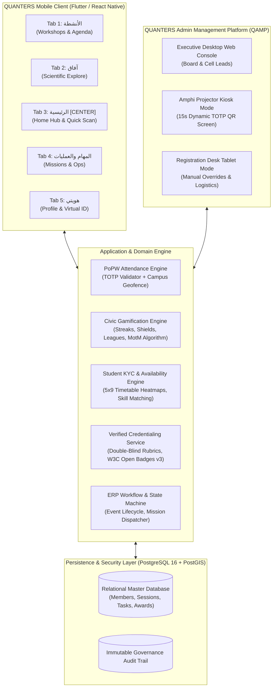
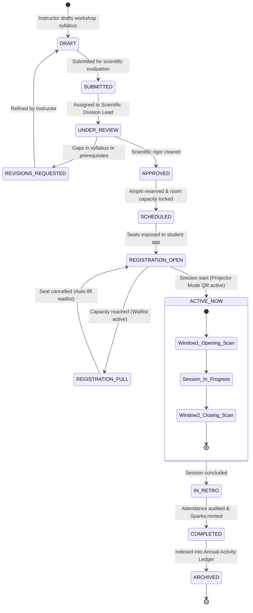
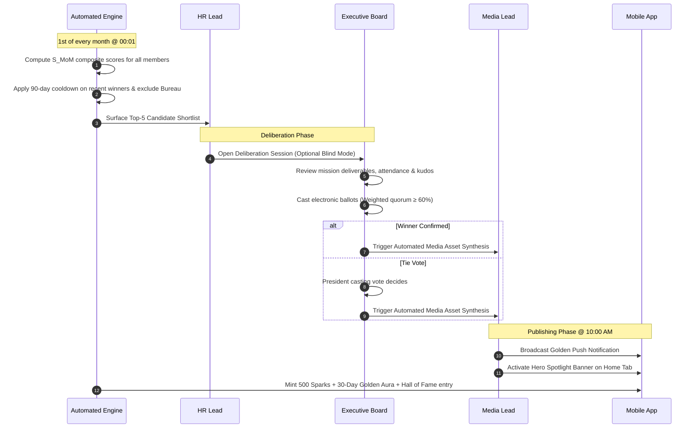

# QUANTERS Mobile Ecosystem & Admin Operations Platform: Master Strategic Blueprint
## Comprehensive Study, Structural UI/UX, Civic Gamification & Enterprise ERP Specification
**Target Entity:** QUANTA Scientific Club (*النادي العلمي كوانتا*)  
**Host Institution:** Faculty of Sciences, University of Algiers 1 Benyoucef Benkhedda (*جامعة الجزائر 1 – بن يوسف بن خدة • كلية العلوم*)  
**Motto:** «المستقبل لنا • THE FUTURE IS OURS»  
**Document Class:** System Implementation Plan & Technical Master Specification  

---

## Executive Overview & Strategic Mission

The **QUANTERS** platform is an institutional-grade, mobile-first ecosystem engineered for the **QUANTA Scientific Club** at the Faculty of Sciences (University of Algiers 1). Its primary mission is to transform student participation in university scientific clubs from fragmented, unorganized messaging channels, paper rosters, and ephemeral attendance into an accredited, professional, and habit-forming personal scientific journey.

### Foundational Directives Applied in this Blueprint:
1. **Zero Legalistic Jargon:** Complete removal of all external legalistic codes (specifically Law 23-07). The focus is entirely on student empowerment, institutional autonomy, academic prestige, and real-world project portfolios.
2. **The Center-Anchor Navigation Spine:** Reconfiguration of the primary mobile navigation so that **Home (الرئيسية) sits at Tab 3 (the exact center)** within a balanced 5-tab thumb-zone layout: `[1: الأنشطة (Activities) | 2: آفاق (Explore) | 3: الرئيسية (Home - Center) | 4: المهام والعمليات (Missions) | 5: هويتي (Profile)]`.
3. **Elimination of UI Bloat & Cognitive Overload:** Stripping out heavy features like campus GIS/FC maps and deep nested menus. Strict **2-depth navigation cap** with contextual bottom sheets.
4. **Member-Initiated QR Attendance Check-In:** Reversing traditional door bottlenecks. The amphitheatre projector screen broadcasts a 15-second dynamic rolling TOTP QR code; **the student scans the code from their seat** using their phone camera, minting instant attendance and XP in under 150ms.
5. **From Casual "Volunteering" to Institutional Operations:** Eliminating the patronizing language of "تطوع" in favor of **«المهام والعمليات» (Missions & Operations)**, treating STEM students as junior researchers, software engineers, event operations directors, and scientific project managers.
6. **Student KYC & Academic Availability Heatmaps:** Capturing each member's academic specialty, year of study (L1–Doctorate), skills taxonomy, and weekly course timetable (Sunday–Thursday, 08:00–17:00) so the platform **never interrupts lectures or schedules tasks during exams**.
7. **Consumer Gamification Benchmarks (Duolingo, Strava, GitHub):** Daily loss-aversion streak loops (`🔥`), Archimedes Shields (streak freezes), circadian morning/evening chests, 30-member Dunbar-sized league ladders, a multi-dimensional **Member of the Month (عضو الشهر)** algorithm, and GitHub-style 52-week scientific contribution heatmaps.
8. **Dedicated Admin Management Platform (QAMP):** A responsive web, tablet, and mobile console for the Executive Board (President, VP, Secretary General) and Cell Leads (Logistics, Media, Tech, HR, Scientific Committees) to manage workshops, project live QR codes on amphi screens, dispatch missions, verify deliverables, and moderate badges.

---

## User Review Required

> [!IMPORTANT]
> **Key Architectural Approvals for Strategic Alignment:**
> 1. **5-Tab Navigation Layout with Center Home (Tab 3):**
>    - `Tab 1: الأنشطة (Activities)` $\rightarrow$ Workshops, scientific symposiums, hackathons, and personal schedule.
>    - `Tab 2: آفاق (Explore)` $\rightarrow$ Daily scientific digests, research breakthroughs, national competitions, internships, and scholarships.
>    - `Tab 3: الرئيسية (Home - Center Anchor)` $\rightarrow$ Today's agenda, Member of the Month spotlight, prominent **«مسح رمز الحضور» (Scan Attendance)** button, active mission preview, daily streak counter.
>    - `Tab 4: المهام والعمليات (Missions & Operations)` $\rightarrow$ Institutional task pool, cell projects, contribution hours, claim a role, deliverable submission.
>    - `Tab 5: هويتي (Profile & Quanter Identity)` $\rightarrow$ Virtual Quanter ID card, scientific rank, verified badges gallery, 52-week contribution heatmap, KYC availability settings.
> 2. **Member-Scans-Code Attendance Flow:** Attendees scan a 15-second dynamic rolling TOTP QR code projected on the amphi screen. Organizers do not scan attendees at the door.
> 3. **The "Member of the Month" (عضو الشهر) Multi-Dimensional Algorithm:** Calculated automatically using normalized month XP (25%), mission reliability on time (35%), verified attendance punctuality (25%), and peer kudos (15%), with a 50% recency penalty on previous winners to prevent senior monopoly.
> 4. **Dedicated Admin Platform (QAMP):** Standalone web/tablet console featuring Projector Mode (`/admin/projector/[sessionId]`), Mission Dispatcher with KYC availability matching, and Skill Badge Verification Desk.

---

## Open Questions

> [!NOTE]
> 1. **Student Onboarding Verification:** During initial KYC setup, should membership be approved automatically upon submitting university matricule and study timetable, or should the HR Cell review and approve newcomers before unlocking cell missions?
> 2. **Member of the Month Announcement Timing:** We currently specify the reveal on the **1st of each month at 10:00 AM** with a synchronized push notification and 30-day profile flair. Does this timing align with the club's monthly executive meeting cadence?
> 3. **Projector Screen Fallback:** For smaller classrooms or laboratory workshops without a projector, do you prefer a static laminated QR stand with Bluetooth Low Energy (BLE) proximity check, or should the session instructor display the dynamic QR code on their tablet/laptop screen?

---

## Proposed System Architecture & Ecosystem Topology



---

## 1. Structural UI/UX Architecture: The Center-Anchor Model

### 1.1. Ergonomic Foundation & The Thumb Zone
Positioning **Home (الرئيسية) at Tab 3 (the exact center)** aligns with mobile ergonomics and natural thumb sweep arcs (Steven Hoober thumb-zone research):
* **Tab 3 (Center)** is the neutral resting zone of the human thumb on both right-handed and left-handed grips.
* It bifurcates the app into two thematic wings:
  * **The Discovery Wing (Right-to-Left leading):** Tab 1 (الأنشطة - Activities) & Tab 2 (آفاق - Explore).
  * **The Center Anchor:** Tab 3 (الرئيسية - Home / Mission Control).
  * **The Execution Wing (Trailing):** Tab 4 (المهام والعمليات - Missions & Ops) & Tab 5 (هويتي - Profile & Identity).

```
   [ Discovery Wing ]         [ Center Anchor ]        [ Execution & Identity ]
 ┌──────────────────────┐  ┌─────────────────────┐  ┌──────────────────────────┐
 │ Tab 1: الأنشطة       │  │ Tab 3: الرئيسية     │  │ Tab 4: المهام والعمليات  │
 │ (Workshops & Agenda) │  │ (Home Hub & Scanner)│  │ (Cell Tasks & Ops Pool)  │
 │                      │  │                     │  │                          │
 │ Tab 2: آفاق          │  │ [Center Action:     │  │ Tab 5: هويتي             │
 │ (Scientific Explore) │  │  📷 مسح رمز الحضور] │  │ (Virtual ID, Skills, KYC)│
 └──────────────────────┘  └─────────────────────┘  └──────────────────────────┘
```

### 1.1.1. Comparative Analysis: Model A (Tab 1 Home) vs. Model B (Tab 3 Center Home)

To ensure complete clarity regarding the navigation spine, we compare the two primary structural models:

| Navigation Dimension | Model A: Classic Tab 1 as Home | Model B: Ergonomic Center Anchor (Tab 3) [Recommended] |
| :--- | :--- | :--- |
| **Tab Ordering (5 Tabs)** | `[1: الرئيسية (Home) \| 2: الأنشطة \| 3: المهام \| 4: آفاق \| 5: هويتي]` | `[1: الأنشطة \| 2: آفاق \| 3: الرئيسية (Home) \| 4: المهام \| 5: هويتي]` |
| **Thumb Reachability** | Sub-optimal for single-hand use; requires thumb stretching to the edge. | Optimal; sits directly in the resting zone of natural thumb arcs on large phones. |
| **Bifurcated Mental Model** | Linear list without thematic symmetry. | **Discovery Wing** (Activities + Explore) on the right/left, **Execution Wing** (Missions + Profile) on the other. |
| **QR Check-In Integration** | Requires either a floating action button (FAB) or deep menu navigation. | The center Home tab hosts the prominent `[ 📷 مسح رمز الحضور ]` quick scanner button. |
| **Familiarity** | High (traditional utility apps). | High in modern engagement apps (Instagram, TikTok, BeReal, Strava). |

*Note: The platform's modular component architecture allows effortlessly switching between Model A and Model B via a simple configuration flag if preferred.*

### 1.2. Tab-by-Tab Detailed Screen Specifications

#### Tab 1: الأنشطة (Activities & Workshops)
* **Header Segmented Control:** `[الكل (All) | ورشات علمية (Workshops) | ملتقيات ومؤتمرات (Conferences) | جدولي المسجل (My Schedule)]`.
* **Feed Architecture:** Clean, linear cards (no complex calendar grids).
  * *Card Anatomy:* Event title, Scientific division tag (`SCI_CS`, `SCI_PHYS`, etc.), amphitheatre/lab venue, date & time, instructor avatar, seat capacity progress bar (`142/200 مقعد`), and registration status badge.
* **Workshop Detail View (Push Screen - Layer 2):**
  * Pedagogical abstract and prerequisites.
  * Instructor bio and credentials.
  * Attached skill badge preview (e.g. *Quantum Computing Specialist*).
  * Sticky Footer CTA: `[حجز مقعد الآن (Reserve Seat)]` or `[في قائمة الانتظار (On Waitlist)]`.

#### Tab 2: آفاق (Scientific Explore & Opportunities)
* **Header Filter Chips:** `[الموجز اليومي (Daily Digest) | مسابقات وهاكاثونات (Hackathons) | منح تدريبية (Internships) | بحوث ومشاريع (Research)]`.
* **Daily 3-Minute Research Digest:** Verified, high-impact scientific synthesis written by the club's scientific committees (reading this maintains the member's daily streak `🔥`).
* **Opportunity Cards:** Verified student competitions, national hackathons, and research laboratory internships (CRAAG, CDTA, university labs).
* **1-Tap Share & Team Builder:** Button to find fellow club members to form hackathon teams based on complementary KYC skills.

#### Tab 3: الرئيسية (Home Hub — The Center Anchor)
* **Top Status Strip:**
  * Greeting with Quanter Guild Rank (`زميل باحث • Research Fellow`).
  * Active Streak Flame: `🔥 14 يوماً` (tapping reveals Archimedes Shield status: `🛡️ 2/2`).
  * Notification Bell with unread counter.
* **Member of the Month (عضو الشهر) Spotlight Banner:**
  * Elegant, non-intrusive card featuring the reigning member's photo, laurel wreath badge, academic department, and major monthly achievement.
  * 1-Tap `[إرسال تهنئة (Send Kudos)]` button.
* **Primary Quick Action Center:**
  * Prominent, thumb-accessible scanning button:  
    `[ 📷 مسح رمز حضور الورشة / Scan Workshop Check-In ]`  
    *Tapping opens the camera viewfinder immediately (< 200ms).*
* **Today’s Academic Agenda (نبض اليوم):**
  * Dynamic widget showing upcoming workshop or active task if enrolled for today.
  * If no event today: Displays the **Question of the Day (سؤال اليوم العلمي)** for a quick +25 Sparks micro-win.
* **Active Mission Progress:**
  * Direct access to any claimed operational task with countdown timer and deliverable upload shortcut.
* **Circadian Chest Reminder:** Indicates whether the Morning Dawn or Evening Horizon chest is ready to unlock.

#### Tab 4: المهام والعمليات (Missions & Operations)
* **Rebranding Header:** Institutional focus: *«منصة العمل المؤسسي والمهام التنفيذية»*.
* **Filter Tabs:** `[المهام المتاحة (Open Tasks) | مهامي الحالية (My Active Missions) | أرشيف الإنجاز (Completed)]`.
* **Task Card Anatomy:**
  * Operational Domain Tag: `لوجستيك وقاعات (Logistics)`, `إعلام وتصميم (Media/Design)`, `برمجة وأنظمة (IT/Systems)`, `استقبال وتوجيه (Protocol)`.
  * Workload Credit: Estimated hours (e.g. `2.5 ساعة معتمدة`), XP reward (`+120 نقطة`).
  * Time Window: e.g., `الثلاثاء: 13:00 - 15:30` (matched against user's KYC timetable).
  * Status: `مفتوح للتكليف (Open)` or `مكتمل (Filled)`.
* **Mission Execution Sheet (Bottom Sheet):**
  * Detailed mission briefing, cell leader in charge, checklist of deliverables.
  * `[تسليم تقرير المهمة / Submit Proof of Work]`: Upload event photos, design links, or GitHub commits for lead validation.

#### Tab 5: هويتي (Profile & Quanter Identity)
* **Virtual Quanter Identity Card (بطاقة العضوية الرقمية):**
  * High-polish digital card with university crest and club seal.
  * Member Full Name, Masked Student ID (`2023****849`), Department, Current Rank, and total verified hours.
  * Dynamic security holographic watermark.
* **Academic Growth Gauges:**
  * Total Quanta Sparks (`3,450 XP`) & Guild Rank progress bar.
  * **52-Week Scientific Contribution Heatmap** (GitHub-style green matrix of daily scientific activities and missions).
* **Verified Skill Badges Gallery:**
  * Grid of earned micro-credentials (e.g. *Python for Scientific Computing, Telescope Optics, Event Stage Manager*).
  * Tapping a badge displays its cryptographic verification hash and peer review score.
* **Student KYC & Academic Timetable Shortcut:**
  * Direct access to edit weekly course schedule and skills inventory.
  * 1-Tap `[تصدير السجل الأكاديمي (Export Portfolio PDF)]` for LinkedIn and CV attachments.

---

## 2. Student Behavioral Psychology & The Institutional Mindset Paradigm

### 2.1. The Root Causes of University Club Attrition
Sociological and organizational studies of Algerian STEM students reveal why casual volunteering programs fail:
1. **The "Day-One Euphoria" Collapse:** Newcomers join with immense enthusiasm during annual club open doors, but participation crashes by **75% to 85% within the first 4 to 6 weeks**.
2. **Academic & Exam Crunch Conflict:** The absolute priority of university students is passing exams and maintaining their GPA. When clubs schedule tasks during lecture hours or exam weeks, students choose their studies and drop out.
3. **The "Cheap Free Labor" Dilemma:** When tasks feel menial (e.g. moving chairs, passing water bottles) without skill development or public recognition, students feel exploited.
4. **Communication Noise:** Endless, chaotic WhatsApp and Telegram groups drown important assignments in chatter, causing information fatigue.

### 2.2. The Institutional Mindset Paradigm (التحول نحو الفكر المؤسسي)
QUANTERS systematically re-engineers club culture through semantic and operational reframing:

| Casual Volunteering Paradigm (❌ القديم) | Institutional Operations Paradigm (✅ كوانترز) |
| :--- | :--- |
| **تطوع عشوائي (Casual Volunteering)** | **مهام وعمليات مؤسسية (Missions & Operations)** |
| **متطوع (Volunteer)** | **عضو كوانتر / باحث تنفيذي (Quanter / Executive Lead)** |
| **مساعدة في الورشة (Helping out)** | **إدارة العمليات الميدانية (Field Operations Management)** |
| **ساعات تطوع بلا قيمة (Uncredited hours)** | **سجل كفاءات معتمد ومحفظة إنجازات (Verified Portfolio & Hours)** |
| **رسائل واتساب متفرقة (WhatsApp chaos)** | **نظام تكليف ذكي مطابق للجدول (KYC-Matched Task Dispatching)** |

Every mission in QUANTERS is treated as a **junior professional internship project**, building skills in:
- *Operations & Supply Chain:* Amphitheatre crowd dynamics, technical audio-visual staging, equipment inventory.
- *Media & Brand Communications:* Science journalism, technical videography, social media analytics.
- *Software & Infrastructure:* Systems engineering, mobile platform administration, AST code plagiarism auditing.
- *Scientific Pedagogy:* Syllabus design, lab demonstrations, technical peer reviews.

### 2.3. Student KYC (Know Your Member) Architecture
During initial onboarding and accessible via profile settings, every member completes a 3-step KYC profile:

```
┌────────────────────────────────────────────────────────────────────────┐
│                   STUDENT KYC ARCHITECTURE                            │
├────────────────────────────────────────────────────────────────────────┤
│ 1. Academic & Specialization Profile                                   │
│    • Department: Computer Science, Physics, Chemistry, Math, Biology   │
│    • Academic Cycle: Licence (L1, L2, L3) | Master (M1, M2) | PhD      │
│    • Student Matricule: Masked for privacy (e.g. 2024****419)          │
├────────────────────────────────────────────────────────────────────────┤
│ 2. The 5x9 Academic Timetable & Availability Heatmap                   │
│    • Weekly Grid: Sunday through Thursday (08:00 to 17:00)             │
│    • Course Hours: Students block out lectures, TDs, and TP sessions   │
│    • Free Windows: Highlights times available for club missions        │
│    • EXAM CRUNCH LOCK: 2 weeks prior to midterms/finals, the platform   │
│      automatically locks mission dispatching for the student!          │
├────────────────────────────────────────────────────────────────────────┤
│ 3. Skills Taxonomy & Personal Growth Objectives                        │
│    • Technical: Python, C++, Data Analysis, Robotics, Bio-stats        │
│    • Creative: Graphic Design, Motion Graphics, Photography, Writing   │
│    • Organizational: Event Moderation, Logistics, Public Speaking      │
│    • Growth Vector: What does the student want to learn this year?     │
└────────────────────────────────────────────────────────────────────────┘
```

---

## 3. Gamification Engine: Benchmarks & Mechanics

### 3.1. Duolingo Mechanics Adapted to Science Clubs

#### The Daily Scientific Streak Loop (`🔥` شعلة كوانتا)
* **Psychological Hook:** Loss aversion (Kahneman & Tversky). Maintaining a continuous streak creates a daily identity habit.
* **Qualifying Actions (1 per day maintains streak):**
  1. Reading the **3-Minute Research Digest** on Tab 2 (*Explore*).
  2. Answering the **Daily Scientific Challenge (سؤال اليوم)**.
  3. Scanning attendance at a workshop or seminar.
  4. Submitting an approved deliverable for an active mission.
* **Milestones Celebrations:** 7 days, 30 days, 100 days, and 365 days. Hitting milestones triggers a 60fps golden particle celebration, a special audio chime, and a temporary profile ring flair.

#### The "Shield of Archimedes" (درع أرخميدس — Streak Freezes)
* Prevents the demoralizing "What-the-hell Effect" where users abandon the app after a single missed day.
* **Inventory & Acquisition:** Members hold up to **2 Shields of Archimedes**. Shields are minted exclusively through academic milestones (e.g. completing a 14-day streak or earning 5 peer kudos in a week).
* **Automated Activation:** If a member logs zero activity by 23:59, the system consumes one shield, marks the day as "Frozen" (`❄️`), and sends encouraging micro-copy:  
  *«لقد حماك درع أرخميدس! لا تقلق، شعلتك العلمية لا تزال متقدة اليوم.»*

#### Exam-Mode Auto-Freeze (تجميد الامتحانات الأكاديمي)
* During the Faculty of Sciences examination sessions, all streaks, daily countdowns, and league relegations **automatically pause club-wide**.
* Notifications are completely suppressed to ensure zero guilt and full academic focus.

#### Circadian Morning & Evening Chests (صناديق الدورة الحيوية)
* **صندوق الإشراق الصباحي (Morning Dawn Chest - 07:00 to 12:00):** Completing the Daily Digest before noon grants a **2x Sparks Multiplier** for evening activities.
* **صندوق الاستكشاف المسائي (Evening Horizon Chest - 18:00 to 22:30):** Evening collaboration or sending peer kudos unlocks a Quanta Spark Bundle.
* **Academic Quiet Hours (فترة الهدوء الأكاديمي - 23:00 to 07:30):** App strictly mutes all alerts and push notifications to protect sleep hygiene.

### 3.2. 30-Member League Cohorts (دوري كوانتا الأكاديمي)
Rather than a demoralizing global leaderboard with thousands of members, QUANTERS implements **Dunbar-Sized Cohort Matchmaking** (30 members per bracket):
* **Weekly Cycle:** Monday 00:00 to Sunday 22:00.
* **5 Tiers:** Subatomic $\rightarrow$ Atomic $\rightarrow$ Molecular $\rightarrow$ Cosmic $\rightarrow$ Quantum League.
* **Weekly Cutoff:**
  * Top 7: Promoted to the higher tier.
  * Middle 18: Safe Zone.
  * Bottom 5: Relegated to lower tier (unless protected by Exam Freeze).

### 3.3. "Member of the Month" (عضو الشهر) & Top 10 Algorithm

#### The Multi-Factor Scoring Formula ($S_{\text{MoM}}$)
Pure XP leaderboards suffer from the "Seniority Monopoly" (veterans dominating juniors). QUANTERS deploys an equitable, multi-factor equation:

$$S_{\text{MoM}}(u) = 0.25 \cdot \widetilde{Z}(\text{XP}_{\text{mo}}(u)) + 0.35 \cdot \mathcal{R}_{\text{task}}(u) + 0.25 \cdot \mathcal{A}_{\text{att}}(u) + 0.15 \cdot \mathcal{K}_{\text{kudos}}(u) - \mathbf{\Phi}_{\text{cooldown}}(u)$$

```
┌────────────────────────────────────────────────────────────────────────┐
│             MEMBER OF THE MONTH EVALUATION MATRIX                      │
├─────────────────────────┬───────┬──────────────────────────────────────┤
│ Metric                  │ Weight│ Algorithmic Definition               │
├─────────────────────────┼───────┼──────────────────────────────────────┤
│ Normalized Month XP     │ 25%   │ Month-bounded XP normalized across   │
│                         │       │ the member's academic year cohort    │
├─────────────────────────┼───────┼──────────────────────────────────────┤
│ Mission Reliability     │ 35%   │ (Tasks Done on Time / Tasks Claimed) │
│                         │       │ × (Avg Cell Lead Quality Score / 5)  │
├─────────────────────────┼───────┼──────────────────────────────────────┤
│ Verified Attendance     │ 25%   │ Dynamic QR amphi check-ins           │
│                         │       │ weighted by punctuality factor       │
├─────────────────────────┼───────┼──────────────────────────────────────┤
│ Peer Kudos Index        │ 15%   │ Unique peer endorsements received    │
│                         │       │ (Capped at 3 per peer to stop rings) │
├─────────────────────────┼───────┼──────────────────────────────────────┤
│ Recency Dampener (Φ)    │ DEDUCT│ -50% for winner of last month (m-1)  │
│                         │       │ -25% for winner of 2 months ago (m-2)│
└─────────────────────────┴───────┴──────────────────────────────────────┘
```

#### Dual-Bracket Recognition:
* **عضو الشهر العام (Club MVP):** Open to all members; recognizes highest overall contribution.
* **النجم الصاعد (Rising Star):** Exclusively for L1/L2 first-year students or members joined $< 90$ days. Ensures newcomers have immediate visibility and motivation.

#### The Monthly Announcement Ritual:
* **Day 1 of Each Month at 10:00 AM:** Synchronized club-wide push notification.
* **Cinematic Reveal Splash:** Unveils the winner's card with impact statistics and quote of praise from their Cell Leader.
* **30-Day Digital Honors:** Golden aura around avatar, crown badge in internal feeds, and spotlight banner on Tab 3 (Home).
* **Permanent Hall of Fame:** Immortalized on Tab 5 in the club's annual records.

### 3.4. GitHub Benchmark: 52-Week Scientific Contribution Heatmap
* Every Quanter profile displays a full-year emerald contribution matrix.
* Squares light up from: attending lectures, completing mission deliverables, publishing digests, or answering daily challenges.
* **1-Tap Portfolio Export:** Generates an official, beautifully styled PDF/SVG transcript of verified skills and contribution hours for CV and LinkedIn use.

---

## 4. Member-Initiated QR Attendance Check-In (Member Scans Code)

### 4.1. Why Member-Scans-Code is 10x Superior
* **Traditional Approach (Admin scans member):** Long, frustrating 30-minute lines outside the amphitheatre door; requires 4–6 organizers acting as gatekeepers; delays event start.
* **QUANTERS Approach (Member scans projector):** The session presenter displays a dynamic TOTP QR code on the amphi screen. **200+ students scan simultaneously from their seats within 45 seconds.**

### 4.2. End-to-End Scanning Flow
1. **Trigger:** Student taps `[ 📷 مسح رمز الحضور ]` on Tab 3 (Home).
2. **Camera Viewfinder:** Opens in $< 200\text{ms}$ with high-contrast targeting frame and flashlight toggle.
3. **Capture & Edge Validation:** Camera reads dynamic QR payload:  
   `HMAC-SHA256(SessionSecret, floor(timestamp / 15)) + SessionID`.
4. **Geo-Verification:** Verifies device is physically on campus ($\Delta d \le 50\text{m}$, `mock_location == false`).
5. **Instant Feedback:** Sensory celebration (haptic vibration + harmonic chime + golden sparks burst).
6. **Ticket Morph:** In-app session pass turns from "Registered" to a glowing green badge: `حاضر ومؤكد بنجاح 🟢` (+150 Sparks).

### 4.3. Anti-Fraud & Security Guarantees
- **15-Second Dynamic Rotation:** Codes refresh every 15 seconds. If an attendee takes a photo and sends it via WhatsApp to an absent friend, the code expires before it can be scanned.
- **Dual-Window Enforcement:** Verification is required during the opening 10 minutes (arrival) and closing 10 minutes (conclusion) to prevent "scan-and-run" behavior.

---

## 5. Dedicated Admin Management Platform (QAMP)

### 5.1. Overview & Personas
The **QUANTERS Admin Management Platform (QAMP)** is a dedicated responsive web, tablet, and mobile console designed for club governance:
* **`BUREAU_PRESIDENT` (رئيس النادي):** Final sign-off on event approvals, room bookings, MotM confirmation, and annual report exports.
* **`BUREAU_VP` (نائب الرئيس):** Cell operations oversight, cross-division balancing, and executive proxy.
* **`BUREAU_SG` (الأمين العام):** Official record keeping, meeting minutes, and member directory administration.
* **`LEAD_SCIENTIFIC` (رئيس اللجنة العلمية):** Reviews workshop syllabi, validates badge rubrics, oversees technical peer grading.
* **`LEAD_LOGISTICS` (رئيس خلية اللوجستيك):** Manages venue bookings (Amphi A, B, Ibn Badis, Labs) and on-site tablet check-in desks.
* **`LEAD_MEDIA` (رئيس خلية الإعلام):** Directs promotional coverage and automated MotM asset generation.
* **`LEAD_TECH` (رئيس الخلية التقنية):** Infrastructure, TOTP encryption keys, and AST plagiarism detection.
* **`LEAD_HR` (رئيس خلية الموارد البشرية):** Member KYC directory, availability heatmaps, and MotM candidate curation.
* **`INSTRUCTOR_MENTOR` (المؤطر / المدرب):** Conducts Projector Mode QR sessions and scores Track A project submissions.

### 5.2. Core Admin Modules

```
┌────────────────────────────────────────────────────────────────────────┐
│               QAMP ADMIN MANAGEMENT CONSOLE MODULES                    │
├────────────────────────────────────────────────────────────────────────┤
│ 1. Workshops & Projector Mode Engine                                   │
│    • Multi-session scheduler (Syllabus, Amphi selection, Seat capacity)│
│    • Projector Mode (/admin/projector/[sessionId]): 15s rotating TOTP  │
│      QR display, live scan ticker, scan-burst feedback animations.     │
│    • Live Real-Time Roster: Real-time incoming attendee feed via SSE.   │
├────────────────────────────────────────────────────────────────────────┤
│ 2. Missions & Operations Dispatcher                                    │
│    • Institutional task poster with skill requirements and hours.      │
│    • AMPB Matchmaker: Automatically matches open tasks against member  │
│      availability heatmaps and skills.                                 │
│    • Proof-of-Work Verification Desk: Review submitted photos, GitHub   │
│      links, and grant verified hours with 1-click approvals.           │
├────────────────────────────────────────────────────────────────────────┤
│ 3. Member KYC & Intelligence Directory                                 │
│    • Searchable directory filtering by specialty, year, and skills.    │
│    • 5x9 Weekly Availability Heatmap Explorer: Click any time slot     │
│      (e.g. Tuesday 14:00) to see all students free from lectures.      │
│    • Dyadic Buddy Monitor: Tracks partner health and flags at-risk     │
│      members before they drop out.                                     │
├────────────────────────────────────────────────────────────────────────┤
│ 4. Gamification & Member of the Month Engine                           │
│    • Month-end automated execution of S_MoM composite scoring.         │
│    • Executive Board blind deliberation and digital ballot voting.     │
│    • 1-Click Publishing: Generates branded Instagram/LinkedIn banners, │
│      sends app-wide push notification, and updates amphi kiosks.       │
│    • Mercy Streak Freeze Desk: For medical or academic emergencies.    │
├────────────────────────────────────────────────────────────────────────┤
│ 5. Skill Badges & Verification Desk                                    │
│    • Track A (Projects): AST code plagiarism radar + 4-axis peer rubric│
│      (Architecture, Accuracy, Reproducibility, Polish).                │
│    • Track B (Exams): Proctored exam score moderation.                │
│    • W3C Open Badges v3.0: 1-click Ed25519 cryptographic issuance.    │
├────────────────────────────────────────────────────────────────────────┤
│ 6. Club Analytics & Executive Pulse                                    │
│    • Real-time charts: Daily/Monthly Active Quanters (DAQ, MAQ).       │
│    • 4-Week retention curve monitoring (combating Day-One Euphoria).   │
│    • 1-Click Annual Moral & Activity Report PDF Generator.             │
└────────────────────────────────────────────────────────────────────────┘
```

---

## 6. BPMN 2.0 Workflows & State Machines

### 6.1. Workshop Creation to Archive Lifecycle



### 6.2. Member of the Month Selection Lifecycle



---

## 7. PostgreSQL Relational Data Model (Admin & Mobile)

```sql
-- ============================================================================
-- QUANTERS ENTERPRISE RELATIONAL SCHEMA SPECIFICATION
-- Platform: QUANTERS Mobile Ecosystem & Admin Operations Platform
-- Organization: QUANTA Scientific Club — University of Algiers 1
-- ============================================================================

CREATE EXTENSION IF NOT EXISTS "uuid-ossp";
CREATE EXTENSION IF NOT EXISTS "pgcrypto";

-- Enums
CREATE TYPE member_role_enum AS ENUM (
    'MEMBER', 'VOLUNTEER', 'CELL_LEAD', 'ORGANIZER', 'BUREAU_MEMBER', 'SUPER_ADMIN'
);

CREATE TYPE event_status_enum AS ENUM (
    'DRAFT', 'SUBMITTED', 'UNDER_REVIEW', 'REVISIONS_REQUESTED',
    'APPROVED', 'SCHEDULED', 'REGISTRATION_OPEN', 'ACTIVE_NOW',
    'IN_RETRO', 'COMPLETED', 'ARCHIVED'
);

CREATE TYPE mission_status_enum AS ENUM (
    'DRAFT', 'OPEN', 'ASSIGNED', 'CONFIRMED', 'IN_PROGRESS',
    'PENDING_VERIFICATION', 'VALIDATED', 'REJECTED', 'REWARDED'
);

-- Core Members Table
CREATE TABLE members (
    member_id UUID PRIMARY KEY DEFAULT gen_random_uuid(),
    student_matricule_masked VARCHAR(16) NOT NULL, -- e.g. '2023****849'
    first_name VARCHAR(64) NOT NULL,
    last_name VARCHAR(64) NOT NULL,
    email VARCHAR(255) UNIQUE NOT NULL,
    phone_number VARCHAR(32) NOT NULL,
    department VARCHAR(128) NOT NULL, -- 'Computer Science', 'Physics', 'Biology', etc.
    academic_level VARCHAR(32) NOT NULL, -- 'L1', 'L2', 'L3', 'M1', 'M2', 'Doctorate'
    role member_role_enum DEFAULT 'MEMBER' NOT NULL,
    
    -- Gamification Metrics
    sparks_balance INT DEFAULT 0 CHECK (sparks_balance >= 0),
    level INT DEFAULT 1 CHECK (level BETWEEN 1 AND 30),
    active_streak_days INT DEFAULT 0 CHECK (active_streak_days >= 0),
    archimedes_shields INT DEFAULT 1 CHECK (archimedes_shields BETWEEN 0 AND 2),
    last_activity_date DATE,
    
    -- Academic Safeguards
    is_exam_freeze BOOLEAN DEFAULT FALSE,
    buddy_partner_id UUID REFERENCES members(member_id) ON DELETE SET NULL,
    total_credited_hours NUMERIC(6, 2) DEFAULT 0.00,
    is_active BOOLEAN DEFAULT TRUE,
    created_at TIMESTAMPTZ DEFAULT CURRENT_TIMESTAMP
);

-- Member Availability Heatmap (KYC 5x9 Grid)
CREATE TABLE member_availability_slots (
    slot_id UUID PRIMARY KEY DEFAULT gen_random_uuid(),
    member_id UUID NOT NULL REFERENCES members(member_id) ON DELETE CASCADE,
    day_of_week INT NOT NULL CHECK (day_of_week BETWEEN 0 AND 4), -- 0 = Sunday, 4 = Thursday
    start_time TIME NOT NULL, -- e.g. '08:00:00'
    end_time TIME NOT NULL,   -- e.g. '09:00:00'
    is_available BOOLEAN DEFAULT TRUE,
    UNIQUE (member_id, day_of_week, start_time)
);

-- Workshops & Events
CREATE TABLE events (
    event_id UUID PRIMARY KEY DEFAULT gen_random_uuid(),
    title VARCHAR(255) NOT NULL,
    category VARCHAR(64) NOT NULL, -- 'WORKSHOP', 'CONFERENCE', 'HACKATHON', 'CAMP'
    division_code VARCHAR(32) NOT NULL, -- 'SCI_CS', 'SCI_PHYS', 'SCI_CHEM', 'SCI_MATH', 'SCI_BIO'
    abstract TEXT NOT NULL,
    venue_name VARCHAR(128) NOT NULL, -- 'Amphithéâtre Ibn Badis', 'Amphi A', 'Lab 02'
    max_capacity INT NOT NULL CHECK (max_capacity > 0),
    status event_status_enum DEFAULT 'DRAFT' NOT NULL,
    base_sparks INT DEFAULT 100,
    created_at TIMESTAMPTZ DEFAULT CURRENT_TIMESTAMP
);

-- Event Sessions & Dynamic Projector TOTP Tokens
CREATE TABLE sessions (
    session_id UUID PRIMARY KEY DEFAULT gen_random_uuid(),
    event_id UUID NOT NULL REFERENCES events(event_id) ON DELETE CASCADE,
    session_number INT DEFAULT 1,
    start_time TIMESTAMPTZ NOT NULL,
    end_time TIMESTAMPTZ NOT NULL,
    totp_secret_key VARCHAR(64) NOT NULL, -- Used to project 15s rotating QR
    is_kiosk_active BOOLEAN DEFAULT FALSE
);

-- Dynamic Attendance Check-In Records (Member Scans Code)
CREATE TABLE attendance_records (
    record_id UUID PRIMARY KEY DEFAULT gen_random_uuid(),
    session_id UUID NOT NULL REFERENCES sessions(session_id) ON DELETE CASCADE,
    member_id UUID NOT NULL REFERENCES members(member_id) ON DELETE CASCADE,
    entry_scan_at TIMESTAMPTZ NOT NULL,
    exit_scan_at TIMESTAMPTZ,
    is_geofence_verified BOOLEAN DEFAULT TRUE,
    sparks_awarded INT DEFAULT 0,
    UNIQUE (session_id, member_id)
);

-- Missions & Operations Tasks
CREATE TABLE mission_tasks (
    task_id UUID PRIMARY KEY DEFAULT gen_random_uuid(),
    event_id UUID REFERENCES events(event_id) ON DELETE SET NULL,
    title VARCHAR(255) NOT NULL,
    domain VARCHAR(64) NOT NULL, -- 'LOGISTICS', 'MEDIA', 'TECH', 'PROTOCOL'
    required_slots INT DEFAULT 1,
    credit_hours NUMERIC(4, 2) DEFAULT 2.00,
    sparks_reward INT DEFAULT 150,
    start_window TIMESTAMPTZ NOT NULL,
    end_window TIMESTAMPTZ NOT NULL,
    status mission_status_enum DEFAULT 'OPEN' NOT NULL
);

-- Mission Volunteer Assignments
CREATE TABLE volunteer_assignments (
    assignment_id UUID PRIMARY KEY DEFAULT gen_random_uuid(),
    task_id UUID NOT NULL REFERENCES mission_tasks(task_id) ON DELETE CASCADE,
    member_id UUID NOT NULL REFERENCES members(member_id) ON DELETE CASCADE,
    status mission_status_enum DEFAULT 'ASSIGNED' NOT NULL,
    proof_of_work_url VARCHAR(512),
    evaluator_lead_id UUID REFERENCES members(member_id),
    quality_score INT CHECK (quality_score BETWEEN 1 AND 5),
    feedback_notes TEXT,
    hours_logged NUMERIC(4, 2) DEFAULT 0.00,
    sparks_granted INT DEFAULT 0,
    UNIQUE (task_id, member_id)
);

-- Member of the Month Registry & Cycles
CREATE TABLE motm_cycles (
    cycle_id UUID PRIMARY KEY DEFAULT gen_random_uuid(),
    cycle_month DATE NOT NULL, -- e.g. '2026-10-01'
    winner_member_id UUID REFERENCES members(member_id),
    category VARCHAR(32) DEFAULT 'GLOBAL_MVP', -- 'GLOBAL_MVP', 'RISING_STAR'
    citation_text TEXT,
    announced_at TIMESTAMPTZ,
    UNIQUE (cycle_month, category)
);

-- Indexes for Fast Query Performance
CREATE INDEX idx_avail_lookup ON member_availability_slots(day_of_week, start_time) WHERE is_available = TRUE;
CREATE INDEX idx_events_status ON events(status);
CREATE INDEX idx_attendance_session ON attendance_records(session_id);
CREATE INDEX idx_tasks_status ON mission_tasks(status);
CREATE INDEX idx_members_streak ON members(active_streak_days) WHERE is_active = TRUE;
```

---

## Verification Plan

### Automated System Checks:
1. **TOTP QR Generation & Expiry:** Unit tests verifying that projected QR payloads rotate strictly every 15 seconds and reject timestamps older than $15\text{s} + 5\text{s}$ grace period.
2. **AMPB Matchmaker Unit Test:** Verifying that a member with scheduled lectures on Tuesday 14:00 is excluded from candidate lists for tasks in that window.
3. **Member of the Month Scoring Test:** Validating that previous month winners receive the $50\%$ recency dampener and that raw XP alone cannot monopolize the top rank.
4. **Streak & Freeze Engine Test:** Ensuring that days without activity consume 1 Archimedes Shield if available, preserving the streak, and that Exam Freeze pauses all countdowns.

### Manual Walkthrough & User Review:
1. **Review Navigation Hierarchy:** Walk through the 5-tab structure with Home as the central anchor (Tab 3).
2. **Walkthrough the Member-Scans-Code Check-In Flow:** Verify the camera scanning UX and sensory celebration modal.
3. **Walkthrough the Admin Platform (QAMP):** Demonstrate the Projector Mode view, Member Availability Heatmap filter, and Mission Dispatcher.
