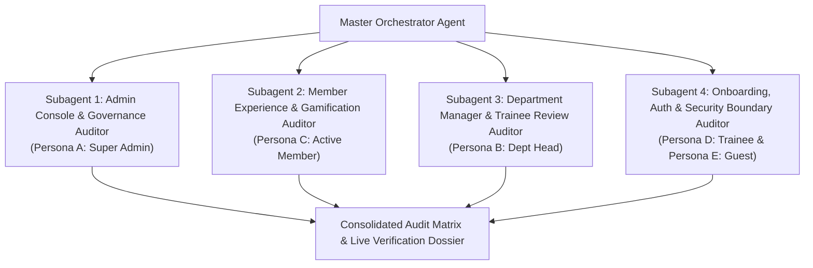

# Deep Multi-User Platform E2E Audit & Live Session Testing Plan

> **For agentic workers:** REQUIRED SUB-SKILL: Use `multi-agent-orchestration` and `dispatching-parallel-agents` to execute this plan persona-by-persona and option-by-option. Steps use checkbox (`- [ ]`) syntax for tracking.

**Goal:** Conduct an exhaustive, option-by-option verification of the entire QUANTERS platform ([https://quanters.web.app](https://quanters.web.app)) across 5 isolated user personas, validating functional behavior, real-time synchronization, role boundaries, and anti-cheat constraints with zero session cross-contamination.

**Architecture:** A multi-persona session isolation harness partitions cookies, `localStorage`, and Firebase Auth tokens into independent browser contexts / sessions. Four parallel subagents audit distinct domain verticals (Admin Console, Member Mobile App, Manager Portal, and Onboarding/Security Gates) and report real-time live telemetry back to the orchestrator.

**Tech Stack:** Next.js 15 App Router, React 19, Cloud Firestore & Firebase Auth, Zustand 5, Chrome DevTools MCP, Playwright / Headless Browser Automation, Tailwind CSS.

---

## 1. User Personas & Session Partitioning Matrix

To guarantee zero cookie or token interaction across user roles, each persona is assigned an isolated session execution environment:

| Persona | Role / Credential | Scope & Landing Route | Session Partition Strategy |
|---|---|---|---|
| **Persona A: Super Admin** | `quantaclubdz@gmail.com` `quanta2026admin` | Admin Console (`/admin/*`) & Global Governance | Primary Browser Context (`Context-Admin`) |
| **Persona B: Department Head** | `ayoubsarri1@gmail.com` `quanta2026admin` | Manager Portal (`/manager`) & IT Department Scope | Secondary Isolated Context (`Context-Manager`) |
| **Persona C: Active Quanter Member** | `member.quanta@univ-alger.dz` `quanta2026pass` | Member App (`/home`, `/workshops`, `/badges`, `/exams`, `/explore`, `/profile`) | Tertiary Isolated Context (`Context-Member`) |
| **Persona D: New Candidate / Trainee** | `trainee.quanta@univ-alger.dz` `quanta2026pass` | Welcome & KYC Onboarding (`/welcome`, `/onboarding`) | Quaternary Isolated Context (`Context-Trainee`) |
| **Persona E: Unauthenticated Guest** | None (Anonymous) | Security gates, public schedules, login redirects | Clean Incognito Context (`Context-Guest`) |

---

## 2. Multi-Subagent Decomposition

Four specialized subagents execute concurrently with disjoint workstreams:

1. **Subagent 1 (Admin Console & Governance Specialist)**:
   - Evaluates all 14 options under `/admin/*`: Overview, Members, Former Members, Alumni, Org, Workshops, Tasks, Proposals, Points, Badges, Messages, Explore, Access, Settings, Audit.
2. **Subagent 2 (Member Experience & Gamification Specialist)**:
   - Evaluates all 9 mobile portal options: Home, Workshops (Enroll/Cancel), Check-In (QR/Code), Badges & Exams (Taking exam, scoring), Explore (Daily Quiz, Quotes), Notifications, Digital ID Profile, Project Proposal, and Project Submission.
3. **Subagent 3 (Department Manager & RBAC Specialist)**:
   - Evaluates `/manager`: Department task queue, team members overview, workshop attendance logs, proposal approvals, and trainee endorsement checks.
4. **Subagent 4 (Auth, Onboarding & Security Boundary Specialist)**:
   - Evaluates `/welcome` (Google Sign-In, Email/Password, Forgot Password), `/onboarding` (10-field KYC validation), anonymous route blocking, and token revocation.

---

## 3. Option-by-Option Test Specification

### Phase 1: Environment & Test Fixtures Setup
- [ ] **Task 1.1**: Verify and prepare test account credentials in Firebase Auth and offline cache seed (`quantaclubdz@gmail.com`, `ayoubsarri1@gmail.com`, `member.quanta@univ-alger.dz`, `trainee.quanta@univ-alger.dz`).
- [ ] **Task 1.2**: Create the headless session isolation test runner script `scripts/e2e_session_isolator.mjs` ensuring separate `storageState` and separate cookie jars for each persona.

### Phase 2: Subagent 1 — Admin Console Deep Audit (14 Options)
- [ ] **Task 2.1: `/admin/overview`**: Verify KPI metrics (total members, active workshops, points ledger health, pending proposals, cosmic hero banner rendering).
- [ ] **Task 2.2: `/admin/members`**: Test searching by Quanter ID / Name, filtering by Department / Status, opening member detail drawer, editing role, editing KYC profile.
- [ ] **Task 2.3: `/admin/former-members`**: Test member deactivation, listing in former members, reactivate member, permanent removal.
- [ ] **Task 2.4: `/admin/alumni`**: Test alumni registry, graduation year tag, toggle alumni portal access.
- [ ] **Task 2.5: `/admin/org`**: Test departments list, scientific teams list, editing department budget and leadership assignments.
- [ ] **Task 2.6: `/admin/workshops`**: Create a new test workshop ("Quantum Computing 101"), set seats capacity (15), assign instructor, generate 6-digit session check-in code, publish workshop.
- [ ] **Task 2.7: `/admin/tasks`**: Create a new department task, set deadline and points reward (+50 XP), assign to IT department.
- [ ] **Task 2.8: `/admin/proposals`**: View submitted club proposals, cast Super Admin executive vote, verify 2/3 approval status calculation.
- [ ] **Task 2.9: `/admin/points`**: Test manual merit point adjustment (+25 XP for research contribution), verify ledger entry, reverse ledger entry.
- [ ] **Task 2.10: `/admin/badges`**: Inspect badge catalog, review exam question pool, verify pass threshold (80%).
- [ ] **Task 2.11: `/admin/messages`**: Compose targeted broadcast, verify delivery progress bar, test individual delete and bulk delete.
- [ ] **Task 2.12: `/admin/explore`**: Test daily quiz manager (add/edit question, mark correct option), test scientific quote manager.
- [ ] **Task 2.13: `/admin/access`**: Inspect RBAC matrix across all 10 roles, test grant toggling.
- [ ] **Task 2.14: `/admin/settings` & `/admin/audit`**: Inspect Internal Laws 2/3 executive amendment voting, inspect immutable audit log records.

### Phase 3: Subagent 2 — Member Portal Deep Audit (9 Options)
- [ ] **Task 3.1: `/home`**: Sign in as `member.quanta@univ-alger.dz`, verify dashboard greeting, rank card, active workshops list, daily quote.
- [ ] **Task 3.2: `/workshops`**: Register for the newly created workshop ("Quantum Computing 101"), verify seats count decreases from 15 to 14 in real time, test cancel registration and verify seat replenishment.
- [ ] **Task 3.3: `/checkin`**: Enter 6-digit session code, verify workshop attendance record created, verify +30 XP check-in reward granted to member.
- [ ] **Task 3.4: `/badges` & `/exams`**: Browse badge library, select available exam ("Git & Collaborative Development"), start exam.
- [ ] **Task 3.5: `/exams/[badgeId]`**: Complete exam questions, verify anti-cheat timer, submit exam, verify passing grade (>= 80%), verify badge awarded and XP ledger updated.
- [ ] **Task 3.6: `/explore`**: Open Daily Quiz, answer scientific question, verify +10 XP awarded, verify duplicate quiz completion lock on same calendar day.
- [ ] **Task 3.7: `/notifications`**: Verify in-app dispatch received, open notification reader modal, verify automatic movement from Inbox to Archived.
- [ ] **Task 3.8: `/profile`**: Verify digital ID card (front and back flip), QR code generation, check XP/Level breakdown, update weekly availability matrix.
- [ ] **Task 3.9: `/proposals` & `/projects/submit`**: Submit a new club project proposal, upload repo/drive link, verify listed in proposals catalog.

### Phase 4: Subagent 3 — Department Head / Manager Deep Audit
- [ ] **Task 4.1: `/manager`**: Sign in as `ayoubsarri1@gmail.com` (IT Head / Co-Manager), verify access granted.
- [ ] **Task 4.2: Department Task Review**: Review submitted task proof URL from Persona C, award score (100%), mark status as `Validated`, verify XP credit transferred.
- [ ] **Task 4.3: Team Oversight**: Filter members by IT department, check health scores and attendance records.
- [ ] **Task 4.4: Trainee Endorsement**: Open trainee evaluation drawer, endorse trainee for promotion to full member status.
- [ ] **Task 4.5: Privilege Boundary Test**: Attempt to access `/admin/settings` or `/admin/access` as Department Head, verify redirect or access denial.

### Phase 5: Subagent 4 — Auth, Onboarding & Security Boundary Deep Audit
- [ ] **Task 5.1: `/welcome` Registration**: Register a new student account (`candidate.new@univ-alger.dz`), verify password confirmation and input validation.
- [ ] **Task 5.2: `/onboarding` 10-Field KYC**: Fill academic year, major, housing type, commute time, laptop capability, student org declaration, and weekly schedule; submit and verify transition to Trainee.
- [ ] **Task 5.3: Trainee Restriction Gate**: Verify trainee cannot access executive proposals or admin routes before promotion.
- [ ] **Task 5.4: Anonymous Security Boundary (Persona E)**: Open `/admin/overview`, `/admin/members`, `/manager` in clean unauthenticated session, verify redirect to `/welcome` with zero sensitive data leaked in network payloads.

### Phase 6: Synthesis & Live Verification Dossier
- [ ] **Task 6.1**: Aggregate all subagent audit outputs into a unified Markdown verification artifact with screenshots and console logs.
- [ ] **Task 6.2**: Present executive briefing in Arabic with English UI terminology.
